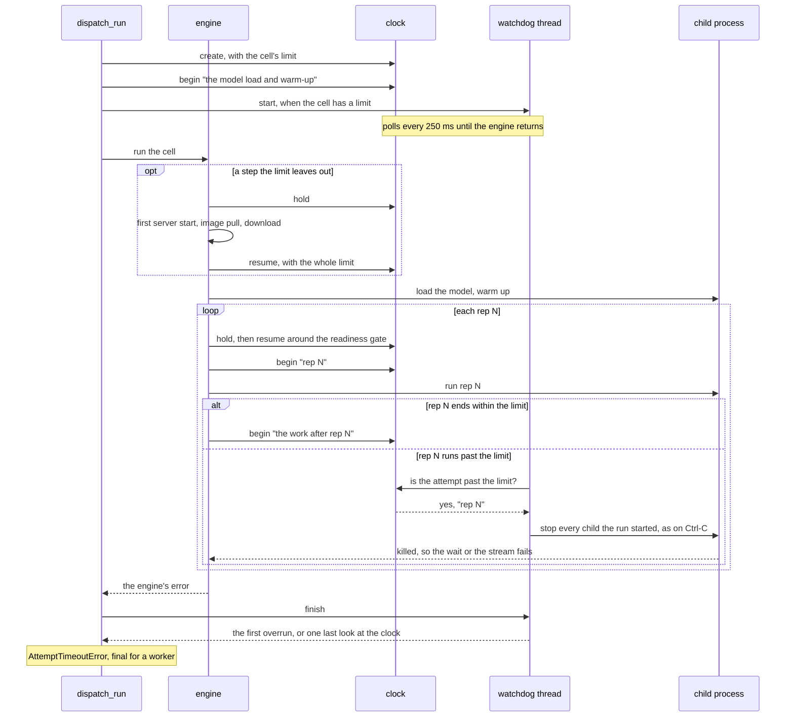

# Architecture

## Benchmark vs run vs execute

Use these words with one meaning each:

| Term | Meaning | Examples |
|------|---------|----------|
| **Benchmark** | Catalog/plan definition of *what* is measured (id, type, parameters, samples) | `BenchmarkDefinition`, workspace `benchmarks/`, `pipette benchmarks list` |
| **Run** | One cell lifecycle: prepare → engine → response → record/submit | `RunRequest`, `pipette_*::run`, CLI `run_cell` / `benchmarks run`, `RunResponse` |
| **`execute/`** | Engine module of per-`BenchmarkType` implementations (not CLI, not prepare) | `prefill_throughput.rs`, `eval.rs` under each runtime crate |

Flow:

```text
benchmarks run | worker claim
        │
        ▼
   run_cell(spec)          # CLI: prepare + dispatch
        │
        ▼
   RunRequest              # plan-types: portable cell (+ bound paths)
        │
        ▼
   engine run(req, …)      # public entry (re-export of execute::run)
        │
        ▼
   execute/<type>.rs       # measurement implementation
        │
        ▼
   RunResponse             # plan-types: metrics, streams, resolved flags
        │
        ▼
   record / submit         # CLI record path
```

Prefer “**run** this benchmark” over “execute a benchmark.” Keep the directory
name `execute/`; do not rename it to `run/` (collides with the entry function)
or `bench/` (collides with the benchmark noun).

## Crates

| Crate | Role |
|-------|------|
| `pipette-workspace`   | Generic workspace lifecycle (init, open, manifest) |
| `pipette-ops`         | The engine-side code that every engine shares and the plan-types contract does not define; see [`pipette-ops`](#pipette-ops) below |
| `pipette-vl-spec-decode-corpus` | The packed corpus a `vl_spec_decode` job downloads through its `RunContext`, and its traversal: verify, unpack, walk `samples.jsonl` in file order, and send each turn (`turn`). Its own crate rather than a `pipette-ops` module because it needs `tar` (and through it `rustix`/`xattr`), `reqwest` and `base64`, and the APK links `pipette-ops` for a benchmark it cannot run; it depends on `pipette-ops`, never the reverse. The Swift counterpart is `ios/Pipette/Pipette/Benchmarks/VlSpecDecodeCorpus.swift` |
| `pipette-completions` | The text-completion endpoint (`/completions`) that vLLM, SGLang, `mlx_lm.server`, OVMS (`/v3/completions`) and pipette's own Python servers answer: a request sent whole or streamed, read into a `pipette_ops::generation::Generation`. Every stream chunk with a choice is a token, on every server; the request body stays each engine's. Also `llama_server`, llama-server's timed chat dialect (`/health`, `/tokenize`, the unstreamed `/v1/chat/completions` with server-clock `timings`), which `pipette-llamacpp` uses |
| `pipette-device`      | Host identity, power, and thermal probes (`DeviceInfo`, `detect_thermal`); the thermal shapes they fill live in `pipette-plan-types` |
| `pipette-artifacts`   | Model / runtime artifact cache: storage keys, manifests, atomic stage/publish, fetch + install |
| `pipette-artifacts-catalog` | What the artifact cache can install: the bundled runtime catalogs (the torch-oai uv presets for vLLM and SGLang, the MLX, OpenVINO and ONNX GenAI presets, and the OVMS release pins and unpacked layout) and the live llama.cpp release listing. The CLI lists them and resolves `--runtime` URIs through them; `pipette-artifacts` checks an OVMS download against its layout and pin, and `pipette-ovms` launches from the same layout |
| `pipette-readiness`   | Pre-benchmark readiness wait (`wait_until_ready`), one probe per platform. A probe that shells out (PowerShell, `dumpsys`, `vcgencmd`) runs it through `pipette-subprocess`'s `output_within`, killed at 30 s |
| `pipette-wait`        | The caller's side of any long wait: `WaitCallbacks` (status / cancel / sleep, generic over the status type) and the cancellable sleep. Dependency-free; the readiness gate and the worker's reindex wait both report through it |
| `pipette-venv`        | uv-provisioned Python venvs for vLLM, SGLang, desktop MLX, OpenVINO, and ONNX GenAI |
| `pipette-subprocess`  | Process plumbing for the programs a client starts and stops (a process or a docker container); see [`pipette-subprocess`](#pipette-subprocess) below |
| `pipette-programs`    | The external programs the client spawns (`uv`, `docker`, `nvidia-smi`, `rocm-smi`, `python`): what each is called, where it comes from when a host lacks it, and how the CLI locates each one at startup from `--uv-path`, `--docker-path`, `--nvidia-smi-path`, `--rocm-smi-path` and `--python-path` |
| `pipette-http`        | Shared HTTP client configuration for GitHub, Hugging Face, and management-server calls |
| `pipette-memprobe`    | A benchmarked process's memory, read by pid from the parent: one sampler per OS, a cgroup v2 sampler on Linux for a server that runs as several processes, and the macOS Metal allocator shim. Every engine's memory peak comes from it; see its [README](../crates/pipette-memprobe/README.md) |
| `pipette-ssh`         | The SSH keys a host already has: the OpenSSH wire framing, an `Ed25519PublicKey` and the hex / blob / fingerprint spellings it travels in, an `Agent` that lists what a local ssh-agent holds and signs bytes with one, `known::discover` for the agents a host runs beyond the one `SSH_AUTH_SOCK` names, a reader for `~/.ssh` private key files, and `inventory` merging the two into the keys this machine can sign with. Lets a person authenticate as themselves with a key that never reaches the process |
| `pipette-mgmt-client` | Management-server API: one call per endpoint, each taking the `ServerUrl` to reach. Split by the principal that authenticates it: `client_api` for what a device calls with a `ClientIdentity`, `user_api` for what an operator calls with a `UserIdentity`. The two public benchmark reads are the exception: they admit anyone, so the identity is optional and signs the read when the caller holds one, and they sit in `client_api` because a device's sync path is what calls them |
| `pipette-plan-types`  | Not a member: from pipette-mgmt by git; the plan and submission vocabulary |
| `pipette-contract`    | Test-only: holds the contract's JSON fixtures, checks them against `pipette-plan-types`, and keeps the `variants.json` and the files of what the crate derives from them (`params.json`, `sampling.json`, `defaults.json`) that the mobile clients' contract tests read. Nothing depends on it |
| `pipette-ctl`         | The operator CLI: drives a typed model/runtime matrix across devices, and calls the management server's account routes as CLI verbs |
| `pipette-cli`         | The unified `pipette` client binary (bundles the runtime libraries below); includes the planner claim loop (`pipette worker`) |
| `pipette-llamacpp`    | llama.cpp runner (library) |
| `pipette-mlx`         | MLX runner (library) |
| `pipette-coreai`      | Apple Core AI runner (library): Swift sidecar over `.aimodel` bundles, macOS 27+ |
| `pipette-openvino`    | OpenVINO GenAI runner for IR models on Intel CPU / GPU / NPU |
| `pipette-onnx-genai` | ONNX Runtime GenAI runner with an install-time execution provider |
| `pipette-ovms`        | OpenVINO Model Server runner: a server launched per cell on an IR directory |
| `pipette-torch-oai`   | OpenAI-compatible runner (library) for PyTorch/HuggingFace models served by Docker or uv runtimes (vLLM, SGLang) |
| `pipette-android`     | The Android app's native core: the llama.cpp engine binding and the measurement kernel it shares with `android/native/`, compiled into the non-default `rustEngine` flavor's `.so`. Not linked by any host CLI |

### `pipette-ops`

What the engines share but the plan-types contract does not define:

- the injected `ReadinessGate` and `RunContext`, and eval checkpoints;
- `run_response`: the `RunResponseBuilder` that every engine answers a run
  with. The builder stops a process before it records the argv and the output,
  keeps the highest memory any observation saw, and has no setter for the
  caller's `thermal` and `benchmark_flags`;
- `measurement`: the typed per-benchmark entries (reps, batch, and the eval
  sample loop with its pool);
- `eval_cell`: what an eval request carries;
- `generation`: what one prompt's generation was, whatever the server speaks.
  An engine reports what arrived and when; this module decides the first
  token, the last token and the end;
- `attempt`: the rules of `attempt_timeout_seconds` (the limit a request runs
  under, the 300 s default and the benchmark types that default to it, the name of
  the first attempt) and `AttemptTimeoutError`, the failure an overrun
  reports. The clock is not here: `pipette-cli` creates one per run, and the
  kernels and engines mark it through the `MeasurementObserver` the CLI passes
  them. Besides the hooks around each rep, the observer has one that starts an
  attempt no rep brackets (a peak-memory run, a corpus sample) and two that
  hold the clock over a step the limit leaves out and resume it after;
- `sse` (the streamed-text reader), `prompt_seed` and `vl_spec_decode`.

An engine contributes a `send`/`read` closure or an attempt. The loop, the
checks and the reduction are in `pipette-ops`.

### `pipette-subprocess`

- the programs a client starts and stops (a process or a docker container),
  with their output kept;
- the description of an external command;
- the `SIGPIPE` reset and the per-pipe guard under it;
- the child wait with a deadline;
- teardown of spawned children: when ^C arrives, when the stderr of a worker or
  a benchmark run closes, when a run passes its attempt limit, when their
  parent exits on Windows, and at the next start for children that a killed
  CLI left running.

## The attempt clock

`attempt_timeout_seconds` limits each attempt of a cell; the rules are in
[usage.md](pipette-cli/usage.md#5c-the-attempt-limit). `pipette-cli` keeps one
clock per run. `dispatch_run` starts the first attempt once the downloads are
done, and the engine marks the rest through the `MeasurementObserver` hooks and
the readiness gate. A watchdog thread reads the clock every 250 ms. Past the
limit it stops every child the run started, as Ctrl-C does, so whatever the
engine waits on fails at once, and `watched` reports the overrun as
`AttemptTimeoutError` with the engine's error beside it.



`begin` and `resume` both give the attempt the whole limit, so a held step never
shortens the step after it. A cell with no limit runs without the watchdog. The
iOS app keeps the same clock (`AttemptClock`, `AttemptWatchdog`) but cannot stop
an engine that runs inside the app: a launch that the farm's proxy claimed exits
the app, and any other run fails at its next boundary.

## Dependency graph

Arrows point from a crate to the crates it depends on.

```mermaid
graph TD
    subgraph bins["Client binaries"]
        pipette["pipette (pipette-cli)"]
        ctl["pipette-ctl"]
    end

    subgraph impls["Runtime libraries"]
        llamacpp["pipette-llamacpp"]
        mlx["pipette-mlx"]
        coreai["pipette-coreai"]
        openvino["pipette-openvino"]
        onnx["pipette-onnx-genai"]
        ovms["pipette-ovms"]
        torch["pipette-torch-oai"]
    end

    subgraph libs["Shared libraries"]
        ops["pipette-ops"]
        corpus["pipette-vl-spec-decode-corpus"]
        completions["pipette-completions"]
        device["pipette-device"]
        artifacts["pipette-artifacts"]
        catalog["pipette-artifacts-catalog"]
        readiness["pipette-readiness"]
        wait["pipette-wait"]
        venv["pipette-venv"]
        programs["pipette-programs"]
        subprocess["pipette-subprocess"]
        workspace["pipette-workspace"]
        mgmt["pipette-mgmt-client"]
        ssh["pipette-ssh"]
        types["pipette-plan-types"]
    end

    pipette --> artifacts & catalog & ops & workspace & mgmt & device
    pipette --> llamacpp & mlx & coreai & openvino & onnx & ovms & torch
    pipette --> readiness & wait & programs & subprocess
    llamacpp --> ops & corpus & completions & subprocess
    mlx --> ops & corpus & completions & venv & subprocess
    coreai --> ops & subprocess
    openvino --> ops & completions & venv & subprocess
    onnx --> ops & completions & venv & subprocess
    ovms --> catalog & ops & completions & subprocess
    torch --> ops & corpus & completions & venv & programs & subprocess
    ctl --> readiness & wait & workspace & mgmt & types & subprocess & ssh
    readiness --> wait & device & subprocess
    ops --> types & subprocess
    corpus --> ops
    completions --> ops & subprocess
    artifacts --> catalog & venv & types & programs & mgmt
    catalog --> types
    programs --> subprocess
    subprocess --> types
    venv --> types & subprocess
    device --> types
    mgmt --> types
```



(Direct edges to `pipette-plan-types` are omitted for readability wherever
the path is already implied, as are leaf helper crates `pipette-http` and
`pipette-memprobe`, the test-only `pipette-contract`, and `pipette-android`,
which no host binary links.)

Only `pipette-cli` depends on a runtime library, and each exports `run` alone,
so a change to one runtime cannot reach another. What two
runtimes both need lives in a shared library or is copied, as OVMS copies
OpenVINO's NPU rules. cargo-deny's `[bans]` in `deny.toml` enforces the first
half of the rule, and `ci/checks/runtime-crates.py` the second. The check also classifies every workspace crate as a runtime or not, so
a new crate fails CI until it is listed as one or the other.

Three absent edges are worth reading. No runtime library depends on
`pipette-readiness`: the gate they wait on is the `ReadinessGate` closure
`pipette-ops` defines, and `pipette-cli` is what injects the platform probe
behind it, so an engine measures without knowing what "ready" costs. None
depends on `pipette-mgmt-client` either: a corpus benchmark fetches its
corpus through the `RunContext` the CLI's workspace implements, so an engine
never holds the server or the device's key. And `pipette-ops` does not depend on
`pipette-vl-spec-decode-corpus`: the edge runs the other way, so
`pipette-android`, which links `pipette-ops`, never links the corpus reader or
its HTTP client.

The `pipette` client (`pipette-cli`) links the runtime libraries into one
binary. `pipette-ctl` loads plans through `pipette-plan-types`, has no
compile-time dependency on `pipette`, and invokes the `pipette` binary over
its local, ADB, SSH and Slurm transports; its iOS transport launches the
Pipette app instead.

## Workspace

Each binary gets its own dot-prefixed directory:

| Directory | Binary |
|-----------|--------|
| `.pipette/`      | `pipette` client |
| `.pipette-ctl/`  | `pipette-ctl` operator CLI (if a work dir holds only a legacy `.pipette-plan/` directory, `pipette-ctl` uses that directory) |

Created by `<binary> init`. See the [usage guide](pipette-cli/usage.md) for
the walkthrough.

Both binaries resolve the working directory the same way: `--work-dir`
(or `PIPETTE_WORK_DIR`), else the current directory.

The storage root is `<work-dir>/.pipette/` for `pipette` and
`<work-dir>/.pipette-ctl/` for `pipette-ctl`.

## Stores

Each store is a concrete handle over one workspace subdirectory; no trait
indirection. They split by audience:

| Store | Crate | Holds |
|-------|-------|-------|
| `RuntimeArtifactStore`    | `pipette-artifacts` | installed runtimes |
| `ModelArtifactStore`      | `pipette-artifacts` | fetched models |
| `EvalCompletionsStore`    | `pipette-ops` | run / checkpoint state |
| `BenchmarkStore`          | `pipette-cli` | benchmark definitions |
| `ResultsStore`            | `pipette-cli` | benchmark results |
| `ClientRegistrationStore` | `pipette-cli` | registration record and signing keypair |
| `ClientDeviceStore`       | `pipette-cli` | this machine's device labels |
| `ClientSettingsStore`     | `pipette-cli` | client-wide settings (storage quota) |

The artifact and eval-completion stores are shared with the runtime libraries,
which run benchmarks without ever talking to the management server: those that
run evals get their `EvalCompletionsStore` from their `RunContext`, and none
opens an artifact store; the client resolves models and runtimes up front and
hands the engines bound paths. `BenchmarkStore`, `ResultsStore` and the three
client stores exist only for the client, alongside the flows that register,
sync, and submit on top of them (`pipette_cli::client`). The client stores
share the `identity/` directory and split by file (`registration.json` plus the
keypair, `device.json`, `settings.json`), because those have different
lifetimes: a box can label itself and run benchmarks locally with no
registration, and keeps that label across `auth reset`.

`pipette_cli::workspace::PipetteWorkspace` mints every store above from the
workspace root.

## Secrets

Three values in this workspace are secret: a HuggingFace access token
(`pipette_plan_types::AuthToken`, carried in the plan for a gated repo), a
pre-auth registration key (`pipette_mgmt_client::types::ClientPreauthKey` for a
device and `UserPreauthKey` for an account, one kind each because the server
keeps them in separate records and admits them on separate routes), and the
Ed25519 key a client signs as (`pipette_mgmt_client::types::PrivateKey`, the
hex in `identity/id_ed25519`, an identity token, and the `ClientIdentity` or
`UserIdentity` a request signs with). All are newtypes, and the trait set
of a secret newtype is fixed:

| Trait | Rule | Why |
|-------|------|-----|
| `Debug` | hand-write → `TypeName(<redacted>)` | Never `derive`. Every struct holding one derives `Debug` and dumps through it, so the redaction has to sit at the leaf. |
| `Display` | hand-write → `<redacted>` | `{}` must compile *and* be safe. If it didn't compile, an author needing `{}` would reach for `as_ref()` and print the raw value instead. |
| `AsRef<str>` | the only door to the raw value | One named way out, so to audit a secret, search for its `as_ref` call sites. |
| `Deref`, `Into<String>`, `ToString` | must not exist | Each re-exposes the raw value implicitly. (`ToString` follows from `Display`, hence the redacting `Display` above.) |
| `Serialize` / `Deserialize` | allowed, and load-bearing | Plans and claim payloads carry these values inline. This is what makes serde (not the rendering traits) the real leak vector. |

A secret newtype may validate as well as redact, and `PrivateKey` does: it
refuses hex that is not a 32-byte seed, so holding one is the guarantee that it
signs, and it lowercases, so equality means "the same key" whatever casing the
build that wrote it chose. That is what lets `auth import` compare a held key
with a bundle's, and what turns a mangled key file into an error against the
path it was read from rather than a 401 that reads as an unregistered client.

A type that merely *contains* a secret derives `Debug` (inheriting the leaf's
redaction) and renders identity only in `Display`: `HfRepo` prints
`org/repo_name`, `Model` prints `source.reference()`, and both deliberately
exclude the token.

Because the leaf serializes, every boundary that persists, submits, or prints a
structure strips the secret explicitly:

| Boundary | Mechanism |
|----------|-----------|
| submitted result descriptor, `models` output, store manifests | `Model::without_auth_token()` |
| an untyped claim payload (no leaf to carry redaction) | `pipette_cli::client::claim::redacted_spec` |
| a `Debug` dump; e.g. the `dispatch` debug log of the request in `pipette_cli::run` | the leaf's own `Debug` |
| the identity token `auth export` writes (it *must* carry the key) | the summary around it reports the public key and a byte count |

One exception, and its guard: a struct that *stages* a token's fields before
they are validated has to hold the raw string, or the decode could no longer
name which field is wrong (`pipette_cli::identity::bundle`'s `BundleWire`).
Such a field is listed in the check's `UNVALIDATED_STAGING_FIELDS` and is sound
only while its type renders nothing. Adding a `Debug` to one fails the check,
which is what keeps the exception from becoming the leak.

Enforcement: `ci/checks/secret-newtypes.py` rejects a secret-named field that
isn't one of these types, rejects a secret newtype that derives a rendering
trait instead of hand-writing it, and rejects a rendering trait on an excepted
staging type. `pipette_plan_types::run`'s `debug_redacts_the_model_auth_token`
pins the dump for every model shape that can carry a token.

## Runner CLI layout

The [usage guide](pipette-cli/usage.md#1-initialize) shows the `.pipette/` tree
that `pipette init` creates. The notes below explain the parts of it that the
architecture depends on.

`cache/` and `datasets/` are not created by `init` and are not artifact stores.
`cache/<runtime-key>/` holds what an engine can recompile and is keyed so
`runtimes remove` reclaims it; it is outside the quota so a sweep cannot delete
what a run depends on. `datasets/<benchmark_id>/` is where a `vl_spec_decode`
corpus is unpacked, and the lease that owns it deletes it when the job ends:
the server serves the corpus `Cache-Control: no-store` and keeps the only
durable copy.

The `models/` store is shared across backends (fetched once, reused). MLX hands
the materialized directory to the `mlx-lm` server; torch-oai Docker bind-mounts
it at `/models/model`, while torch-oai uv passes the host path into the server
process. `runtimes/` is the common root for installs: every runtime is
published through the shared artifact store as `<key>/manifest.toml` plus a
`blobs/` payload, and each installer owns what lands in `blobs/`; an extracted
archive for llama.cpp, a uv-provisioned venv for MLX and torch-oai uv, nothing
for Docker, whose image the daemon holds. A torch-oai Docker container lives
only as long as the `benchmarks run` that started it.

`init` creates the directory tree and a `manifest.toml` marker (a legacy
`manifest.json` is migrated to TOML on open). All other files are created by
the commands that need them.

## Plan CLI layout

After `pipette-ctl init`:

```
.pipette-ctl/
  manifest.toml
  identity/        # the operator's identity, written by `pipette-ctl auth`
  plans/
    {plan_id}/
      state.jsonl
```

`plan_id` is unique per plan, so plans never collide. `pipette-ctl` keeps plan
state and the operator's identity; runtimes, models, benchmarks and results
live in each device's own `.pipette/` workspace, under the transport's
`work_dir`, which the runner passes to the remote binary as `--work-dir` (the
iOS app keeps its own).

The plan file and its transports are described in
[pipette-ctl/plan-runner.md](pipette-ctl/plan-runner.md), and the plan schema
and which model types pair with which runtimes in its
[Plan TOML shape](pipette-ctl/plan-runner.md#plan-toml-shape) section. Minimal
plans are in [`examples/plans/`](../examples/plans/).
