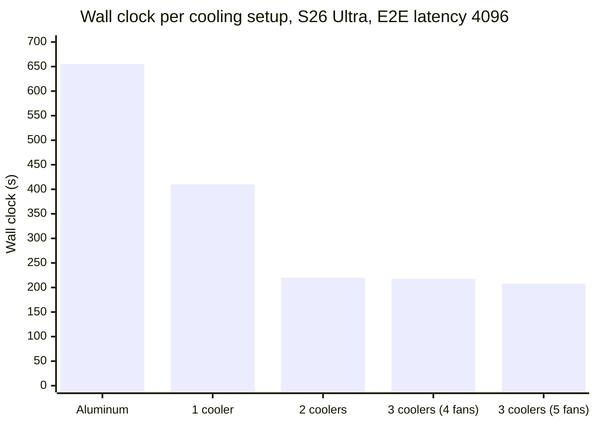

# Device Conditions

Timing benchmarks measure how fast a model runs, so they are only meaningful when
the device is in a known, comparable state. Two things define that state: what the
device is doing when measurement starts (its temperature and how busy it is), and
how the test rig is set up around it, namely power and cooling. This article
describes the conditions every measured device is held to, what is checked
automatically versus arranged by hand, and the specifics per platform we measure
on. The per-metric articles describe how each number is then measured; this one
describes the environment it is measured in.

## Overall expectations

Before a timed measurement starts, a device is expected to be:

- **Cool.** Below a platform-specific temperature band, so the measured work
  starts with thermal budget rather than part-way into throttling. This is
  enforced by the readiness gate (see
  [End-to-end latency → System Readiness Control](end-to-end-latency.md#system-readiness-control)
  for the full per-platform criteria and the reasoning behind each threshold).
- **Idle.** Not already busy with other work: no second benchmark, no heavy
  background process. The same gate enforces this with a CPU load signal, and
  with a GPU load signal where the platform has one. The Android app's gate has
  no load criterion.
- **On external power.** Phones stay connected to a charger, and dedicated
  hosts are wired to AC. A phone on a charger can still draw part of its load
  from the battery: the Galaxy S26 Ultra keeps its pack in the power path (see
  *Fast charging* below), and the energy probes saw both the S26 Ultra and the
  iPhone draw from the pack during a rep
  ([Energy: device capabilities](energy/02-device-capabilities.md) §3 and §6).
  Each result records the power state it ran under
  ([Recorded run environment](#recorded-run-environment)).
- **Actively cooled.** Phones run clamped between powered coolers. The fanless
  MacBook Neo carries a passive pad inside the case and one active pad under it.
  See [Active cooling](#active-cooling) for what the coolers change and what
  they do not change. A modified device does not represent the product as sold.
  Each platform section says where this applies.

These conditions are of two kinds, treated differently:

- **Detected**: the readiness gate reads them immediately before each measured
  repetition, on every platform, the iOS app included. Each gate reads a
  thermal signal, and every gate except the Android app's reads load. Some
  gates also read other signals:
  - the OS thermal state, on Android, iOS and macOS
  - the firmware's throttle and under-voltage flags, on the Raspberry Pi 5
  - the throttle-reason flags and the critical trip point, on Windows
  - an optional skin-temperature bound (`[readiness.android] skin_below_c`) and
    a held touch on the touchscreen, on the Android CLI

  If a device cannot reach the band before a per-platform deadline, the cell
  fails with a recorded error, and no throttled number is stored.
- **Managed**: power and cooling are arranged by the rig, and the device's OS
  settings are brought to a fixed state before it joins the fleet. All three are
  held constant for the duration of a run. They are not gated; they are part of
  the test condition, so two numbers are comparable only when they ran under the
  same power, cooling, and OS setup. On Android the rig holds that state over
  `adb`; on the other platforms a technician sets it, and on iOS configuration
  profiles carry part of it.

## Active cooling

Phones are held between two powered coolers, one clamped to the screen side and
one to the back. Both coolers draw from the rig's charger. The MacBook Neo has a
different setup; see [Cooling on the MacBook Neo](#cooling-on-the-macbook-neo).

The readiness gate controls only the temperature at which a repetition *starts*.
A large timing benchmark then runs for tens of seconds. On a long cell the die
leaves the band during the rep, also with a cooler. Under a full load, the
hottest CPU zone of a cooled Galaxy S26 Ultra reaches its 105 °C trip point
within 2–4 s
([Galaxy S26 Ultra thermal behavior](galaxy-s26-ultra-thermal-behavior.md)).

Active cooling changes two things:

- **Less throttling during a rep.** The thermal governor holds a higher CPU clock
  ceiling. With passive aluminum heat sinks, the measured latency in the sweep
  below is about twice the latency with any active cooler.
- **A shorter wait between reps.** The device returns to the readiness band
  sooner, so the gate holds each rep for less time.

Among the active setups, the rep time changes little; the wait changes more. The
Pixel 11 Pro study found the same result on short cells
([Pixel 11 Pro thermal behavior](pixel-11-pro-thermal-behavior.md)).

The sweep below ran on a Galaxy S26 Ultra: end-to-end latency at 4096 tokens
(LFM2-350M, `Q4_K_M`), five identical runs per configuration. The wall clock
drops as cooling is added, and it changes little after two coolers:



The table gives the same runs in full: the plotted wall clock, the measured
latency, and its run-to-run spread.

| Cooling | Wall clock | Measured latency | Latency std. dev. | Cooldown share |
| --- | --- | --- | --- | --- |
| Aluminum heat sinks (passive) | 655 s | 34.7 s | 1.22 s | 95 % |
| 1 cooler (2 fans) | 410 s | 18.3 s | 0.23 s | 96 % |
| 2 coolers (3 fans) | 220 s | 17.6 s | 0.27 s | 92 % |
| 3 coolers (4 fans) | 218 s | 17.4 s | 0.49 s | 92 % |
| 3 coolers (5 fans) | 208 s | 17.4 s | 0.31 s | 92 % |

Passive aluminum roughly doubles the measured latency, and it is the least
stable setup. Every actively cooled configuration lands near 17–18 s, with a
standard deviation under half a second. Even at its best, measured compute is
under a tenth of the wall clock. The rest is the wait for the readiness band, so
a shorter wait is what makes a run fast.

We standardize on **two coolers, one per side**:

- The first cooler roughly halves the measured latency (34.7 s → 18.3 s).
- The second cooler roughly halves the wall clock again (410 s → 220 s).
- A third cooler changes the wall clock by less than 6 % and does not improve
  stability. It adds power draw and cabling, so we do not use it.

Placement matters more than the fan count, because the two faces are the
phone's main surfaces for heat loss. Two coolers on one side gave no useful
gain.

A **cooler** is one piezo-electric pad that clamps to the phone. A pad carries
one or two **fans**, so the fan and cooler counts above differ. The sweep mixes
the single-fan Black Shark FunCooler 5 NEO with the two-fan Neveika 001. We
standardize on the two-fan **Neveika 001** (only one two-fan pad fits per
side). Each pad has its own USB-C port on an Anker A2345 Prime 250 W charging
station, and the phone has a port of its own. On 2026-10-15, some pads drew
11–13 W, more than the station's USB-A ports supply, so the pads use the USB-C
ports. The standard rig (two Neveika
pads: two coolers, four fans) was not a row in the sweep. It sits between the
two-cooler/three-fan and three-cooler/four-fan points, which both land at
17–18 s with a standard deviation under 0.5 s.

A cooler on the screen side can also cause phantom touches, from condensation
or from a soft pad pressed on the glass. The Android CLI gate holds a rep while
it detects a held touch; see
[Android](end-to-end-latency.md#android) in the readiness criteria.

No cooler sweep exists for **iPhone**. In the iPhone 18 Pro study (2026-10-16
to 2026-10-19), each handset ran with one active cooler
([iPhone 18 Pro thermal behavior](iphone-18-pro-thermal-behavior.md)).

### Cooling on the MacBook Neo

The MacBook Neo ships with no internal fan. The benchmark unit carries two
modifications:

- **A passive thermal pad inside the case**, which couples the CPU and GPU to
  the chassis. It is permanent, and it is by far the larger change. It gives the
  system on a chip (SoC) a heat sink that the product does not have.
- **One active cooling pad** under the case.

**Neither is stock, so no published macOS number from this host describes a
machine as sold.** A stock unit would be expected to run hotter.

The active pad changes the idle equilibrium temperature of the Neo, and through
that the spread of start temperatures across a batch. It does not reduce mid-rep
throttling, shorten the benchmark, or make reps more repeatable. It stays because
it is cheap. The measurements are in
[MacBook Neo thermal behavior](macbook-neo-thermal-behavior.md#cooled-versus-uncooled).

## Operating-system configuration

A stock phone serves a human who holds it and runs it on battery. It runs
background maintenance on its own schedule. It adapts screen brightness and
refresh rate to what it sees. It restarts itself and its apps to stay healthy,
and it installs an OS update when one arrives. Each of these actions adds work,
heat, or an interruption to a measured run, at a moment the harness does not
control. The settings below turn that behavior off.

The Android handsets hold this state under automation: every setting a key
reaches is written and re-checked over `adb`, and the rest is set by hand. The
other platforms are set by hand once, when a device joins the fleet, and left in
place. A factory reset or a repair clears the state on any of them, so configure
such a device again before you compare its numbers to the rest of the fleet.

The iPhones carry part of their list in configuration profiles. They enroll in a
mobile device management (MDM) service, which delivers those profiles. Those
settings return by themselves after an erase, because the phone enrolls again
and receives the profiles again. The rest of the list still needs a technician.
See [Profile enforcement and manual steps](#profile-enforcement-and-manual-steps)
for which settings fall on each side.

The readiness gate reads thermal, throttle and load signals. It reads none of
this configuration. The harness therefore records no error for a misconfigured phone.
Instead the phone produces run-to-run scatter that nothing explains, or it
reboots and drops off the fleet part-way through a batch. On Android a check
outside the harness catches such a phone before a batch runs.

### Android (Samsung Galaxy S26 Ultra)

The Galaxy S26 Ultra is model `SM-S948U1`. This file and the fleet table below
use the marketing name; `docs/methodology/peak-memory-android.md` and
`ci/checks/model-catalog-parity.py` use the model number. Both spellings mean
this handset under the conditions below.

The manufacturer controls Android's power management and maintenance behavior,
not the Android Open Source Project (AOSP). Most of the features below are
therefore Samsung One UI features, under Samsung's names.

**This list applies to the Galaxy S26 Ultra alone.** A Pixel 4 organizes its
Settings app differently, and it lacks some of the features below. The cause may
be the vendor, the Android version, or both, and we have not established which.
Paths also move between One UI versions. The Pixel 11 Pro handsets in the fleet
also run under a settings list. The rig writes it and re-checks it over `adb`,
like the list below, but this article does not reproduce it. For another phone,
use the list as a description of the behavior to look for, then find that
behavior under the phone's own names.

The rig writes this state over `adb` and re-checks it, so a handset that drifts
is reported rather than measured on. Six items carry no settings key, and a
person sets each one: NFC off, screen resolution HD+, *Put unused apps to sleep*
off, the Google Discover panel off, the Do not disturb schedule deleted, and the
home screen emptied. Developer options and USB debugging are set by hand as
well, because `adb` cannot enable the thing `adb` needs.

Two conditions are runtime state, and a reboot clears them.
`svc power stayon true` holds the handset awake, and `dumpsys deviceidle
disable` holds it out of doze. A dozing handset accrues wall clock while its CPU
sleeps, so its latency and its run-to-run spread both increase. The
readiness gate cannot catch this, because a suspended handset looks idle: one
handset at 30 % awake measured 2.2× slow, with a 758 ms standard deviation
against a 9 ms fleet norm. The rig writes both again before a batch, and it
reports how much of the last window each handset spent awake.

#### Settings

Two steps happen outside the Settings app:

- **Delete every home-screen icon.** The screen-side cooler can raise
  condensation on the panel, and a capacitive digitizer reads water as a touch.
  A stray touch on an empty home screen starts nothing. See the note on
  accidental touch protection below.
- **Close every app.** Open the recents list with the left-hand button in the
  navigation bar. Only the benchmark client then holds memory or wakes during a
  batch.

The Settings entries below follow the order of the app, so you can work through
a device from top to bottom:

- **Connections**
  - *Airplane mode*: **on**. Turns off the cellular radio, with the power it
    draws and the interrupts it raises.
  - *Wi-Fi*: **on**. One UI permits Wi-Fi while airplane mode is on, so turn
    Wi-Fi back on. The client has to reach the management service to claim work
    and to submit results, so Wi-Fi is the one radio a run needs.

    `global.wifi_on` carries three states: 0 is Wi-Fi off, 1 is Wi-Fi on with
    airplane mode off, and 2 is Wi-Fi on under airplane mode. The rig pins it to
    2. State 0 is a handset that cannot reach the management service, and state
    1 is a handset whose cellular radio is live during a measurement.
  - *Bluetooth*: **off**. Removes both its power draw and its interrupts.
  - *NFC and contactless payments*: **off**. Stops the reader polling loop. No
    settings key carries this state, and `svc nfc disable` has no effect, so a
    person sets it. The NFC service reports the state: `adb shell dumpsys nfc`
    prints `mState=off`.
  - *UWB* (ultra-wideband): **off** (`global.uwb_enabled` = 0). Airplane mode
    appears to turn UWB off already. Set it off here as well, so the state does not depend on
    airplane mode.
- **Connected devices**
  - *Music Share*: **off** (`secure.bluetooth_cast_mode` = 0). Music Share runs
    over Bluetooth, so Bluetooth off already stops it. We set it off as well, so
    that Music Share stays off even if Bluetooth comes back on.
- **Modes and Routines**
  - **Delete the *Sleep* mode.** Then check that every remaining mode and
    routine is off. A mode reacts to a location, time, or usage trigger, and it
    changes device state part-way through a batch. We delete the mode so that
    nothing turns it back on later. The package behind this screen,
    `com.samsung.android.app.routines`, is disabled as well; see
    [Packages that hold a process](#packages-that-hold-a-process).
- **Notifications → Do not disturb**
  - **On**, at total silence. A deleted schedule stops a schedule from turning
    Do not disturb on. It does not stop a notification from posting, because Do
    not disturb starts off. Every post is a live interrupt during a run.

    Read the state with `adb shell settings get global zen_mode`. Total silence
    reads 2. Priority-only reads 1, and alarms-only reads 3. Both of those let
    something through, so the rig uses total silence.
  - **Delete the schedule.** A disabled schedule changes nothing today, but a
    person can turn it on by accident. Deletion removes that risk.
- **Display.** The panel is a significant heat source, and its refresh rate and
  resolution cost GPU and display-pipeline work.
  - *Adaptive brightness*: **off** (`system.screen_brightness_mode` = 0). Then
    set the brightness slider at the top of Display to **minimum**
    (`system.screen_brightness` = 0). The panel sits directly against the
    screen-side cooler, and minimum brightness produces the least heat. With a
    fixed level, the light sensor also has no effect on panel output. Order
    matters: while adaptive brightness is on, the level moves on its own and a
    written level does not hold.
  - *Motion smoothness*: **Standard** (`secure.refresh_rate_mode` = 0). Standard
    holds the refresh rate at 60 Hz.
    Adaptive varies the rate with content, so the display pipeline and the GPU
    do a variable amount of work. A fixed rate costs less, and it costs the same
    on every run.
  - *Eye comfort shield*: **off** (`system.blue_light_filter` = 0). Otherwise
    panel output varies with the time of day. This is a One UI control, and the
    AOSP `night_display_activated` key does not exist on this phone.
  - *Adaptive color tone*: **off** (`system.ead_enabled` = 0). Otherwise panel
    output varies with ambient light in the lab.
  - *Screen resolution*: **HD+**, the lowest the device offers. Fewer pixels to
    composite means less GPU, display-pipeline, and memory-bandwidth work. Set
    this by hand, in the Settings app. The control changes the physical display
    size. These figures were read on an S25 Ultra, not the S26 Ultra this list
    covers: `wm size` then reports 720x1560 against a native 1440x3120 panel, a
    quarter of the pixels of QHD+, and `display_density_forced` moves with the
    control, from 450 to 300. A write to that key alone changes the density and
    leaves the resolution where it was.
  - *Accidental touch protection*: **off** (`system.screen_off_pocket` = 0). The
    feature reads the light sensor to decide the phone is in a pocket, which
    makes it one more ambient-light-driven behavior. Read the note below before
    you set it.
  - *Screen saver*: **None** (`secure.screensaver_enabled` = 0). A screen saver
    runs while the device charges. These phones charge continuously and hold the
    screen on, which is exactly the condition a screen saver needs.
  - *Auto-rotate*: **off** (`system.accelerometer_rotation` = 0). The screen then
    keeps its layout when a technician moves the phone on the rig.
- **Lock screen and AOD** (Always On Display)
  - *Screen lock type*: **None**. A keyguard gives a phantom touch a surface to
    act on, and it puts a person in the path of every restart. A phone with no
    lock screen reaches the home screen on its own.

    Read the state back with `adb shell locksettings get-disabled`, which prints
    `true` when the lock screen is off. The secure setting `lockscreen.disabled`
    still reads 0 in that state, so do not use it as the check.

    A phone that holds a PIN, pattern, or password needs the credential first.
    Clear it with `adb shell locksettings clear --old <credential>`. Then
    `adb shell locksettings set-disabled true` succeeds.
- **Battery**
  - *Background usage limits → Put unused apps to sleep*: **off**. One UI
    otherwise decides on its own that an app is unused. The harness drives the
    benchmark client over `adb`, and a human touches it only rarely, which is
    the pattern that heuristic looks for. Set this by hand: the control moves no
    settings key. The per-package protections under
    [The harness packages](#the-harness-packages) cover the same ground for the
    two packages a run depends on.
  - *Charging → Fast charging*: **on**. The battery sits in the power path on this
    phone: the system draws from the pack, and the charger refills the pack. With
    fast charging off, the phone holds its input at the standard USB rate. That
    rate is below the draw of a benchmark run, so the pack covers the deficit and
    the battery drains. A battery that discharges current-limits the SoC, and it
    breaks the external-power condition the whole rig depends on; see
    [Overall expectations](#overall-expectations). Fast charging does add heat to
    the chassis that the coolers clamp to, and that cost is real. A phone short of
    power is the larger problem. The recorded battery level and power state confirm
    the result per run.

    Samsung specifies fast charging for a wired charger of
    [15 W or more](https://www.samsung.com/ca/support/mobile-devices/my-galaxy-device-is-not-fast-charging-how-do-i-fix-it/).
    The rig exceeds that floor: each port on the Anker station supplies over 60 W.
    The same page states that you cannot change this switch while the device
    charges. On the bench the phone applied the change after several minutes on the
    same cable. The input power then climbed to about 19.3 W with no reconnect,
    above Samsung's 15 W floor for the feature.
    Unplug the phone before you toggle the switch, so the new rate takes effect at
    a known moment.

    The restriction applies to the Settings app alone. A write to the
    `adaptive_fast_charging` key over `adb` takes effect while the phone charges,
    so the unplug step belongs only to the Settings-app route.
  - *Battery protection*: **Maximum** (`global.protect_battery` = 1, with
    `global.battery_protection_threshold` = 80, which caps the charge at 80 %).
    These phones
    live on a charger for months. A cell at full charge ages faster and can
    swell. A swollen pack changes the thermal coupling between the SoC and the
    chassis, and that coupling is the property the whole rig depends on. Samsung
    documents that the device
    [stops charging at the cap](https://www.samsung.com/ca/support/mobile-devices/set-a-maximum-charge-level-on-your-samsung-galaxy),
    and publishes no threshold at which it charges again. Because the battery
    carries the load, a run draws the level below the cap, and the phone then
    charges again to reach it. Results therefore alternate between `charging` and
    `plugged_in_not_charging`. A heavier run widens the swing.
  - *Power saving*: **off** (`global.low_power` = 0). The device never
    down-clocks to save energy. Every result records `device_power_save_mode`, which
    makes this setting verifiable after a run; see
    [Recorded run environment](#recorded-run-environment).
- **Location: off.** Removes a source of background wakeups, together with the
  Wi-Fi and Bluetooth scans that a position fix drives. It also stops the
  location triggers that a mode or routine can carry.
- **Advanced features → Side button.** Both actions launch a heavy app out of
  the box, and the clips that hold the coolers press this button. An app that
  starts behind the benchmark client holds memory, drives the memory compressor,
  and slows the measured runs.
  - *Double press*: **Nothing** (`global.function_key_config_doublepress` = 0).
    The default starts the Camera app.
  - *Press and hold*: **Power off menu** (`global.power_button_long_press` = 1,
    with the `global.function_key_config_longpress_*` keys pointing at
    `globalAction`). The default starts the on-device AI assistant. The power-off
    menu is the lightest action this control offers.
- **Security and privacy → More security settings**
  - *Inactivity restart*: **off** (`secure.inactivity_restart` = 0). This restart
    control is easy to miss, because it lives here rather than under Device care
    with the other one. It targets exactly the kind of device a bench phone is: a
    device that runs over `adb` for days, and that no human unlocks.
  - *Block USB while locked*: **off** (`secure.block_usb_lock` = 0). A locked
    screen otherwise cuts `adb` off, and the device drops out of the fleet.
- **Device care**
  - *Performance profile*: **Standard** (`global.sem_low_heat_mode` = 0).
    Standard applies no performance cap. The alternative, *Light*, trades
    performance for battery life and heat, which is the wrong trade for a
    benchmark. This is the one profile item that governs what a benchmark
    measures directly. It is a Device care setting, so the Device care package
    stays enabled: disabling it breaks the screen that shows the mode.
  - *Memory → RAM Plus*: **off** (`global.ram_expand_size` = 0). RAM Plus is swap
    on storage. A run that pages
    measures zram compression rather than the model. A Galaxy S26 Ultra held
    about 1 GB paged out while idle with RAM Plus at 8 GB.

    The Settings app cannot express this state. `ram_expand_size_list` reads
    `2,4,6,8,12`, so the lowest value the app offers is 2 GB. Set it over `adb`:

    ```sh
    adb shell settings put global ram_expand_size 0
    ```

    Then reboot. init sizes zram at boot, so the key changes at once and the swap
    does not. Read the effect with `adb shell grep SwapTotal /proc/meminfo`. An
    S26 Ultra reports 12582908 kB with RAM Plus at 8 GB, and 4194300 kB with RAM
    Plus off. `SwapTotal` is the state that matters: the key alone reads correct
    on a phone that has not rebooted since the write.

    A 4 GiB base zram remains. Only root removes it, because `swapoff` and a
    write to `/sys/block/zram0/disksize` are both refused. `zram_enabled` is not
    the control, and setting it to 0 changes nothing.
  - *Auto optimization*: **off** (`secure.sec_silent_auto_reset` = 0), including
    its *Restart when needed* switch. It otherwise closes apps, frees memory, and
    reboots the phone on its own schedule. A reboot part-way through a batch
    loses the run, and it returns the device unauthorized to `adb`. The
    sub-switch moves no key of its own, so this one key covers both controls.
  - **Restart controls.** This phone exposes two: *Restart when needed*, above,
    and *Inactivity restart*, under Security and privacy. Both are off. A
    different One UI version may offer a scheduled restart as well. Find that
    control and turn it off.
- **Software update**
  - *Auto download*: **Never** (`system.SOFTWARE_UPDATE_WIFI_ONLY2` = 0). This
    control sits behind the three-dot menu in the top-right corner of the
    Software update screen, rather than on the screen itself. An OS update breaks
    comparability against every result measured before it, and it also reboots
    the phone.

    This control alone does not hold the OS still. A Galaxy S26 Ultra in the lab
    took two firmware updates, and reported them as `reboot,ota` and
    `reboot,abfotaupdate`. Several update agents run behind the setting, and the
    agent that carries a firmware update differs by region. Three further
    measures therefore hold the OS version:

    - The update agents are disabled as packages, on both the US and the non-US
      path; see [Packages that hold a process](#packages-that-hold-a-process).
    - The build string is pinned. Every handset in the fleet reports
      `BP4A.251205.006.S948U1UES4AZG3`. A handset on any other build is held out
      of the fleet until it comes back to that build. Moving the pin re-baselines
      the fleet, and every earlier result stops being comparable.
    - The pin also fixes the variant, because the build string carries the model.
      `S948U1` is the US unlocked variant, which decides which update agent
      matters and which preloads the handset carries at all.

    Read the last two restarts with `adb shell getprop sys.boot.reason` and
    `adb shell getprop sys.boot.reason.last`. The properties hold two entries, so
    read them before the next restart overwrites the evidence.
- **Developer options.** One UI hides this menu until you reveal it. Open **About
  phone → Software information**, then tap *Build number* seven times. A factory
  reset returns the menu to its hidden state. Check that state first on a phone
  that fails to join the fleet.
  - *USB debugging*: **on**. The harness drives every phone over `adb`, and every
    other entry in this group depends on it. Accept the host key when the phone
    prompts for it, and select *Always allow from this computer* in that prompt.
    Android stores the host key only when you select it. Without it the
    authorization covers the session alone, and the phone returns unauthorized
    after a restart.

    USB debugging and wireless debugging hold separate authorizations. A phone
    that answers over Wi-Fi can still refuse the same host over USB. Grant both
    on a phone that needs a USB path for recovery.
  - *Stay awake*: **on** (`global.stay_on_while_plugged_in` = 15). The screen then
    never times out during a run. The value 15 covers AC, USB, wireless, and dock
    power; 7 leaves the dock bit clear. A side-key press still sleeps it; see
    `global.pipette_keep_screen_on` below.
  - *Disable adb authorization timeout*: **on**
    (`global.adb_allowed_connection_time` = 0). The device keeps the host's
    authorization key across days without human interaction, so it stays in the
    fleet. The AOSP default of 604800000 revokes an unused host key after seven
    days, which drops the phone out of the fleet.

Two of these settings conflict. *Accidental touch protection* suppresses touch
input when the light sensor reads dark, and a cooler pad over the panel produces
exactly that condition. The feature would therefore also suppress a phantom
touch from condensation. We turn it off, because the light sensor then has no
effect on device behavior, and an empty home screen handles the phantom touches
instead. If a phone ever acts on a stray touch despite an empty home screen,
turn the feature back on.

One UI includes true bypass charging under the name *Pause USB PD charging when
gaming*, in Gaming Hub → Game Booster. It routes charger power straight to the
SoC and isolates the battery, which is the supply a benchmark rig needs: no
charge and discharge cycle, and less heat in the pack. The feature needs three
things, and the rig supplies all three:

- a charger of
  [25 W or more](https://www.samsung.com/uk/support/apps-services/pause-usb-pd-power-delivery-charging-when-gaming-feature-on-your-galaxy-device/)
  with Programmable Power Supply (PPS) support
- a battery above 20 %
- fast charging on

The feature applies only to an app that Game Launcher registers as a game.
Samsung's community support confirms that a non-game app
[cannot use it](https://r2.community.samsung.com/t5/Gaming-Hub/Add-apps-to-Game-Launcher/m-p/13875907/highlight/true).
It also stops when the screen turns off, or when another app takes the
foreground, which an `adb`-driven client causes often. The benchmark client
therefore takes its power through the battery, and *Fast charging* above is the
nearest equivalent this phone offers.

#### Packages that hold a process

A settings key stops a feature. It does not stop the app behind the feature from
waking up. A One UI handset carries about 530 enabled packages, and a census on
a rig handset found 97 of them holding a live process. Only a package with a
process costs a measurement anything, so the list of packages the rig acts on
comes from that census rather than from a guess: what runs is on-device machine
learning, media indexing, telemetry, and prediction. Bixby and Samsung Free, the
two obvious suspects, hold no process here.

About a hundred packages are disabled with `pm disable-user --user 0`. They fall
into these groups:

- consumer apps: the browsers, the mail, photo, video, gallery, messaging,
  calendar, and clock apps, and Settings search
- accounts, cloud, and payment: Samsung Cloud, Samsung Pass, Samsung Pay, car key
  and digital key. The handset holds no account, so these have nothing to do but
  poll.
- sharing and casting: Quick Share, Link to Windows, Smart Mirroring, and the
  beacon manager, each of which runs discovery over Wi-Fi or Bluetooth
- the telephony surface: the dialer, the call assistant, the telephony UI, Wi-Fi
  calling, and eSIM. Airplane mode is on, so none of it has work to do.
- on-device AI and indexing: Samsung and Google AI cores, Android System
  Intelligence, the vision model, content indexing, media search, smart
  suggestions, and the face service
- update agents: the firmware-over-the-air (FOTA) clients for both the US and the non-US path, Samsung
  device management and its configuration feed, the preload update center, and
  the Google config updater
- diagnostics and telemetry, the weather daemon, and the battery health service
- the camera stack, image post-processing, and the Always On Display service
- the location providers, the Galaxy Store, the Play Store, and the search app
  that hosts Discover

Chrome and Gemini are disabled on every Android handset in the rig, not only on
this model. Both are targets a phantom touch can launch.

Four packages cannot be disabled at all: the Samsung account, Find My Mobile,
Galaxy Themes, and the Knox license agent. They are restricted instead. The
`RUN_ANY_IN_BACKGROUND` app op is set to `ignore`, which denies them background
execution, and the standby bucket is set to restricted, which has no effect on
the two that sit on the system power allowlist. A restriction leaves the memory
where it is: the Samsung account and Find My Mobile hold a process in every
sample, at 51 MB and 18 MB of proportional set size (PSS).

Game Optimizing Service stays enabled. It was measured on an S26 Ultra over ten
runs: the client landed in the same cpuset every time, and no benchmark
separated. Disabling it removes Samsung's thermal ceiling for no measured gain.

#### The harness packages

The harness ships as two packages, and the rig protects both from the
background limiters that restrict every other package on the handset:

- `ai.liquid.pipette`, the benchmark client, and its debug build on a handset
  that holds one.
- `ai.liquid.pipette.adbconnector`, which holds `adb` over Wi-Fi open, so a
  handset rejoins the fleet on its own after a reboot. With
  `global.pipette_keep_screen_on` = 1 it also turns the screen back on after a
  side-key press. The rig writes this key and re-checks it.

Installing a package does not configure it. The rig grants each package a doze
whitelist entry, the `active` standby bucket, and `RUN_ANY_IN_BACKGROUND` set to
`allow`. It grants the client `POST_NOTIFICATIONS`, because the client posts an
ongoing notification while it benchmarks: ungranted, it raises a dialog and
waits, and a rig phone has nobody to tap it. The connector also needs its
`WRITE_SECURE_SETTINGS` grant and one launch after any install or force-stop, or
the handset stops coming back from a reboot; the grants, the `FLAG_STOPPED`
trap and the recovery paths are in
[`tools/adb-connector-apk/README.md`](../../tools/adb-connector-apk/README.md).

These grants have a measured effect. Left unprotected on an S26 Ultra, a debug build of
the client collected 249 freeze and thaw events from Samsung's Freecess freezer,
while the two protected packages collected none. Freeze churn during a run is
work that competes with the measurement.

#### Frequency ceiling after a reboot

The thermal manager can cap the CPU frequency with no setting changed, and the
readiness gate does not read the cap. `scaling_max_freq` reports the ceiling in
force for each CPU policy, and `cpuinfo_max_freq` reports the fixed hardware
maximum; the thermal manager lowers the first and never the second. A run that
starts while they differ measures the ceiling, not the change under test.

The ceiling is low directly after a reboot. On an S25 Ultra the two policies
settle at 3532800 kHz and 4473600 kHz, with the two files in agreement, and read
3072000 kHz and 3840000 kHz right after a reboot, a drop of 13 to 14 %. On an
S26 Ultra the settle period is short. At 66 seconds after boot the two policies
read 3513600 kHz and 3974400 kHz against a hardware maximum of 3628800 kHz and
4742400 kHz, a cap of 3 % and 16 %. At 87 seconds both reach the hardware
maximum, and they hold it for the next twenty minutes, across forty samples, on
an idle phone.

Wait two minutes after a boot, then compare the two files per policy. Treat the
frequency comparison as the test rather than the clock, because a phone under
load settles more slowly. Provisioning reboots a phone more than once, so check
the ceiling after the last reboot.

### iPhone

iOS offers fewer controls than One UI, and the relevant ones sit in many
different places in the Settings app. The list below follows the order of the
Settings app, so you can work through a device from top to bottom. The reason
follows each setting or group of settings.

**This list was written for the iPhone 17 Pro.** The fleet also holds an iPhone
16 Pro Max and five iPhone 18 Pro handsets (as of 2026-10-23). Camera Control and
Always On Display belong to the iPhone 17 Pro. Some other iPhone models lack one
or both, and a model can organize the Settings app differently. Check each item
on the model at hand.

- **Apple Account → iCloud**
  - *All iCloud syncing*: **off**. Sync runs on an interval that the bench does
    not control. It also drives background photo analysis, which is heavy enough
    to change a measurement.
  - *iCloud backups*: **off**. Avoids network access at an uncontrolled moment.
  - *Access iCloud on the web*: **off**. For the same reason.
- **Airplane Mode: on.** Turns off the cellular radio, with the power and heat it
  draws.
- **Wi-Fi: on.** iOS permits Wi-Fi while airplane mode is on, so turn Wi-Fi back
  on. The device has to reach the management service to claim work and to submit
  results, so Wi-Fi is the one radio a run needs.
- **Bluetooth: off.** Removes both its power draw and its interrupts.
- **Battery**
  - *Charging → Charge Limit*: **100 %**.
  - *Charging → Optimized Battery Charging*: **off**.
  - *Clean Energy Charging*: **off**. These three settings together mean the
    phone charges once and then holds. It does not pick its own moment to resume
    a charge, which would add heat during a run. The Galaxy's 80 % cap serves a
    different purpose: cell longevity on a phone that lives on the charger. The
    two platforms therefore hold at different levels. Both end in a steady,
    charge-terminated state, which is what the measurement needs, and the level
    itself has no effect.
  - *Power Mode → Adaptive Power*: **off**. iOS never down-clocks on a
    prediction about upcoming load.
  - *Low Power Mode*: **off**. The device never down-clocks to save energy.
- **General**
  - *Software Update → Automatic Updates → Automatically Install*: **off**.
    Stops the network access and holds the OS version steady across the fleet.
  - *Software Update → Automatic Updates → Automatically Download*: **off**.
  - *Software Update → Automatic Updates → System Files Update*: **off**.
  - *AirDrop → Receiving*: **off**. A transfer part-way through a generation
    competes for the cores under measurement. See
    [Accidental input](#accidental-input) for the larger reason.
  - *AirDrop → Bringing Devices Together*: **off**.
  - *AirDrop → Use Cellular Data*: **off**.
  - *AirPlay & Continuity → Automatically AirPlay*: **Never**.
  - *AirPlay & Continuity → Handoff*: **off**.
  - *AirPlay & Continuity → Continuity Camera*: **off**.
  - *Background App Refresh*: **off**.
- **Accessibility**
  - *Display & Text Size → Auto-Brightness*: **off**. Ambient light then has no
    effect on panel output, or on the power the display draws.
- **Display & Brightness**
  - *True Tone*: **off**. Another ambient-light-driven variation in panel
    output.
  - *Night Shift*: **off**. The same variation, driven by the time of day.
  - *Auto-Lock*: **Never**. A lock part-way through a run affects the
    measurement. Single App Mode holds this state, so a technician sets nothing
    here.
  - *Raise to Wake*: **off**. The device then stays asleep when a technician
    moves the phone on the rig.
  - *Always On Display*: **off**. The panel otherwise refreshes about once a
    second while the phone idles. That draws power and warms the display.
  - *Brightness*: **minimum**, on every phone in the fleet. The panel sits
    directly against the screen-side cooler, and minimum brightness produces the
    least heat. *Auto-Brightness* off stops the phone from changing the level,
    but it does not set the level. Two phones at different levels draw different
    display power and settle at different panel temperatures.
- **Privacy & Security**
  - *Location Services*: **off**. Removes a source of background wakeups.
  - *Tracking*: **off**.
  - *Analytics & Improvements*: all **off**. Both settings stop background
    uploads at moments the bench does not control.

#### Profile enforcement and manual steps

The iPhone fleet enrolls in an MDM service, and two configuration profiles carry
part of the list above. Phase 1 applies at enrollment. Phase 2 applies after the
Pipette client reaches the phone, because it freezes Bluetooth and a technician
turns that radio off first. Both profiles return by themselves after an erase,
because the phone enrolls again. They lock what they carry: the Settings app
grays the row out, or drops it.

Phase 1 holds:

- the camera, which cannot launch at all; this also covers Continuity Camera
- Siri, dictation, and every Apple Intelligence feature
- iCloud sync, iCloud backup, Photo Stream, and Find My
- analytics uploads and the advertising identifier
- AirDrop, AirPrint, Handoff, NFC, satellite connections, and personal hotspot
- setup of a new device by proximity, and password requests by proximity
- iMessage, RCS, Game Center, News, Podcasts, Apple Music, and Apple Radio
- automatic app downloads
- rapid security responses and system file updates
- the software update delay, at 90 days
- Control Center, notifications, the Today view, and Wallet on the Lock Screen
- screenshots and screen recording
- the passcode and the Apple Account: nobody can change either one
- keyboard autocorrection, predictive text, and spell check
- USB Restricted Mode, which stays off, so a locked phone still answers on USB

Phase 2 holds:

- Bluetooth, at the state the phone is in when the profile arrives
- removal of a system app

A third profile puts the phone in Single App Mode, which holds every physical
control and Auto-Lock. See [Accidental input](#accidental-input) below.

A technician sets the rest by hand, because no profile key reaches them:

- Access iCloud on the web
- Airplane Mode, and Wi-Fi back on afterwards
- Bluetooth, off before Phase 2 arrives; see the note below
- Charge Limit, Optimized Battery Charging, and Clean Energy Charging
- Adaptive Power and Low Power Mode
- Automatically Install and Automatically Download, under Software Update
- Automatically AirPlay
- Background App Refresh
- Auto-Brightness, True Tone, Night Shift, and Raise to Wake
- Always On Display, and the brightness level
- Location Services
- Tracking

Bluetooth needs both halves. No profile key turns the radio off, so a technician
turns it off by hand. Phase 2 then freezes that state. Order matters: a Phase 2
profile that arrives while Bluetooth is on freezes it on, and then nobody can
turn it off. An erase returns the radio to on, so a phone that a technician sets
up again needs this step again.

Several keys work the same way. They freeze the state they find, rather than set
a state: Bluetooth, the passcode, personal hotspot, and notifications. Bring the
phone to the state you want before the profile that freezes it arrives.

Check Wi-Fi last on every phone. iOS permits Wi-Fi while Airplane Mode is on, and
a phone left with Wi-Fi off drops out of reach of the MDM service. It then
accepts no further configuration until a technician returns to it.

#### Accidental input

Any control or radio on the phone can deliver input that nobody intended. The rig
closes those paths, rather than detect what comes through them: a detector costs
overhead on every run, and it reports the damage instead of preventing it. A
phone, and the power and cooling hardware around it, needs maintenance from time
to time. That work must not invalidate a run in progress on a healthy phone.

The camera is the clearest case. Camera Control sits on the lower right edge,
under a clip, and a press starts the Camera app behind the benchmark client. The
app then holds memory, it drives the memory compressor, and the measured runs
slow down. The profile blocks the camera, so the press does nothing.

Contact sharing affects the most phones at once. iOS shares contact details when
two phones come together, a feature the Settings app calls *Bringing Devices
Together*. The phones work as designed here. A knock against the shelf presents
that same gesture to every phone that feels it, so one accident interrupts a
whole shelf of runs, or a whole rack of them when the knock is harder. The
profile turns off AirDrop, NFC, Handoff, and setup by proximity, so one phone
near another does nothing.

The external buttons and the touch screen carry the same risk, and their effects
are harder to predict. Single App Mode therefore holds the benchmark client in
the foreground. It turns off the touch screen, the volume buttons, the sleep and
wake button, and rotation sensing, and it holds Auto-Lock at Never. The phone
then accepts no input from the screen or from those buttons.

Single App Mode does not close the paths a run needs. The phone still accepts a
new build of the benchmark client, and it still claims work and submits results.
We close every input path we can reach, because reliable data from a shelf of ten
phones cannot depend on nobody touching them.

## Recorded run environment

Device identity (model, chip, OS and version, memory) is read for each run but
does not change between runs. Power state can change, so each submitted result
carries the power state as read for that result. This applies to every
benchmark kind (latency, prefill or decode throughput, peak memory, eval). Three
fields carry it:

- `device_battery_level`: the battery level, 0 to 100.
- `device_power_state`: `charging`, `plugged_in_not_charging` (holding on
  external power), or `not_charging` (on battery).
- `device_power_save_mode`: whether the OS power-save profile is on.

`device_power_state` has three values because both external-power states lift
the battery current limit that can throttle the SoC, and running on battery does
not. A single charging flag would put holding on external power together with
running on battery. The field names and values are those of the management
service (mgmt), in
[pipette-mgmt docs/httpapi.md §2.7.1.1](https://github.com/Liquid4All/pipette-mgmt/blob/main/docs/httpapi.md#2711-request-body).
Each field is best-effort, and a field the platform cannot report is left out,
so absence means "not detected," not "off."

What each client reads:

- **macOS**: `pmset -g batt`, and `lowpowermode` from `pmset -g`.
- **Windows**: `Win32_Battery`, and whether `powercfg /getactivescheme` names
  the built-in Power saver scheme.
- **Linux**: the first battery under `/sys/class/power_supply` (a supply
  directory with no battery reads as a desktop on AC), and the ACPI
  `platform_profile`.
- **Android app**: `BatteryManager` and `PowerManager.isPowerSaveMode`.
- **iOS app**: `UIDevice` battery level and state, and
  `ProcessInfo.isLowPowerModeEnabled`.

The point of recording is verification and filtering after collection. The rig
already fixes power for the phone benchmarks, and these fields let that be
confirmed per run rather than assumed. A laptop that slipped onto battery or into
a low-power profile down-clocks regardless of temperature, and a recorded
on-battery state or power-save mode flags why its numbers may sit off the rest
of the fleet instead of leaving the anomaly unexplained.

### Per-rep readings

Around each measured rep a client also records what the readiness gate and the
device reported, in three fields mgmt stores without reading inside. Their size
caps are in
[pipette-mgmt docs/httpapi.md §2.7.1.1](https://github.com/Liquid4All/pipette-mgmt/blob/main/docs/httpapi.md#2711-request-body)
and their recommended shape in
[pipette-mgmt docs/design/device-telemetry.md](https://github.com/Liquid4All/pipette-mgmt/blob/main/docs/design/device-telemetry.md).

- `readiness_gate_waits`: the gate's last report on each rep's wait. The CLI
  records it on every platform, and so does the iOS app.
- `device_hardware_readings` and `device_os_throttling_readings`: what each OS
  facility returned at `before_rep`, when the gate releases the rep, and at
  `after_rep`, when its timed work ends. The client keeps the OS's own names,
  units and codes, and it does not round or rename any value.

A client cuts a field over its cap the way mgmt would, keeping its last
elements, so what is left still parses and the result still goes out.

Only the CLI on Windows and the iOS app post readings. Windows reads the
`\Thermal Zone Information`, `\EsifDeviceInformation` and
`\Processor Information(_Total)` counter sets through the Performance Data
Helper (PDH) API, plus the GPU's
`D3DKMT_ADAPTER_PERFDATA` and `D3DKMT_NODE_PERFDATA`. No power is recorded:
neither `\Energy Meter` nor the adapter's `Power` field. `Throttle Reasons`,
`% Passive Limit`, `% Performance Limit` and `Performance Limit Flags` are the
OS's own verdict, so they go to the throttling field. Each sample takes about a
second, outside the timed window, because the rate counters are formatted over a
1 s span. A five-rep cell on a GMKtec posts about 60 KB of hardware readings.

The iOS app posts `ProcessInfo.thermalState`'s raw value (0 nominal to 3
critical) as `apple_process_info_thermal_state` in the throttling field. A
`PIPETTE_PRIVATE_THERMAL` build also posts every IOHID (I/O Kit human
interface device) temperature sensor as
`apple_iohid_temperature_sensors` in the hardware field: each sensor's `Product`
name and its `TemperatureLevel` in °C, the board probes and the battery gauge
beside the die sensors, nothing rounded. A public build reads no sensor, so it
posts no hardware readings. iOS sends no `device_apple_*` thermal fields.

The CLI on the other platforms and the Android app post no readings. They send
the per-platform thermal fields instead, described in
[pipette-mgmt docs/storage.md](https://github.com/Liquid4All/pipette-mgmt/blob/main/docs/storage.md#legacy-thermal-columns).

## Per device we measured

The fleet each platform's gate runs on, as of 2026-10-23, and the rig conditions
it runs under.
The readiness criteria, deadlines and the reasoning behind each threshold are in
[End-to-end latency → System Readiness Control](end-to-end-latency.md#system-readiness-control);
a host's `[readiness.<gate>]` overrides are in
[Tuning the readiness gate](../pipette-cli/usage.md#tuning-the-readiness-gate).
The macOS gate's behavior on these hosts is characterized in
[MacBook Neo thermal behavior](macbook-neo-thermal-behavior.md) and
[MacBook Pro (M5 Max) thermal behavior](macbook-m5-thermal-behavior.md).

| Platform / board | Representative hardware | Power | Cooling |
| --- | --- | --- | --- |
| Android phone | Galaxy S26 Ultra ×10; Pixel 11 Pro ×10; Galaxy S25 Ultra (Snapdragon 8 Elite) | mains | two piezo coolers, one per side |
| iPhone (iOS) | iPhone 17 Pro ×10; iPhone 18 Pro ×5; iPhone 16 Pro Max; the [private-API build](../pipette-ios/private-thermal-release-build.md) | mains | iPhone 18 Pro: one active cooler per handset (2026-10-16 to 2026-10-19 study) |
| macOS | Mac Studio (M3 Ultra) ×4; MacBook Pro (M5 Max) ×3; MacBook Neo (A18 Pro) | stock AC | Mac Studio and MacBook Pro stock; **Neo is thermally modified: passive pad inside the case plus one active cooling pad under it** |
| Linux host (generic) | x86 / ARM benchmark host | stock AC | stock |
| Raspberry Pi 5 (BCM2712) | Raspberry Pi 5 ×10 | sized PSU | stock |
| Jetson Orin (Tegra234) | NVIDIA Jetson AGX Orin | stock AC | stock |
| Windows mini-PC or laptop | GMKtec EVO-X2 (AMD Ryzen AI MAX+ 395) ×4; Core Ultra 7 258V; Zenbook S 16 (Ryzen AI 9 HX 370) | stock AC | stock |
