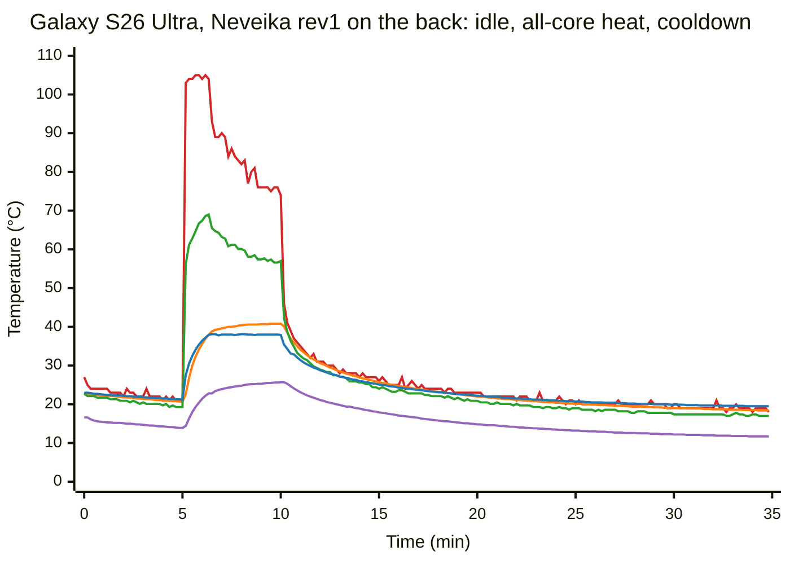
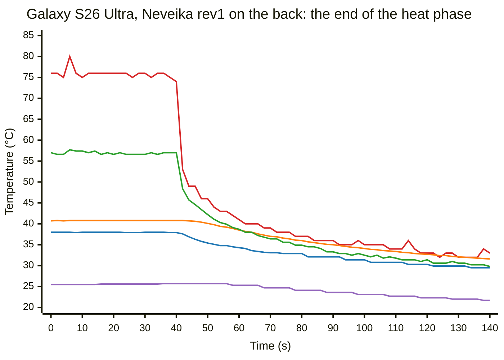
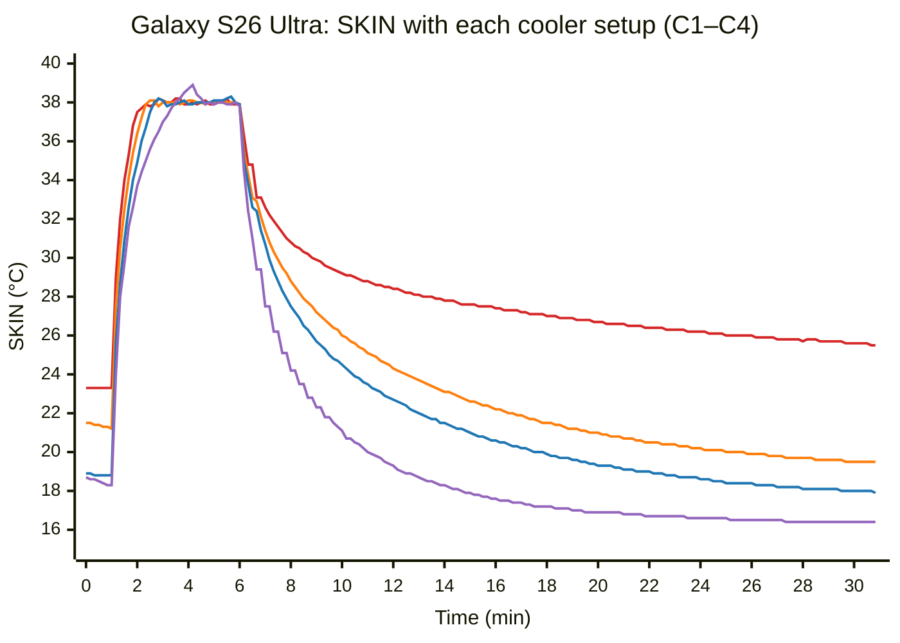

# Galaxy S26 Ultra Thermal Behavior

This article records what we measured on two Galaxy S26 Ultra handsets in two
studies:

- **2026-10-22 to 2026-10-23:** how fast the die heats, how the CPU throttles,
  how coolers and cooler positions change the results, and which coolers cause
  phantom touches.
- **2026-10-26 to 2026-10-27:** a heat-and-cooldown cycle with each cooler, the
  thread layouts, the skin criterion of the readiness gate, a search for memory
  throttling, and a setup with a Black Shark on each side.

The article records findings, not requirements. Most setups ran on one handset,
and each setup ran once. See [Open questions](#open-questions) before you use a
number to choose a fleet setup.

For the same studies on the Pixel 11 Pro, see
[Pixel 11 Pro thermal behavior](pixel-11-pro-thermal-behavior.md). The S26
Ultra's memory use and swap are in
[Galaxy S26 Ultra memory pressure](galaxy-s26-ultra-memory-pressure.md).

## Key findings

**Two limits control the CPU clock.** Within 2–4 s of a full load, the hottest
CPU zone reaches about 105 °C, the hardware trip point, and the thermal governor
lowers the CPU frequency ceiling. After about 80–100 s of full load, the `SKIN`
sensor of the thermal Hardware Abstraction Layer (HAL) reaches 38.0 °C, its
first throttling threshold. From then on, the governor holds `SKIN` at about
38 °C, and the die runs at 75–90 °C. A 60 s rep (one timed run of a cell) of our
7B cell can reach both limits: with only the die criterion, `SKIN` reached 38 °C
34–59 s into each rep after the first.

**A cooler gives a higher clock, not a cooler skin.** With every cooler, `SKIN`
peaked at 38.2–39.0 °C under a full load. In the last minute of a 5 min load,
the clock ceiling was about 10 % higher than with no cooler with the Neveika
rev1, about 18 % higher with the Black Shark, and about 32 % higher with two
Black Sharks. Active cooling does not keep the die in band for a whole rep of
these cells: the die reaches the trip point in the first seconds of each rep.

**Unpinned threads go to the prime cores first.** With 4 unpinned threads, both
prime cores were busy in 82 % of the samples, and the other two threads ran on
performance cores. The prime cores throttle the most, so this layout drifts the
most. On the Pixel 11 Pro, unpinned threads go to the small cores some of the
time: the S26 Ultra does the opposite.

**6 threads on the 6 performance cores is the best layout that we tested.** It
was 5 % faster than 4 unpinned threads with the same gate, with less drift and
shorter waits.

**The rep time follows the skin temperature at the start of the rep.** With 4
unpinned threads, across five runs (the die criterion only, and skin thresholds
from 26 to 30 °C), the rep time rose by 1.29 s for each 1 °C of `SKIN` at the
rep start (r = 0.999). A rep that starts
cooler reaches the 38 °C skin limit later, or not at all. There is no threshold
below which the rep time stops changing. On this phone, the skin
threshold is part of the definition of a result, like the cooler.

**The skin criterion removes the drift across a cell.** With only the die
criterion, the first reps are faster than the later ones. With a skin threshold
of 28 °C, every rep starts from the same state, the coefficient of variation
(CV) falls from 1.6 % to 0.9 %, and the cell takes about a third longer.

**Two Black Sharks shorten the run, not the rep.** With 6 threads on the
performance cores and a skin threshold of 28 °C, a Black Shark on each side gave
nearly the same mean rep time as one Neveika rev1 on the back (57.2 against
57.9 s). The run took 39 min instead of 65 min, because the waits were shorter.
One Black Shark on the back was not measured in the same mode, so this result
does not show how much of the gain comes from the second cooler.

**We found no memory throttling.** The memory cooling device `ddr-cdev` never
left state 0, also with no gate, a `ddr` zone at 72.9 °C and `SKIN` at 39.2 °C.
The decode time does not change with temperature when the CPU clock does not
change.

**Front coolers can cause phantom touches.** On 2026-10-23, the Neveika rev1 and
the 50 W cooler on the screen each gave about 1,200 touch events in 5 s, and the
Black Shark gave 0. On a more humid day, 2026-10-26, the Black Shark in AI mode
also gave touches on the screen. Clients built on 2026-10-26 or later hold a
rep in the Android CLI gate while it detects a held touch. The clients in these
studies did not have that criterion.

## Measurement rig

- **Handsets:**
  - Phone 9 (SM-S948U1) of our fleet, on 2026-10-22, with its benchmark
    workers stopped and a Neveika rev2 cooler on each side.
  - A second S26 Ultra (SM-S948U1) on a desk, over wireless adb, for all other
    runs. This article calls it the desk phone.
- **CPU layout:** 6 performance cores (cpu0–5, 3.63 GHz) and 2 prime cores
  (cpu6–7, 4.74 GHz). The cpufreq policies are `policy0` (cpu0–5) and `policy6`
  (cpu6–7).
- **Coolers:**
  - Neveika rev1: the 4 W Neveika 001 that
    [Device conditions](device-conditions.md#active-cooling) names as the
    standard. The fleet setup is one on each side.
  - A 50 W cooler with a metal plate, in its 50 W mode, about 25 W from the
    charger.
  - A Black Shark cooler with a fan and a soft rubber pad. It has three modes:
    quiet, overcool and AI (a thermostat mode). It used about 25 W from the charger in overcool
    mode.
- **Room:** an office at about 23 °C. The humidity was not measured.
- **Clients:**
  - First study: `pipette` builds of 2026-10-07 and 2026-10-22.
  - Second study: a `pipette` build of 2026-10-25, which has the skin criterion
    (`[readiness.android] skin_below_c`, `--readiness-skin-below-c`).

  All runs were started by hand over `adb shell`.
- **Runtime:** llama.cpp b10216 (`android-arm64-v8a`), CPU only, flash attention
  off, no mmap. The fleet's S26 cells use other llama.cpp builds. This study used
  the same build as the Pixel study.
- **Cell:** Olmo-3-7B-Think Q4_K_M on `end_to_end_latency_1024_256`
  (`ctx_size` 2048), with the 34 °C die criterion. One run on phone 9 used
  Qwen3.5-4B on `end_to_end_latency_256_256`.

The runs used scripts from this study that are not checked in to this
repository or the device lab's configuration. On this phone, the adb shell user can read
`/sys/class/thermal` and the cpufreq files. `/sys/class/devfreq` is denied, and
the phone has no power-stats HAL, so Perfetto cannot record memory clocks or
power rails.

In the second study, a logger recorded once a second:

- the hottest `cpu-<n>-*` zone, and the `ddr`, `sys-therm-0` and `battery`
  zones
- the frequency ceiling (`scaling_max_freq`) and the current frequency of each
  cluster
- the state of `ddr-cdev`, and every other cooling device with a state above 0,
  except the cpufreq devices. This includes `pause-cpuN`, `thermal-pause-*` and
  `cpu-hotplugN`, which take cores out of use.
- every second sample, the HAL values `SKIN`, `AP` and `BAT` from
  `dumpsys thermalservice`

A second script recorded, every 5 s, the CPU of each running llama-server
thread (`ps -T -o S,PSR`). Every run also recorded each touch event with
`getevent -t`.

`pmh0104_tz` and `pmr735d_tz` read a fixed 37.0 °C and are not useful.

## Temperature and throttling signals

- **The die limit.** The hottest CPU zone reaches about 105 °C in 2–4 s of full
  load, and the governor lowers the frequency ceilings in steps of 0.1–0.3 GHz.
  The ceiling returns to the hardware maximum within about 6 s after the load
  stops.
- **The skin limit.** The HAL gives `SKIN` the hot throttling thresholds 38, 40,
  42, 45 and 47 °C. Under a full load, `SKIN` reaches 38 °C in 80–100 s, and the
  governor then holds it there: the ceilings keep falling, to 2.2–2.7 GHz after
  5 min.
- **The board.** `sys-therm-0` and `SKIN` follow the heat in the body of the
  phone. They change over minutes, and the die changes over seconds.
- **The battery** is not a useful signal with a back cooler: the cooler sits on
  the battery.
- **No core went out of use.** The pause and hotplug cooling devices stayed at
  state 0 in all runs of the second study.

### Throttling in a rep

Rep 4 of a Qwen3.5-4B cell on phone 9, with a Neveika rev2 cooler on each
side, shows the pattern of a rep:

| Time into the rep | 0 s | 2 s | 6 s | 10 s | 14 s | 18 s | 22 s (end) | 24 s | 28 s |
|---|---|---|---|---|---|---|---|---|---|
| Hottest CPU zone | 43 °C | 105 °C | 98 °C | 100 °C | 98 °C | 96 °C | 92 °C | 55 °C | 46 °C |
| Big cluster ceiling | 4.74 | 3.86 | 4.74 | 3.86 | 3.40 | 3.40 | 3.40 | 3.86 | 4.74 GHz |
| Performance cluster ceiling | 3.63 | 3.63 | 3.63 | 3.40 | 3.19 | 3.19 | 3.19 | 3.40 | 3.63 GHz |

The ceiling follows the die temperature. A fixed power policy does not explain
this pattern.

## The sensors through one cycle

Each cycle has three phases: 5 min idle, 5 min with one `yes` loop on each of
the 8 cores, and 25 min idle. The C1 cycle had 1 min idle, because the phone
had rested for a long time before it. The setups:

| Cycle | Cooler | `SKIN` before the heat |
|---|---|---|
| C1 | None | 23.3 °C |
| C2 | Neveika rev1, middle of the back | 21.2 °C |
| C3 | Black Shark, middle of the back, AI mode | 18.8 °C |
| C4 | Black Shark on the back and on the screen, both in quiet mode (2026-10-27) | 18.3 °C |

The charts show raw samples, not averages. Where the HAL gave no value for
`SKIN` in a sample, the chart repeats the previous value. The line colors are:
hottest CPU zone red, `sys-therm-0` orange, `ddr` green, `SKIN` blue and
`battery` purple.

The C2 cycle, one sample every 10 s. The heat phase runs from minute 5 to
minute 10:

The end of the heat phase in C2, one sample every 2 s, from 40 s before the
load stops to 100 s after it. The load stops at 40 s:

- **The die reaches the trip point first.** The hottest CPU zone read
  103–105 °C from the first sample of the heat phase for about 80 s.
- **Then the skin limit takes over.** `SKIN` reached 38.0 °C after 81 s. From
  then on, the governor held `SKIN` at 37.8–38.1 °C, and the CPU zone fell to
  75–90 °C as the ceilings fell.
- **When the load stops, `SKIN` falls at once.** It fell from 38.0 to 35.8 °C in
  8 s, and to 31.4 °C in the first minute. The CPU zone fell from 74 to 47 °C in
  7 s. On the Pixel 11 Pro, the skin kept rising for about 10 s after the load
  stopped.
- **`sys-therm-0` peaked at 40.8 °C** at the end of the heat phase, and fell by
  about 4 °C in the first 30 s.
- **The `ddr` zone peaked at 69 °C,** and `ddr-cdev` stayed at state 0.

`SKIN` in the four cycles, one sample every 10 s, from 1 min before the heat
phase to 25 min after it. The heat phase runs from minute 1 to minute 6. C1 red,
C2 orange, C3 blue, C4 purple:

| | C1, no cooler | C2, Neveika rev1 | C3, Black Shark (AI) | C4, two Black Sharks (quiet) |
|---|---|---|---|---|
| `SKIN` reaches 38 °C | 101 s | 81 s | 99 s | 150 s |
| Clock ceiling of the performance cores, average of the last minute of heat | 2.28 GHz | 2.52 GHz | 2.70 GHz | 3.01 GHz |
| `SKIN` / battery when the load stops | 37.9 / 33.0 °C | 37.9 / 25.7 °C | 37.9 / 25.9 °C | 38.0 / 23.5 °C |
| 2 min after | 30.6 / 28.3 °C | 28.8 / 21.1 °C | 27.5 / 19.1 °C | 24.2 / 16.0 °C |
| 5 min after | 28.7 / 26.6 °C | 25.1 / 17.9 °C | 23.5 / 15.1 °C | 20.0 / 11.9 °C |
| 10 min after | 27.4 / 25.3 °C | 22.2 / 14.9 °C | 20.6 / 12.0 °C | 17.6 / 9.3 °C |
| 20 min after | 26.0 / 23.4 °C | 19.9 / 12.2 °C | 18.4 / 9.6 °C | 16.5 / 7.9 °C |
| `SKIN` back at its value before the heat | not in 25 min (+2.2 °C) | 13 min | 17 min | 8 min |

- The Black Shark kept `SKIN` about 1.5 °C below the Neveika at every point of
  the cooldown.
- Two Black Sharks kept `SKIN` about 3 °C below one Black Shark in the first
  10 min, and delayed the skin limit by about 50 s. C3 and C4 used different
  modes on different days, so the table does not isolate the second cooler.
- The touch log recorded 0 events through C4.

## Coolers

Olmo-3-7B on 1024/256, 4 unpinned threads, the 34 °C die criterion, 5 reps per
row, all on 2026-10-23. "Big cluster ceiling" is the average `scaling_max_freq`
of cpu6–7 during each rep, for rep 1 and rep 5.

| Cooler and position | Mean | CV | Rep 1 → rep 5 | Median wait | Rep + wait | Big cluster ceiling, rep 1 → 5 |
|---|---|---|---|---|---|---|
| None | 67.2 s | 4.94 % | 62.9 → 70.0 s | 103 s | ~170 s | 3.03 → 2.52 GHz |
| Neveika rev1, back middle | 60.4 s | 3.87 % | 56.7 → 62.8 s | 55 s | ~115 s | 3.62 → 3.10 GHz |
| Black Shark, back middle | 60.2 s | 2.67 % | 57.4 → 61.5 s | 49 s | ~109 s | 3.58 → 3.13 GHz |
| 50 W cooler, back middle | 59.0 s | 2.67 % | 57.0 → 60.8 s | 55 s | ~114 s | 3.66 → 3.39 GHz |
| 50 W cooler, back top, over the CPU (cold start) | 54.3 s | 1.59 % | 53.5 → 55.7 s | 25 s | ~80 s | 4.27 → 3.60 GHz |
| 50 W cooler, back top, over the CPU (resting start) | 54.9 s | 2.46 % | 53.3 → 56.7 s | 25 s | ~80 s | 4.07 → 3.67 GHz |
| Neveika rev1, back + front (the fleet setup) | 57.6 s | 3.92 % | 54.7 → 60.3 s | 34 s | ~92 s | 3.80 → 3.46 GHz |
| Black Shark, front | 58.6 s | 2.78 % | 56.8 → 60.1 s | 37 s | ~96 s | 3.57 → 3.32 GHz |

- **All setups throttled from the first seconds of each rep.** The time under a
  cap was 65–100 % of each rep.
- **The top of the back, over the CPU, was the best position** (−6.9 % against
  the same cooler in the middle, Welch t = −4.4). The two runs there agree
  within noise (t = 0.9). A book held the 50 W cooler in place, so the contact
  pressure was also higher than with its clip. This setup is an upper bound, not
  a candidate for the fleet.
- **The Black Shark on the front was 2.7 % faster than on the back** (t = −1.6,
  5 reps each). Its cap deepened less from rep to rep.
- **The fleet setup was 4.6 % faster than one Neveika on the back** (t = −1.9),
  with the same drift (+10 %). The front Neveika registered as a touch during
  this run (see [Phantom touches](#phantom-touches)).
- **Cooler power does not change the mean in the middle of the back.** The 4 W
  Neveika, the 50 W cooler and the Black Shark (each of the last two about 25 W
  from the charger) gave 59.0–60.4 s there. The two stronger coolers gave a
  lower CV, because the drift across the cell was smaller.

### Two Black Sharks

Olmo-3-7B on 1024/256, 6 threads on the performance cores, the 34 °C die
criterion and a skin threshold of 28 °C, 20 reps in 4 cells of 5. Before each
run, the phone rested until `SKIN` read below 22 °C.

| Cooler | Date | Mean | CV | `SKIN` at the rep start | Median wait | Total wait | Run time |
|---|---|---|---|---|---|---|---|
| Neveika rev1, back | 2026-10-26 | 57.9 s | 0.55 % | 27.7–27.9 °C | 121 s | 41 min | 65 min |
| Black Shark on the back and on the screen, quiet | 2026-10-27 | 57.2 s | 0.94 % | 25.5–28.6 °C | 46 s | 15 min | 39 min |

- **The mean rep time changes little.** The skin criterion sets the start state,
  so a better cooler changes the waits more than the reps.
- **With two Black Sharks, the skin criterion rarely held a rep.** `SKIN` at the
  rep start was mostly below 28 °C, and most waits came from the die criterion.
  The start state varied more, and the CV was higher.
- **The clock ceiling of the performance cores stayed higher:** 3.63 → 3.56 GHz,
  against 3.47 → 3.42 GHz with the Neveika.
- **No touches.** The touch check at the start of each cell read 0. This run did
  not record touches between those checks.
- **One Black Shark on the back in quiet mode was not measured.** The test
  stopped before that run. Without it, the 40 % shorter run cannot be divided
  between the second cooler and the change from the Neveika to the Black Shark.

## The board temperature and the drift

With the 50 W cooler in the middle of the back, the board sensors at the start
of each rep rose with the rep time:

| | Warm-up | Rep 2 | Rep 3 | Rep 4 | Rep 5 |
|---|---|---|---|---|---|
| Rep time | 53.8 s | 57.9 s | 59.4 s | 60.1 s | 60.8 s |
| Hottest CPU zone (the die criterion's signal) | 56.7 °C | 40.9 °C | 35.9 °C | 35.1 °C | 35.1 °C |
| `sys-therm-0` | 22.8 °C | 32.6 °C | 34.1 °C | 34.4 °C | 34.5 °C |
| `pmh0101_tz` | 24.5 °C | 32.1 °C | 33.5 °C | 34.0 °C | 33.8 °C |
| HAL `SKIN` | 21.5 °C | 28.7 °C | 29.7 °C | 29.7 °C | 30.1 °C |

After the run, `sys-therm-0` fell from 42 to 22 °C in about 5 min. The die fell
below 50 °C within 6 s.

With only the die criterion, `SKIN` at the rep start rises over the first 2–3
reps and then stays at about 30–31 °C (Neveika rev1 on the back). From that
point the rep time is stable. The drift is the change from a rested phone to
this plateau.

## Threads

Olmo-3-7B on 1024/256, the 34 °C die criterion, a Neveika rev1 on the middle of
the back, 2026-10-26. Each layout ran 2 cells of 5 reps. Before each layout, the
phone rested until `SKIN` read below 22 °C. `taskset` set the CPU mask on the
client, and llama-server inherits the mask.

| Layout | Mask | Mean | CV | Rep 1 → rep 10 | Median wait | Thread samples on the prime cores |
|---|---|---|---|---|---|---|
| 4 unpinned | — | 60.6 s | 3.83 % | 55.3 → 61.5 s (+11 %) | 70 s | 46 % (in the 20-rep run) |
| 3 on performance cores | `07` | 81.3 s | 1.03 % | 79.7 → 81.0 s | 55 s | 0 % |
| 4 on performance cores | `0f` | 66.4 s | 0.87 % | 65.4 → 67.2 s (+2.7 %) | 64 s | 0 % |
| 6 on performance cores | `3f` | 59.1 s | 1.18 % | 57.9 → 59.5 s (+2.8 %) | 64 s | 0 % |
| 2 on the prime cores | `c0` | 67.4 s | 1.73 % | 64.6 → 67.8 s (+5 %) | 85 s | 100 % |
| 8 unpinned | — | 59.0 s | 1.32 % | 57.6 → 59.4 s (+3.1 %) | 82 s | 22 % |

- **The scheduler puts busy threads on the prime cores first.** In a 20-rep run
  with 4 unpinned threads, 46 % of the thread samples were on cpu6–7, and both
  prime cores were busy in 199 of 242 samples. The other two threads ran mostly
  on cpu1, cpu4 and cpu5. With 4 unpinned threads, the average clock under load
  was 3.21 GHz on the prime cores. In the pinned layouts on the performance
  cores, the prime cores stayed at their idle clock (0.88 GHz).
- **The prime cores throttle the most.** With 2 threads on the prime cores, the
  prime ceiling averaged 3.74 → 3.35 GHz over a rep, against a maximum of
  4.74 GHz. That layout had the longest waits, because the prime cores heat the
  die fastest.
- **The prime ceiling also falls when the prime cores are idle.** With 6 threads
  on the performance cores, the prime ceiling fell from 4.17 to 3.45 GHz. The
  two clusters share one thermal limit.
- **6 threads on the performance cores matches 8 unpinned threads with shorter
  waits.** With 8 threads, the ceilings of both clusters fell to about 2.8 GHz.
- **3 threads are too few.** With 3 threads on the performance cores, the
  ceiling stayed near the maximum, but the rep was 34 % slower than with 4
  unpinned threads.

The 20-rep runs of the next section repeat the comparison: with the die
criterion only, 6 threads on the performance cores gave 59.2 s (CV 1.00 %), and
4 unpinned threads gave 62.2 s (CV 1.62 %).

## The skin criterion

Olmo-3-7B on 1024/256, the 34 °C die criterion, a Neveika rev1 on the middle of
the back, 2026-10-26 and 2026-10-27. Each run had 20 reps in 4 cells of 5. Before
each run, the phone rested until `SKIN` read below 22 °C. "`SKIN` at the rep
start" and "Mean" are for reps 3–20.

| Threads | Skin threshold | `SKIN` at the rep start | Mean | CV | Rep 1 → rep 20 | Median wait | Run time |
|---|---|---|---|---|---|---|---|
| 4 unpinned | — | 30.8 °C | 62.5 s | 1.62 % | 58.8 → 62.3 s | 82 s | 53 min |
| 4 unpinned | 30 °C | 29.8 °C | 61.1 s | 1.59 % | 57.3 → 61.5 s | 91 s | 57 min |
| 4 unpinned | 29 °C | 28.8 °C | 59.9 s | 1.26 % | 57.6 → 58.3 s | 112 s | 63 min |
| 4 unpinned | 28 °C | 27.9 °C | 58.5 s | 0.86 % | 57.8 → 58.4 s | 142 s | 72 min |
| 4 unpinned | 26 °C | 25.9 °C | 56.2 s | 0.64 % | 56.2 → 56.4 s | 196 s | 92 min |
| 6 on performance cores | — | 30.4 °C | 59.3 s | 1.00 % | 58.4 → 59.3 s | 76 s | 49 min |
| 6 on performance cores | 28 °C | 27.8 °C | 57.9 s | 0.55 % | 57.9 → 58.1 s | 121 s | 65 min |

- **The rep time is a linear function of `SKIN` at the rep start.** For the five
  runs with 4 unpinned threads, the slope is 1.29 s per °C, about 2 % per °C,
  with r = 0.999. A lower threshold gives a faster rep and a longer wait.
- **The reason is the skin limit inside the rep.** `SKIN` rises by 7–12 °C
  during a rep. With the die criterion only, `SKIN` reached 38 °C 34–59 s into
  each rep after the first, and the governor then lowered the clock for the
  rest of the rep. With skin 28 °C, some reps reached 38 °C at about 53 s. With
  skin 26 °C, no rep reached it: the peaks were 37.3–37.6 °C. The
  6-thread runs show the same pattern.
- **With only the die criterion, `SKIN` at the rep start settles at about
  30–31 °C.** A skin threshold above that value holds no rep. At 30 °C, the
  skin criterion held only some reps, and the drift stayed.
- **At 28 °C and below, every rep starts from the same state.** The CV is below
  1 %, and rep 1 is not faster than the others. The clock ceilings change
  little across the run: 3.39 → 3.30 GHz on the performance cores at 28 °C,
  against 3.32 → 2.99 GHz with the die criterion only.
- **The skin criterion has a smaller effect with 6 threads on the performance
  cores:** 2.2 % faster at 28 °C, against 6 % with 4 unpinned threads. The CV of
  0.55 % is the lowest of any run in this study.
- **The cost is time.** At 28 °C, a run takes about a third longer than with the
  die criterion only. At 26 °C, it takes about 75 % longer. The phone needed
  11–15 min to cool from about 30 °C to 22 °C.
- **This is different from the Pixel 11 Pro.** On its short cells, the rep time
  does not depend on the start temperature, and the skin criterion keeps a memory clamp
  out of the reps.

## Memory

We found no memory throttling.

- **`ddr-cdev` stayed at state 0 in every run.** This includes a 20-rep run with
  no gate, in which the `ddr` zone reached 72.9 °C, `SKIN` 39.2 °C,
  `sys-therm-0` 42.6 °C and the CPU zone 105.8 °C.
- **The decode time does not change with temperature when the CPU clock does
  not change.** llama-server logs the prefill time and the decode time of each
  request. With 6 threads on the performance cores, the median decode time was
  32.7 s with the die criterion and 32.2 s with skin 28 °C, while `SKIN` at the
  rep start differed by 2.6 °C. Decode depends on memory speed, so a memory
  clock that falls with heat would show here.
- **With 4 unpinned threads, decode changes more than prefill.** From the die
  criterion to skin 26 °C, the median decode time fell from 33.5 to 29.3 s, and
  the prefill time from 28.9 to 26.9 s. The share of thread samples on the prime
  cores was 46–47 % in every run. The prime ceiling changes the most with
  temperature, so the decode change probably comes from the prime cores.
- **With no gate, decode slowed less than the clock.** From rep 1 to the last
  reps of a 20-rep run, the average ceilings fell from 3.15 to 2.12 GHz, a
  factor of 1.49. Prefill slowed from 29.6 to about 44.5 s (+50 %), as the clock
  predicts. Decode slowed from 31.7 to about 37.3 s (+18 %).

The phone has no power-stats HAL, and `/sys/class/devfreq` is denied. A memory
clock change outside `ddr-cdev` is therefore not visible. The result is "no
memory throttling seen", not proof that there is none.

## Phantom touches

| Front cooler | Date | Touch events in 5 s | Signature | Phone temperature |
|---|---|---|---|---|
| 50 W cooler | 2026-10-23 | about 1,270 | not measured | CPU and board zones at 7–9 °C |
| Neveika rev1 | 2026-10-23 | about 1,200 | one steady contact, `TOUCH_MAJOR` 93–94 of 255 at about 120 Hz | front side at about 18–20 °C |
| Black Shark (rubber pad), overcool | 2026-10-23 | 0, also after 10 min on the cold glass | — | — |
| Black Shark (rubber pad), AI | 2026-10-26 | 1,200–3,300 | 1–3 contacts that change; one near the top edge of the screen | `SKIN` 20.2 °C |
| Black Shark (rubber pad), quiet, with a second Black Shark on the back | 2026-10-27 | 0 through a 35 min cycle and a 39 min run | — | `SKIN` 16–38 °C |

- **The Neveika rev1 on the screen registered as a held touch without
  condensation.** The contact did not move or change size, and the phone was
  not cold enough for condensation. With this touch, `system_server` used 28.5 %
  of one CPU in one sample on an idle phone.
- **The 50 W cooler on the screen chilled the phone to 7–9 °C.** The touches
  were probably condensation, the plate, or both. The signature was not
  recorded.
- **The Black Shark on the screen depends on the air.** On 2026-10-26 the room
  was more humid, and AI mode formed condensation on the glass. The contacts
  moved and changed in number, which agrees with water on the glass. After the
  Black Shark moved to the back, the touch count was 0 for the full cycle.
- **The fleet showed no touches.** On 2026-10-19, the fleet S26 Ultras read 0
  touch events, and on 2026-10-22, phone 9 with a Neveika rev2 on each side
  read 0. The touches in the fleet setup row of [Coolers](#coolers) come from
  this handset's front Neveika rev1 and how it sat on the glass.
- **The held-touch criterion.** In clients built on 2026-10-26 or later, the
  Android CLI gate holds a rep while it detects a held touch; the mechanism is in
  [End-to-end latency → Android](end-to-end-latency.md#android). On this phone
  the gate counts the `synaptics_ts` line in `/proc/interrupts`. The touch
  interrupt rate was not measured on this phone. The Neveika rev1's held contact sent reports at about
  120 Hz, and the Black Shark's touches sent 240–660 events a second. The
  clients in these studies did not have this criterion, so it held no rep here.
- The touchscreen on this phone is `sec_touchscreen` (`/dev/input/event5` on
  the desk phone, `/dev/input/event8` on phone 9). Find it with
  `getevent -pl`. Count events with `timeout 5 getevent -t <device> | wc -l`,
  and read the contacts with `dumpsys input` (`pointerCount`).

## Other observations

- **A second benchmark on the handset.** On 2026-10-22, a second benchmark
  (gemma-4-12B) started on phone 9 beside the test's 4B cell. About 90 s later
  the handset rebooted. Run one benchmark at a time on a handset.
- **A frequency cap from the screen state.** With a benchmark running and
  the screen dozing, the CPU frequency ceiling on phone 9 was 2.75 of 3.63 GHz
  and 2.67 of 4.74 GHz. With the job stopped and the screen awake, both returned
  to the hardware maximum.
- **mDNS names change.** The adb name of a wireless handset can change to
  `<name> (N)` after a reconnection. Find a handset by its serial number.

## Open questions

- **One handset, one run per setup.** Repeat the leading setups on a second
  handset and on a second day. Day-to-day drift on the Pixel 11 Pro was about
  3 %.
- **The skin threshold for the fleet.** On this phone, the threshold sets the
  rep time. A fleet value needs one threshold for all S26 Ultras, and the
  handsets must rest well below it with their coolers. The resting `SKIN` was
  23.3 °C with no cooler, 19–21 °C with the Neveika rev1 and 18.8 °C with the
  Black Shark.
- **The thread layout for the fleet.** 6 threads on the performance cores gave
  the best results here. The fleet's S26 cells use 4 unpinned threads.
  llama-server's own `--cpu-mask` had no effect on the Pixel 11 Pro, so a mask
  needs another mechanism, such as `taskset` on the client.
- **The skin criterion with other coolers.** All skin runs used one Neveika rev1
  on the back. The waits will be shorter with a cooler that cools the body
  faster.
- **One Black Shark or two.** Two Black Sharks in quiet mode shortened a
  skin-gated run by 40 % against one Neveika rev1. Measure one Black Shark on
  the back in quiet mode, on the same day, to find how much of that gain the
  front cooler gives. The front cooler gave touches in AI mode on a humid day.
- **The fleet's front Neveika.** This handset's front Neveika rev1 registered as
  a touch, and the fleet's did not on 2026-10-19. Check the fleet handsets again
  before you compare fleet results with this note.
