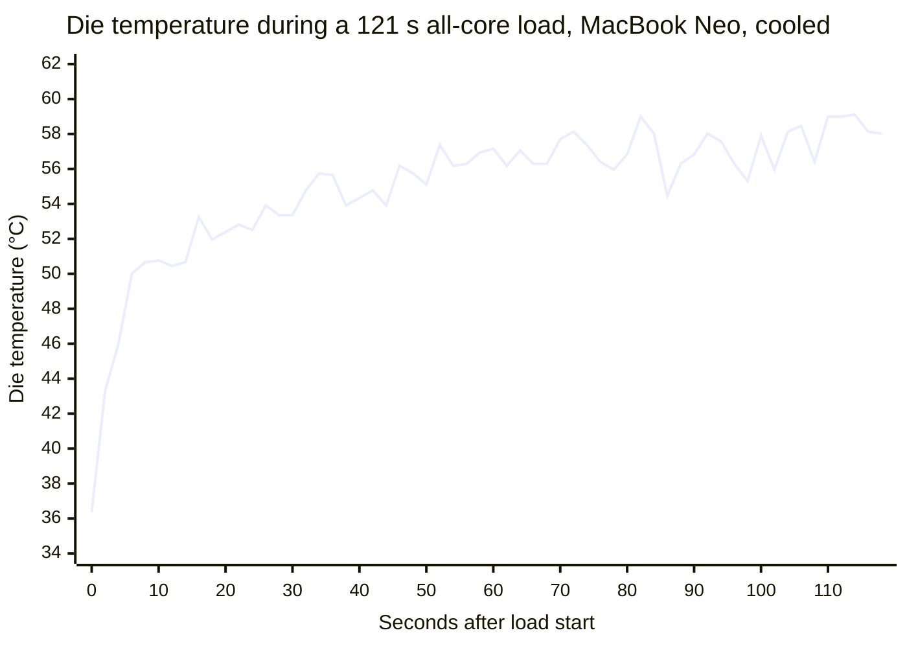
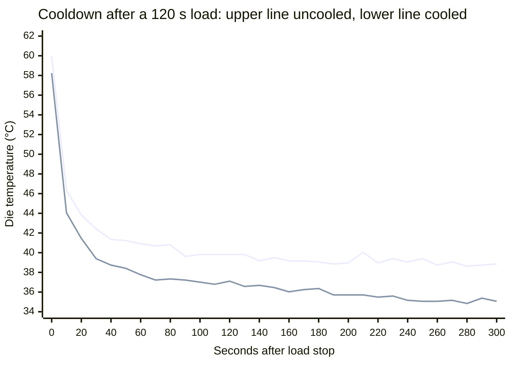

# MacBook Neo Thermal Behavior

Every timing benchmark is measured under some thermal condition, and the harness
tries to hold that condition constant so two runs are comparable. Doing that
requires knowing what the machine's thermal signals actually mean. On the
MacBook Neo they do not mean what their names suggest: the operating system's
thermal-pressure level is not a temperature reading, and the die temperature that
would replace it is noisier than any of the thresholds one would reach for by
intuition.

This article records what we measured on that machine, with and without its
external cooler, and why the benchmark setup around it looks the way it does. It
is the detailed backing for the thermal-pressure criterion and the deadline in
[End-to-end latency → macOS](end-to-end-latency.md#macos).

The machine under test is thermally modified. See
[Measurement rig](#measurement-rig) before quoting any temperature from here.

## Key findings

**The thermal-pressure level is not a temperature signal.** Despite its name,
`kOSThermalNotificationPressureLevelName` is an integrator with a fixed ~318 s
hold-off. It released at the identical sample after a 10 s load and a 123 s one,
and at the identical sample with the die at 34.84 °C and at 38.52 °C. It engaged
on a die change of 0.10 °C: one quantization step. Nothing thermal moves it.
This is the finding most likely to mislead, because the name promises otherwise.

**Idle die temperature is noisy enough to rule out intuitive thresholds.**
With no load at all, the Neo's die wanders 3.8 °C peak-to-peak, with a standard
deviation (σ) of 0.4–0.8 °C on clean baselines. The sensors quantize at
0.10 °C. A gate written as "within 1 °C of idle" needs a resolution that the
hardware does not have. The noise is also
autocorrelated, so averaging recovers far less than `√N` suggests.

**Heat arrives in seconds and leaves over minutes.** A 3.5 s rep (one timed
run) heats the die 10–12.5 °C; shedding the last degree takes minutes across at least two thermal
time constants. Gating on a return to baseline therefore spends nearly all its
time in the slowest part of the curve.

**An external cooler changes the equilibrium temperature and almost nothing
else**: not the noise floor, not the cooling rate, not peak temperature, not
the level. It gives margin, not speed. "Uncooled" here still has the passive
internal pad; see [Measurement rig](#measurement-rig).

**Across the temperature spread a batch actually produces, results do not
change.** The macOS gate's default die criterion (`die < 50 °C`) was calibrated
on the M5 Max; see
[MacBook Pro (M5 Max) thermal behavior](macbook-m5-thermal-behavior.md).

## Measurement rig

The device is a MacBook Neo (A18 Pro), which ships with no internal fan. The
machine is modified with a passive thermal pad inside the case and an external
active cooling pad under it; the setup is described in
[Cooling on the MacBook Neo](device-conditions.md#cooling-on-the-macbook-neo).
Every number in this article was measured on the modified machine. The internal
pad is present in every run, so **"cooled" and "uncooled" throughout this
article mean with and without the *external* pad.**

> **There is no stock-Neo data.** Neither arm represents a machine as shipped.
> A stock Neo would be expected to run hotter than anything reported here,
> plausibly hot enough to reach a throttling regime that neither arm approaches.
> Nothing in this article should be read as characterizing the product.

The internal pad is also the most likely explanation for several results below,
and it is worth holding in mind while reading them. Coupling the die to the
chassis adds a large, slow thermal mass in series with it, which fits the
**multi-timescale cooling** (a fast die-to-chassis constant followed by much
slower chassis-to-air ones), the **long baseline settling times**, and the fact
that the external pad moves the equilibrium by only 3.4 °C. It is cooling a
chassis that was already doing most of the work. That reading is inference from
the shape of the data, not something measured against an unmodified machine.

All measurements come from `tools/macos-thermal-probe`, which samples three
signals side by side:

- **`PMU tdie*` die temperature** via private IOHID sensors: the same reading
  the macOS readiness gate (`crates/pipette-device/src/die_temp.rs`) and the
  iOS client take. The Neo exposes 7 such sensors; the reported figure is the
  **maximum** across them.
- **`kOSThermalNotificationPressureLevelName`** via `notify_get_state`: the
  thermal-pressure level that the readiness gate reads.
- **`ProcessInfo.thermalState`**: the coarser public thermal state, recorded for
  comparison.

Two properties of the temperature reading matter before any number below can be
interpreted. The sensors **quantize at 0.10 °C**, so that is a hard floor on
resolution. And because the figure is a *maximum over sensors*, it is
upward-biased and noisier than any single sensor would be, and not comparable
across hosts with different sensor counts.

### The contrast host

Several findings below are stated as a comparison against a **MacBook Pro
(M4 Max, 14 cores, internal fans, stock cooling, 20 `PMU tdie` sensors)**. It
appears throughout as *the contrast host*.

A single machine cannot show which of its properties belong to the *hardware
class* and which belong to *that machine*. A threshold that looks correct on one
host is shown to be wrong only when a second host disagrees with it. The two
hosts differ as much as two Macs can:

| | MacBook Neo (as tested) | Contrast host (MacBook Pro M4 Max) |
| --- | --- | --- |
| Internal cooling | no fan; passive pad added to chassis | fans, stock |
| `PMU tdie` sensors | 7 | 20 |
| Idle die noise, σ | 0.43–0.80 °C | 0.26–0.41 °C |
| Thermal-pressure level under load | reaches `moderate` | **never leaves `nominal`** |

That last row is the important one. The level is uninformative on both machines
for **opposite reasons**: on the Neo it trips and stays tripped, so the gate can
never pass; on the contrast host it never trips at all, so a level-only gate
passes instantly even at 60.4 °C under full load. Any rule derived
from one alone would look reasonable and be wrong on the other.

## Idle noise floor

The single most consequential number: **the Neo's die temperature wanders on its
own, with no load applied.**

Four 300 s idle baselines at 2 s sampling. A baseline counts as **settled** when
the total temperature change implied by its linear fit is smaller than its own
σ, that is, when the machine is genuinely idling rather than still coming to
rest from earlier work. The right-hand column is that ratio; above 1.0 the
measurement tool flags the baseline as drifting and every statistic derived from
it is suspect.

| Baseline | σ (raw) | σ (de-trended) | Lag-1 | Drift / 300 s | Drift ÷ σ |
| --- | --- | --- | --- | --- | --- |
| Cooled, settled | 0.43 °C | 0.426 °C | +0.07 | −0.25 °C | 0.6 ✓ |
| Cooled, settled: separate session, weeks apart | 0.80 °C | 0.799 °C | +0.68 | +0.20 °C | 0.3 ✓ |
| Uncooled, **still warming from cold** | 0.64 °C | 0.404 °C | +0.63 | +1.74 °C | **2.7 ✗** |
| Cooled, **still cooling from prior work** | 1.03 °C | 0.925 °C | +0.80 | −1.53 °C | **1.5 ✗** |

The first two rows are the trustworthy ones. The last two are included precisely
because they are not: they show what an unsettled baseline does to the numbers,
which is the most common way these measurements go wrong.

Peak-to-peak on a clean 300 s baseline was **3.79 °C** (35.92–39.71 °C) with the
machine doing nothing at all.

Three consequences follow.

**No fixed temperature threshold survives.** A gate written as "wait until the
die is within 1 °C of idle" is asking for a resolution the sensor does not have
on this machine. The contrast host is quieter (σ 0.26–0.41 °C). A tolerance
tuned on the contrast host is too tight for the Neo, so the Neo's gate would
hold reps until the deadline.

**Averaging helps far less than it appears to.** The noise is autocorrelated:
lag-1 reached +0.92 at 0.25 s sampling, implying a correlation time of a few
seconds. For a first-order autoregressive (AR(1)) process, the variance of a
mean inflates by `(1+r)/(1-r)`,
so **eight samples taken over two seconds are worth about one independent
sample**. Sampling faster improves time resolution and nothing else.

**Idle noise is not a stable per-machine constant.** De-trended σ ranges
0.40–0.93 °C across the four baselines above, on one physical machine. Some of
that is drift (the two worst-behaved baselines were both flagged as still
settling), but not all: the two "Cooled, settled" baselines are both clean by
that test and still differ twofold. Any calibration measured once should be
treated as provisional.

## Heating and cooling asymmetry

Heat arrives in seconds. It leaves over minutes. This is the property that
drives most of the setup decisions.

Die temperature across a 121 s all-core load, sampled every 2 s from a 36.4 °C
start. Most of the total rise happens in the first six seconds; the remaining
two minutes add about as much again, slowly and noisily:



| Time after load start | Die rise |
| --- | --- |
| 2 s | **+6.9 °C** |
| 4 s | +9.6 °C |
| 6 s | +13.7 °C |
| 8 s | +14.3 °C |
| 121 s | +23.1 °C (peak 59.8 °C) |

**A 3.5 s rep heats the die by roughly 10–12.5 °C**: about ten times the idle
noise floor. Thermal variation across an ungated batch is therefore real and
easily measurable, not an artifact.

Cooling does not mirror this. The first 300 s after the same load stops, sampled
every 10 s; upper trace uncooled, lower trace cooled:



The shape shows the phases plainly: a near-vertical drop of ~14 °C in the first
ten seconds, a visible knee around 30–60 s, then a long shallow tail where the
remaining degree or two takes minutes. Fitting the decay confirms at least two
thermal masses:

| Phase | Time constant |
| --- | --- |
| First ~20 s, bulk of the excursion | τ ≈ 15 s |
| Next ~20 s | τ ≈ 44 s |
| Approaching baseline | τ ≈ 55 s+ |

A small excursion sheds with τ ≈ 7.5 s; a large one takes minutes to give up its
last degree. Waiting for a return to *baseline* therefore spends almost all of
its time in the flattest part of that curve, where each second of waiting gives
the smallest drop in temperature.

Both traces also make the cooler's actual contribution visible: the two curves
have the **same shape**, offset vertically. The cooler is not draining heat
faster. It is holding a lower floor.

## Thermal-pressure level as a timer

One of the macOS readiness gate's three criteria is that
`notify_get_state(kOSThermalNotificationPressureLevelName)` reads 0 (`nominal`);
the others are die temperature and CPU load (see
[System Readiness Control](end-to-end-latency.md#system-readiness-control)).
**That level is not a temperature signal.** It is an integrator with a fixed
hold-off, and three independent lines of evidence establish it.

**It releases at a fixed delay regardless of how much heat went in.** A 10 s
load and a 123 s load (a 12× difference) cleared 317 s and 318 s after load
stop respectively.

**It releases at a fixed delay regardless of the machine's temperature.**
Identical schedules run with and without the cooling pad:

| | External cooler ON | External cooler OFF |
| --- | --- | --- |
| Level trips | 304 s | 304 s |
| Level clears | 738 s (318 s after load stop) | 738 s (318 s after load stop) |
| **Die temperature when it cleared** | **34.84 °C** | **38.52 °C** |

Not approximately identical: the same sample. Two materially different thermal
states, one identical instant of release.

**It engages on a change too small to be a threshold crossing.** In one run the
transition from `nominal` to `moderate` occurred as the die moved from 43.72 °C
to 43.83 °C: a single 0.10 °C quantization step. No temperature threshold
crosses on one least-significant bit.

Two further behaviors matter for the setup:

- **Engagement is fast, release is slow.** The level trips roughly 2.9–4 s after
  load start and holds for ~318 s. A single 3.5 s benchmark arms it for over
  five minutes.
- **Repeated work keeps it armed indefinitely.** Across a 15-rep batch of
  3.5 s reps with 30 s rests, **99 % of samples read non-nominal** and the level
  never returned to `nominal` once. Each rep re-arms the integrator well
  inside its own hold-off.

The practical consequence, **for a load heavy enough to trip it**, is severe: a
cell with a warm-up and five reps behind six thermal gates trips the level on
the first rep, and every gate after that cannot pass at all;
`nominal` never arrives while the batch is running, so each gate runs out the
deadline instead.

**Real workloads confirm this, and the two hosts diverge.** The measurements
above drove a synthetic all-core burn, which is more thermally aggressive than a
3.5 s inference rep, but a 14-cell soak of the actual benchmark reproduces the
same behavior where it matters:

| 14-cell soak | Thermal-pressure level |
| --- | --- |
| MacBook Neo | goes to `moderate` and **stays there** for the rest of the soak |
| Contrast host (MacBook Pro M4 Max) | **never leaves `nominal`** |

So on the Neo the gate genuinely cannot pass mid-batch under real load, and on
the contrast host it passes unconditionally. The synthetic burn overstates
absolute temperatures, but it does not overstate the level's behavior.

`ProcessInfo.thermalState` moved in lock-step with the notify level in both
directions in every run, so it is not an alternative signal: only a coarser
view of the same one.

No level above `moderate` appeared on this hardware, also uncooled at a 60 °C
peak. Three of the five pressure levels (`heavy`, `trapping`, `sleeping`) remain
unexercised against real silicon.

## Cooled versus uncooled

Three paired runs, identical schedules, with and without the *external* cooling
pad. The passive internal thermal pad is present in both arms:

| | External cooler ON | External cooler OFF |
| --- | --- | --- |
| Idle σ, de-trended | 0.426 °C | **0.404 °C** |
| Idle baseline drift over 300 s | −0.25 °C | **+1.74 °C** |
| Peak, 120 s all-core load | 58.24 °C | 59.97 °C |
| Idle equilibrium temperature | **35.0 °C** | **38.4 °C** |
| Rate of heat shedding | **the same** | **the same** |
| Max pressure level reached | `moderate` | `moderate` |
| Batch start-temp spread, 15 reps | **0.82 °C** | **3.00 °C** |
| Rep-to-rep scatter (start / peak) | 0.10 / 0.46 °C | 0.11 / 0.51 °C |

The cooler changes **less than expected, and not what one would guess**:

- **Not the noise floor.** De-trended idle σ is identical. The apparent
  0.43 → 0.64 °C difference in raw σ was entirely the uncooled baseline still
  warming from cold.
- **Not peak temperature**, much: 1.7 °C under a sustained all-core load.
- **Not the rate of cooling.** Measured as excess over each arm's *own* settled
  point, the decay curves nearly overlay (t+20 s: +6.4 vs +5.4 °C; t+120 s:
  +2.1 vs +1.4 °C).
- **Not the level**, by even one sample.
- **The equilibrium temperature**, by 3.4 °C. That is the whole effect.

One number invites misreading and is worth stating explicitly. Return-to-baseline
took roughly ten times longer uncooled, but **that is an equilibrium effect, not
a slower cooling rate.** The uncooled machine settles 3.4 °C higher, so a test
written as "return to the pre-load baseline temperature" is waiting for a
temperature that arm never reaches. Time to shed a given excess is the same in
both. Time to reach a given *absolute* temperature is much longer, or never.

The uncooled arm also takes far longer to become measurable at all: its 300 s
"idle" baselines were still warming by +1.7 to +2.8 °C, which is enough to
corrupt any statistic derived from them.

## Batch behavior

The real benchmark duty cycle per cell is a ~2 s I/O-bound load, a 3.5 s
warm-up, then **five** 3.5 s reps, with a ~6 s break between sets and a
readiness gate before each rep.

The runs below deliberately do **not** replicate that. They are a probe
configuration (**fifteen** reps of 3.5 s with **30 s** rests)
chosen to answer a question the real cycle cannot: *does repeated work reach a
stable temperature, and if so after how many reps?* Five reps are
too few to distinguish a plateau from a slow climb, so the count was raised to
fifteen. The rest was set to 30 s because a 10 s rest was measured to accumulate
heat without bound, so it could not have shown a plateau at any rep count. Nothing about the real benchmark was changed.

Fifteen reps of 3.5 s, 30 s rest:

| | External cooler ON | External cooler OFF |
| --- | --- | --- |
| Start temp, first rep | 36.82 °C | 36.91 °C |
| Start temp, fifteenth rep | 37.60 °C | 39.90 °C |
| Spread across all 15 | 0.82 °C | 3.00 °C |
| Systematic drift | +0.041 °C/rep | +0.159 °C/rep |

Neither arm reached a provably flat plateau within 15 reps, though the
cooled arm is close: its total drift across the batch is around 0.6 °C, against
3.00 °C spread uncooled.

**Whether any of this affects the reported numbers was measured directly, and
the answer is no.** Across the ~3 °C spread a batch produces, benchmark results
did not change measurably. A separate 14-cell soak on this host held 0.27 %
between-cell variation. Rep-to-rep scatter is also essentially identical cooled
and uncooled, so the cooler does not make individual results more repeatable;
it narrows the systematic drift across a batch.

### Settling curve

How long to wait between runs depends on how close to settled the die has to
be. After a 123 s all-core load (59.76 °C peak, settling to 37.45 °C), the
smoothed die came within each tolerance of where it settled at these times
after load stop. The reference is where the die settled, not the pre-load
baseline.

| Tolerance vs settled | First reaches | Stays within |
| --- | --- | --- |
| 4.0 °C | 45 s | 45 s |
| 3.0 °C | 57 s | 57 s |
| 2.0 °C | 73 s | 203 s |
| 1.5 °C | 83 s | 207 s |
| 1.0 °C | 105 s | 318 s |
| 0.5 °C | 121 s | never |

The gap between the two columns is noise, not heat. About 60 s buys 3 °C
reliably; tightening to 1 °C costs a further ~260 s per run. ±1 °C is a hard
floor, because idle σ was 1.03 °C in that session.

Before you pay for that wait, find out whether start temperature matters. Run the
batch back to back with no cooldown, record die temperature at each run's
start, and correlate it against the result. No correlation means stop gating. A
correlation gives a sensitivity (result change per °C), which is the only
non-arbitrary way to pick a tolerance. If that sensitivity calls for tighter
than ±1 °C, thermal gating cannot deliver it, and the answer is more
reps or randomized ordering.

## Consequences for benchmark setup

**Die temperature is recorded per rep**, as
`device_apple_soc_temp_c_before` / `_after`. A tight threshold such as "within
1 °C of idle" would not survive the Neo's noise floor, and on this workload the
variation such a gate would control was measured not to affect results. By
default the gate does require `die < 50 °C` whenever the die reads, a criterion
calibrated on the M5 Max (see [MacBook Pro (M5 Max) thermal behavior](macbook-m5-thermal-behavior.md)),
and that threshold sits far above the Neo's noise. In the cooldown traces above
the die is back under 50 °C within about 10 s of load stop, so on the Neo the
level's hold-off is the criterion that sets the wait.

Cooling to an idle die before every rep does not work at plan scale.
1000 benchmarks × 5 reps at ~3.5 s is ~5 hours of measurement; cooling
147 s before each would add over 200 hours, to control a variable measured not
to affect the result.

**If die temperature is gated on, use an absolute threshold, not a trend
test.** The gate's `die < 50 °C` is a fixed threshold. Measured on the Neo after
a 123 s load, a "slope is zero" test needs a long window to beat
the noise: the idle 90th-percentile (p90) |slope| was 2.38–2.80 °C/min over a 60 s window, 0.98–1.55
over 120 s, and 0.15–0.49 over 180 s. A window cannot report sooner than its own
length, so an honest 180 s trend test, replayed over that trace, fires 224 s
after load stop. A 60 s range-only test fired at 97 s while the die was still
falling at −3.21 °C/min, a false positive. An absolute test (a short smoothed
mean within a noise-derived distance of a known idle baseline) fired at 147 s.
Against the level's 318 s, a trend gate recovers ~94 s and an absolute one
~171 s. "Close to a known value" is a far easier estimate than "the slope is
zero". The catch is that an absolute test needs a trustworthy baseline:
settled, not drifting (see [Idle noise floor](#idle-noise-floor)).

The recorded value is rounded to whole °C, so the sub-degree figures on this page
came from raw readings and cannot be re-derived from the column. The effects the
column has to answer for (a batch drifting warmer, two runs starting from
different temperatures) are degrees, not tenths. Re-measuring a
tenth-of-a-degree effect means instrumenting the raw `die_temp_max_c()` for that
experiment.

**The macOS deadline is 7 minutes (420 s).** That is longer than the level's
~318 s hold-off. A 5-minute deadline is shorter than the hold-off, and with it
the gate timed out and failed cells.

**The external cooling pad gives margin, not speed.** It adds no throughput
(nothing in the loop waits on cooling), and it does not improve run-to-run
repeatability. It gives a 0.82 °C batch spread instead of 3.00 °C. That is about
four times more margin on the finding that start temperature does not affect
results. It also gives thermal room for a heavier workload, and it reaches a
trustworthy idle baseline much sooner.

**A cell may waive the thermal criterion** (`benchmark_flags.readiness.skip_thermal`, see
[System Readiness Control](end-to-end-latency.md#system-readiness-control))
where thermal state has been established not to matter for that host and
workload. That waives both the level and the die check; the load criterion still
applies, and such results are not comparable to gated ones.

## Open questions

- **Workload-specific.** The ~60 °C peak is where a 120 s all-core load
  settles on this rig, not a property of the machine. A longer or heavier job could reach a throttling
  regime this one never approaches, at which point temperature would start to
  matter and the reasoning above would need redoing.
- **Host-specific, in both directions.** The contrast host never leaves
  `nominal` even at full load, reaching 60.4 °C with the level reading zero
  throughout. The level is useless on both machines for opposite reasons, and
  neither generalizes to the other.
- **`moderate` is not `nominal`.** The Neo sits permanently in a raised pressure
  state while benchmarking. Nothing here establishes that state is harmless:
  only that within it, a 3 °C swing does not move these numbers.
- **One machine, and a modified one.** The temperature figures here
  (equilibrium, peak, cooling constants) describe this rig, not the product
  (see [Measurement rig](#measurement-rig)). Re-measure them before you apply
  them to another Neo.
- **What does transfer across both measured configurations** (with and without
  the external pad) is the level's behavior. It is a fixed timer on both sides of the external-cooler
  comparison and across a 12× load range, which is a software property rather
  than a thermal one, so it is the one finding not contingent on the rig.
- **Uncooled data is thinner.** The uncooled arm's baselines were still settling
  in every run, which is itself a finding but limits how precisely its
  steady-state figures can be quoted.
- **The load was synthetic.** Every heating, level timer and duty-cycle figure
  here, except the 14-cell soak, came from an all-core floating-point burn, not
  from an inference workload of the same duration. It is an upper bound on what
  a real rep does thermally.
  Numbers describing the machine's *response* (noise floor, time constants,
  equilibrium, level timer behavior) transfer; numbers describing *how hot a
  benchmark gets* should be re-measured against the real thing.

## Reproducing these measurements

`tools/macos-thermal-probe` reproduces everything above on a given host. It
derives its thresholds from the host's own measured noise rather than from
constants, and reports the derivation so the numbers can be audited.

```bash
cd tools/macos-thermal-probe
clang -O0 -framework Foundation -framework IOKit -o thermal-probe thermal-probe.m

# Idle noise floor: the prerequisite for interpreting anything else
./thermal-probe 300 0 60 2 1

# Single load and cooldown: level timing, cooling curve, settling curve
./thermal-probe 300 120 60 2 <cores> 900 3600

# Repeated duty cycle: batch drift and convergence
./thermal-probe --cycle 15 --load 3.5 --rest 30 --interval 0.1 --baseline 300
```

Two cautions when running these. Watch for the `[DRIFT]` warning: a baseline
taken while the machine is still settling inflates every statistic derived from
it, and on an uncooled Neo 300 s of idle is not enough. And if using the
`THERMAL_PROBE_CALIB` cache, use a **separate file per physical configuration**.
It validates the sampling window but has no way to know the cooling changed.

The tool's own [README](../../tools/macos-thermal-probe/README.md) carries the
derivation details and the reasoning behind each statistic it reports. The gate
itself is `crates/pipette-readiness/src/macos.rs`.
