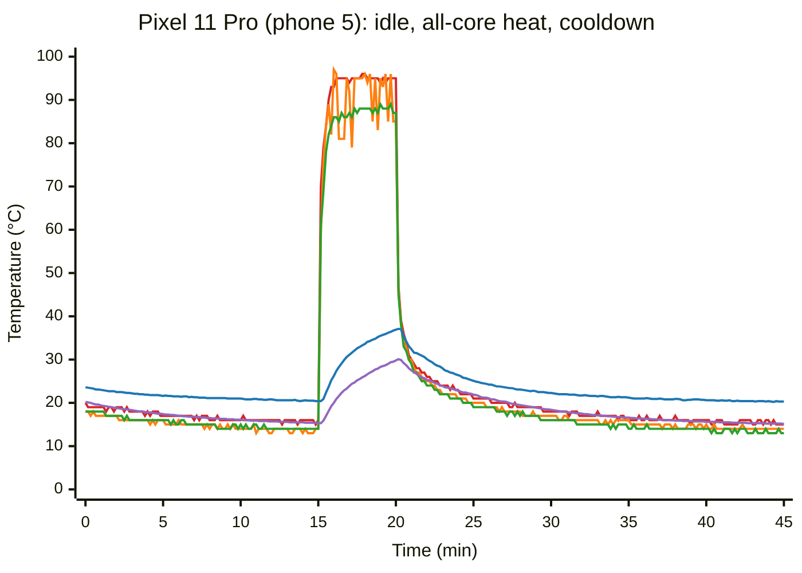
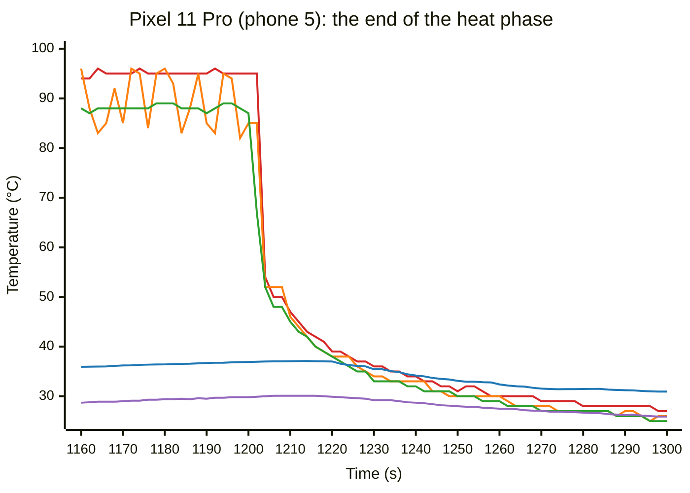

# Pixel 11 Pro Thermal Behavior

The `pipette` CLI's Android readiness gate holds a rep (one timed run of a
cell) until the hottest CPU zone is below `THERMAL_THRESHOLD_C` (34 °C) in
`crates/pipette-readiness/src/android.rs`, along with its thermal-status and CPU
criteria
([System Readiness Control](end-to-end-latency.md#system-readiness-control)).
That value comes from Galaxy S25-class handsets, which rest at about 32 °C in
the fleet. A host can replace it with `[readiness.android] hottest_below_c`, and
it can add a skin criterion with `[readiness.android] skin_below_c`
([Tuning the readiness gate](../pipette-cli/usage.md#tuning-the-readiness-gate)).

This article records two studies of the Pixel 11 Pro:

- **The first study (2026-10-19)** measured the 34 °C die criterion on the
  cooled fleet handsets with the fleet's short cells (1B and 4B models,
  `end_to_end_latency_256_256`).
- **The second study (2026-10-20 to 2026-10-26)** used one handset and longer
  cells, which heat the phone for minutes. It compared coolers, cooler modes,
  thread layouts and the skin criterion.

The article records findings, not requirements. Each result comes from one
handset in one room, and most cells ran 5 or 20 reps. See
[Open questions](#open-questions) before you use a number as a fleet default.
See [Measurement rig](#measurement-rig) before you quote a temperature.

For the same studies on other phones, see
[iPhone 18 Pro thermal behavior](iphone-18-pro-thermal-behavior.md) and
[Galaxy S26 Ultra thermal behavior](galaxy-s26-ultra-thermal-behavior.md).

## Key findings

**On short cells, the 34 °C die criterion is correct for this phone, and a lower
threshold gives no benefit.** On a quiet handset, the rep time does not change
with the start temperature. Two models and five thresholds from 22 °C to 34 °C
all gave a coefficient of variation (CV) of about 1–1.5 %. A lower threshold
only adds wait time.

**The gate cannot stick on this phone.** The cooled handsets rest at 9–19 °C,
far below 34 °C. The failure seen on the S25-class phones, a gate that stops at
the resting temperature and never releases, cannot occur here, even in a warmer
room.

**The die heats and cools in seconds.** After a rep, the die falls from about
50 °C to about 35 °C in 3 s. After that, it follows the battery temperature
(about 2–3 °C above it), which falls slowly over tens of minutes.

**On long cells, the skin temperature starts the throttling, not the die.** At a
skin of about 37 °C, Android caps the CPU clocks. At a skin of about 35.5 °C and
above, the memory controller runs at a lower frequency, and the CPU clocks stay
at the maximum. The OS thermal status stays at 0 in both cases. With a strong
back cooler and a skin criterion, no rep throttled on any cell we ran.

**The die criterion does not see the memory clamp.** In a batch of back-to-back
reps with no thermal gate, 9 of 20 reps ran about 15 % slower, and only 3 of
them had a CPU frequency cap. A Perfetto trace of later runs with the same kind
of slow reps shows that the memory controller frequency fell in them
([Memory clamp](#memory-clamp)).

**With 3 threads on the mid cores, the 34 °C criteria gave the lowest
variability.** Over 20 back-to-back reps each, the 34 °C die criterion gave a CV
of 0.63 % on `end_to_end_latency_1024_256`. A skin criterion of 34 °C with the
34 °C die criterion gave 0.39 % on `end_to_end_latency_2048_256`. A skin
criterion of 36 °C let the memory clamp in. A skin criterion of 32 °C gave the
same CV as 34 °C, with 30 % fewer results per hour.

**Thread placement causes more variability than the cooler.** Unpinned threads
run on the small cores some of the time. Three threads pinned to the mid cores
were steadier than four unpinned threads, and they gave more results per hour
([Threads](#threads)).

**The cooler changes the wait, not the rep time.** Every cooler setup without
phantom touches gave the same rep time. A stronger cooler shortened the gate
wait. The three modes of one cooler gave the same rep time, and the strongest
mode gave about 5 % more results per hour.

**A cooler on the screen can cause phantom touches in two ways.** Water from
condensation registers as a touch: the fleet's front cooler of October 2026 did
this on 3 of 10 handsets. A soft pad pressed on the glass also registers as a held touch,
without any water. A held touch costs CPU time on every rep, and the gate's CPU
criterion does not see that cost. Clients built on 2026-10-26 or later hold a
rep in the Android CLI gate while it detects a held touch. The clients in these
studies did not have that criterion. See [Phantom touches](#phantom-touches).

## Measurement rig

The fleet's current cooling is one Black Shark Live Streaming Cooler on the
back of each phone ([Active cooling](device-conditions.md#active-cooling)).
This section lists the setups that this study measured.

**First study (2026-10-19):**

- **Handsets:** ten Pixel 11 Pro (device `grizzly`, Tensor G6, Android 17,
  build 16238327), phone 1 to phone 10. The rep data comes from phone 7, which
  had no phantom touches.
- **Cooling:** each handset has the same active cooler. The cooler plate presses
  against the screen. The plate is not flat, so small air gaps stay between the
  plate and the glass.
- **Client:** a `pipette` build of 2026-10-07, run by hand over `adb shell` with
  the benchmark workers stopped.
- **Cell:** llama.cpp b10216 (`android-arm64-v8a`), `end_to_end_latency_256_256`,
  4 threads, `ctx_size` 512, flash attention off, no mmap, no GPU layers. These
  are the fleet's flags for this phone.

**Second study (2026-10-20 to 2026-10-26):**

- **Handset:** phone 8, on a desk, over wireless adb, with its benchmark worker
  stopped.
- **CPU layout:** 2 small cores (cpu0–1, 2.65 GHz), 4 mid cores (cpu2–5,
  3.38 GHz) and 1 big core (cpu6, 4.11 GHz).
- **Coolers:** all on the back of the phone, below the camera bar, except where
  a row says "front". The camera bar keeps a back cooler away from the area
  over the CPU.
  - Neveika rev1: the 4 W Neveika 001 that
    [Device conditions](device-conditions.md#active-cooling) names.
  - A 25–50 W cooler with four power modes (30, 40, 50 and 25 W), called "the
    50 W cooler" here.
  - A Black Shark cooler with a fan, a soft rubber pad and three modes:
    overcool, quiet and AI (a thermostat mode).
- **Clients:** a `pipette` build of 2026-10-07, and a build of
  2026-10-25 for the skin criterion.
- **Runtime:** llama.cpp b10216 (`android-arm64-v8a`), CPU only, flash attention
  off, no mmap.
- **Models (Q4_K_M):** MiniCPM5-1B, Qwen3.5-4B, and Olmo-3-7B-Think
  (`unsloth/Olmo-3-7B-Think-GGUF`, revision `1dcda0d5`).
- **Cells:** `end_to_end_latency_256_256` (`ctx_size` 512),
  `end_to_end_latency_1024_256` (`ctx_size` 2048) and
  `end_to_end_latency_2048_256` (`ctx_size` 3072).

**Both studies:** an office at about 23 °C (74 °F), with the humidity not
measured; AC power; wireless adb; the screen held on by `svc power stayon true`.

The studies used scripts that are not checked in to this repository or the
device lab's configuration. In the second study, the scripts logged the CPU frequency
ceiling (`scaling_max_freq`) once a second, the temperatures and cooling-device
states of the thermal Hardware Abstraction Layer (HAL) (`dumpsys
thermalservice`) every 5 s, and a Perfetto power
trace. A "capped" sample is one where `scaling_max_freq` was below the hardware
maximum of the mid or big cluster.

## Temperature and throttling signals

**The die.** The gate reads `/sys/class/thermal` first. On the Pixel 11 Pro,
SELinux refuses that read for the adb shell user as well as for apps. The gate
then uses the fallback: the hottest `mType=0` value in the
`Current temperatures from HAL:` block of `dumpsys thermalservice`. On this
phone, that block has three CPU sensors: `BIG`, `MID` and `MIDLL`. `MID` is
usually the hottest. The gate truncates the value to an integer and releases
when it is strictly below the threshold.

The `Cached temperatures:` block in the same output holds old values (for
example, `BIG` at 64 °C on an idle handset). The gate ignores that block.

The HAL reports no TPU sensor on this phone. It reports `GPU`, `soc_therm`, the
skin and battery sensors, and several board thermistors. A TPU workload heats a
block that the gate does not read directly. This article does not cover TPU or
GPU workloads.

**The skin.** The skin criterion reads the hottest live `mType=3` value, which is
`VIRTUAL-SKIN` on this phone. On a bare handset, the first CPU frequency cap of
every rep came when `VIRTUAL-SKIN` was between 37.1 and 38.1 °C. The die
readings at that time varied widely. Before a cap, the HAL marked `VIRTUAL-SKIN`
with status 1, while the CPU sensors had status 0. `VIRTUAL-SKIN` does not read
below 20.0 °C: it read 20.000006 °C for hours on an idle, cold handset.

**The CPU frequency ceiling.**
`/sys/devices/system/cpu/cpufreq/policy*/scaling_max_freq` is readable to the
adb shell user. A value below `cpuinfo_max_freq` is a cap.

**The memory and interconnect frequency.** `/sys/class/devfreq/*` is not
readable to the adb shell user.
`dumpsys android.hardware.power.stats.IPowerStats/default` fails with
`FAILED_TRANSACTION`. `dumpsys powerstats` lists the power entities, but it does
not give live values. A Perfetto trace started from the adb shell gives the live
values:

```text
buffers { size_kb: 32768 fill_policy: RING_BUFFER }
write_into_file: true
file_write_period_ms: 10000
data_sources { config { name: "android.power" android_power_config {
  battery_poll_ms: 2000 collect_power_rails: true
  collect_entity_state_residency: true } } }
duration_ms: 21600000
```

Pass the config on stdin (`perfetto --background --txt -c - -o
/data/misc/perfetto-traces/<name>.pftrace`). Perfetto cannot read a config file
from `/data/local/tmp`. The trace then holds:

- the time at each frequency for `GMC0-DVFS` (the memory controller, 421 MHz to
  4.8 GHz), `MEMSS-DVFS`, `FABHBW-DVFS`, the other fabrics and the CPU clusters
- the energy of 32 power rails, including the two DDR rails (`S4S_VDD2H_MEM`,
  `S5S_VDDQ_MEM`) and the memory controller rail (`S8S_VDD_GMC`)

The average `GMC0-DVFS` frequency over a rep comes from the change in time at
each frequency. The CPU cells in this article kept `FABHBW-DVFS` at its lowest
frequency (178 MHz), so it is not a useful signal for these cells.

**Cooling devices.** Of the cooling devices in `dumpsys thermalservice`, only
`chg_mdis` (charging-current mitigation) changed during the gate tests, through
levels 0–5. It did not follow the memory clamp.

## Resting temperature and cooldown

This section is from the first study. The cooler test sampled the gate's reading
every 2 s through three phases:

1. 900 s idle (`base`).
2. 300 s with one busy loop on each core (`heat`).
3. 1500 s idle (`cool`).

All ten handsets ran at the same time. Seven lost their ssh connection 2.5 min
into the heat phase, so only phones 1, 5 and 8 have a full cooldown.

**The sensors through one cycle.** The charts show phone 5, which had no phantom
touches. Each point is one raw sample, not an average: one sample every 10 s in
the first chart, and every sample (about every 2 s) in the second. Where the HAL
gave no value for a sensor, the chart repeats the sensor's previous value. `MID`
is the gate's reading. The line colors are: `MID` red, `BIG` orange, `MIDLL`
green, `VIRTUAL-SKIN` blue and `battery` purple. The heat phase runs from 900 s
to 1200 s (minutes 15–20).



The end of the heat phase, from 40 s before the load stops to 100 s after it:



- **The CPU sensors follow the load within seconds.** In the first 2 s of the
  heat, `MID` went from 16 to 58 °C, and it reached 85 °C after about 25 s. In
  the 20 s after the load stopped, it fell from 95 to 39 °C. `BIG` jumps by up
  to 19 °C between readings while the load runs.
- **The skin and the battery respond at the same times, but more slowly.** They
  rise through the whole heat phase. After the load stops, they rise for about
  10 more seconds: the skin to a peak of 37.1 °C and the battery to 30.1 °C.
  Then they fall together with the CPU sensors: the skin by about 2 °C in the
  next 20 s, and by 4.5 °C in the first minute after the load stopped.
- **After about 10 min, every sensor falls slowly.** The skin stays 5–7 °C above
  the CPU sensors, and all of them fall by less than 1 °C in each of the last
  10 min.

**Resting temperature.** The table gives one value for each handset: the gate's
reading, averaged over the last 120 s of the idle phase.

| Phone | 1 | 2 | 3 | 4 | 5 | 6 | 7 | 8 | 9 | 10 |
|---|---|---|---|---|---|---|---|---|---|---|
| Gate °C | 19 | 18 | 14 | 16 | 16 | 14 | 9 | 18 | 15 | 15 |

These values are upper bounds. Earlier the same day, a 30 min heat load ran by
accident, and at the end of the idle phase the readings still fell by about
2 °C every 10 min. After a long idle, phone 7 read 8–12 °C. The 10 °C spread
between handsets with the same cooler is probably a difference in cooler
contact.

**Cooldown.** The heat phase took the gate reading to 97 °C. In the first
minute of the cool phase, the die fell to about 38 °C. After that, the gate
reading stayed about 2–3 °C above the battery temperature, and it fell by
about 1 °C every 10 min after 25 min. Time until the gate released, by how far
the threshold was above each handset's resting temperature:

| Threshold above rest | +1 °C | +2 °C | +3 °C | +5 °C |
|---|---|---|---|---|
| Wait after the heat | 15–19 min | 11–12 min | 8–10 min | 5–7 min |

This heat load is much larger than a benchmark rep. It shows how slow the last
few degrees are, which is why a threshold close to the resting temperature
costs a long wait.

## Die threshold tests

This section is from the first study. Each threshold ran in two cells of 5 reps,
in a symmetric order (for example, 34 → 28 → 25 → 22 → 22 → 25 → 28 → 34), so
slow drift in room or battery temperature does not favor one threshold.
`--readiness-max-wait-secs 900` raised the deadline from 5 to 15 min, which no
wait reached. All data is from phone 7.

**MiniCPM5-1B (Q4_K_M).** The die reached about 42 °C after each rep.

| Threshold | Reps | Mean | CV | Gate at rep start | Total wait for 10 reps |
|---|---|---|---|---|---|
| 34 °C | 10 | 68.4 s | 1.48 % | 30–32 °C | 41 s |
| 28 °C | 10 | 68.1 s | 1.56 % | 24–27 °C | 125 s |
| 25 °C | 10 | 68.0 s | 1.24 % | 24 °C | 248 s |
| 22 °C | 10 | 68.3 s | 1.39 % | 21 °C | 455 s |

Across all 40 reps, the rep time changes by 4 ms per °C of start temperature
(r = 0.02).

**Qwen3.5-4B (`unsloth/Qwen3.5-4B-GGUF`, Q4_K_M).** The die reached 46–52 °C
after each rep.

| Threshold | Reps | Mean | CV | Gate at rep start | Total wait for 10 reps |
|---|---|---|---|---|---|
| 34 °C | 10 | 87.5 s | 0.96 % | 29–33 °C | 71 s |
| 30 °C | 10 | 87.4 s | 1.30 % | 29 °C | 167 s |

The difference between the means is 0.03 s (Welch t = 0.07). Across all 20
reps, the rep time changes by −43 ms per °C (r = −0.07).

At 34 °C the start temperature rises by 2–3 °C over the 5 reps of a cell, as
the body of the phone gets warmer. This rise has no measurable effect on the
rep time of these short cells.

## Coolers

This section and the ones after it are from the second study. MiniCPM5-1B on
`end_to_end_latency_256_256`, 4 unpinned threads, the 34 °C die criterion,
20 reps per row:

| Date | Cooler | Mean | CV | Gate wait, cells 2–4 (median) | Results per hour |
|---|---|---|---|---|---|
| 10-20 | none | 68.2 s | 1.08 % | 142 s | 15.9 |
| 10-20 | Neveika rev1, back | 68.1 s | 1.05 % | 58 s | 26.4 |
| 10-20 | 50 W cooler on the front, 0.5 mm silicone pad | 77.5 s | 5.76 % | 7 s | 35.7 |
| 10-20 | Black Shark, back, overcool | 66.5 s | 1.82 % | 19 s | 36.4 |
| 10-20 | Black Shark, back, AI | 66.6 s | 2.09 % | 25 s | 34.7 |
| 10-21 | 50 W cooler, back, 30 W mode | 68.5 s | 1.27 % | 22 s | 34.6 |
| 10-21 | 50 W cooler, back, 40 W mode | 68.3 s | 1.10 % | 19 s | 35.3 |
| 10-21 | 50 W cooler, back, 50 W mode | 68.4 s | 0.98 % | 16 s | 37.2 |
| 10-21 | Black Shark, back, overcool | 68.6 s | 0.93 % | 22 s | 34.5 |

- **The rep time does not depend on the cooler** for the setups without phantom
  touches. The cooler sets how long the gate waits.
- **The day changes the rep time more than the cooler does.** The Black Shark in
  overcool mode gave 66.5 s on 10-20 and 68.6 s on 10-21 (+3.1 %, Welch
  t = 6.8). Compare coolers only against a reference run from the same day.
- **The front cooler with a pad registered as a held touch.** Its reps were
  13.9 % slower than with the Neveika on the back
  (see [Phantom touches](#phantom-touches)).

## Phantom touches

In the first study, three of the ten handsets (phones 1, 8 and 10) reported a
continuous touch with nothing on the screen. A 5 s read of the touchscreen
device (`synaptics_tcm_touch`) gave 269, 3,531 and 2,304 events. The other seven
handsets gave 0. The touch contact was very large (`ABS_MT_TOUCH_MAJOR` near
12,000 of a maximum of 28,559), and on phone 8 it changed size quickly. These
signs agree with water on the glass, not with a finger or a pad.

The cause is condensation. The cooler holds the glass below the dew point of
the room. Humid air in the gap between the plate and the screen then deposits
water on the glass. At the same time, the nine reachable S26 Ultra handsets of
the fleet showed 0 touch events.

In the second study, a soft pad on the glass registered as a touch without any
water:

| Front cooler | Touch events in 5 s | `TOUCH_MAJOR` | Probable cause |
|---|---|---|---|
| The fleet's October 2026 front cooler, bare (phones 1, 8, 10) | 269–3,531 | near 12,000, changes quickly | condensation |
| 50 W cooler with a 0.5 mm Arctic TP-4 silicone pad | 90–146 (interrupt at about 240/s) | about 7,500, changes slowly | the pad and plate |
| Black Shark (rubber pad) | 131–2,360 (interrupt at 241/s) | about 7,060, changes slowly | the pad |
| The silicone pad alone, no plate | 0 | — | — |

The Black Shark's pad does not register on the S26 Ultra
([Galaxy S26 Ultra thermal behavior](galaxy-s26-ultra-thermal-behavior.md#phantom-touches)).
The touch interrupt rate shows the cost better than the event count: a held
contact keeps the controller at its full scan rate, even when few events reach
`getevent`.

The cost is in the touch pipeline, before any app receives the touch. On
phone 1, the touch daemon `twoshay` used 19 % of one CPU and the touch interrupt
used 9.4 %. With the pad and plate, each used about 10 %. A constant touch also
counts as user activity. Phone 1 ran the same cell about 20 % slower than
phone 7, and its CV was 9.7–13.7 % at every threshold from 22 °C to 34 °C. Its
rep time changed by up to 20 s between reps that started at the same
temperature. The CPU criterion of the readiness gate does not detect this
condition: the CPU load stays below its 30 % limit.

**The held-touch criterion.** In clients built on 2026-10-26 or later, the
Android CLI gate also holds a rep while it detects a held touch; the mechanism is in
[End-to-end latency → Android](end-to-end-latency.md#android). On this phone the
gate counts the `synaptics_tcm` line in `/proc/interrupts`. Both pad setups in
the second study kept the touch interrupt at about 240 per second, far above the
gate's trigger of 20 per second. The interrupt rate of the condensation touches
in the first study was not measured. The clients in these studies did not have
this criterion, so it held no rep here.

The gate's poll line shows the result: `touch=irq:<rate>/s(ok)` below the
trigger, and `touch=irq:<rate>/s,pointers:<n>(held)` for a held touch. To check
a handset by hand, count touch events over 5 s with nothing on the screen:

```sh
adb -s <target> shell 'timeout 5 getevent -t /dev/input/event2 | wc -l'
```

In these studies a clean handset gave 0. Find the device number with
`getevent -pl`. The name is `synaptics_tcm_touch`. On 2026-10-14, idle Pixel 11
Pros streamed 100–460 touch-size events in 2 s for a slot that never became a
touch. The 5 s count of 0 on clean handsets in these studies disagrees with
that. On this phone, confirm a nonzero count with a held pointer in
`dumpsys input` before you trust or discard a handset.

Kiosk mode and screen pinning do not stop this cost, because the controller and
the touch daemon still process every touch. Android has no shell command that
turns off one input device without root. A screen-off policy stops the
controller, but it lets the CPU enter idle states, which is worse for timing.
On this phone, the second study found no front cooler without a touch problem:
a bare plate allows condensation, and a soft pad registers as a touch. A cooler
on the back only does not touch the screen.

## Throttling without a gate

With no cooler, the 34 °C die criterion held each rep until the body had shed
most of its heat. Without the gate, the heat built up:

| Cell, no cooler | Gate | Mean | Range | Time under a cap |
|---|---|---|---|---|
| Qwen3.5-4B, 256/256, 4 threads | die 34 °C | 86.7 s | 82.5–88.6 s | 0 % |
| Qwen3.5-4B, 256/256, 4 threads | none | 155 s | 130–187 s | most of each rep |
| Olmo-3-7B, 256/256, 4 threads | die 34 °C | 97.0 s | 94.3–98.5 s | the last 4–9 s of 3 reps |
| Olmo-3-7B, 1024/256, 4 threads | die 34 °C | 179.8–184.8 s | 151.7–212.0 s | 55–68 % (first cap after 40–76 s) |

On the bare phone, a rep that starts at the gate runs for about 60–90 s at full
clocks before the first cap.

## Memory clamp

With the Black Shark on the back (overcool), 3 threads on the mid cores, and no
thermal gate, 20 back-to-back reps of Olmo-3-7B on 1024/256 gave a mean of
103.1 s and a CV of 8.2 %. The skin leveled off at 35.5–37.2 °C. Reps 8, 13 and
18 started at a skin of 36.8–36.9 °C and had a CPU cap for 12–25 s. The two reps
after each of them took about 110 s with the mid cores at 3.34–3.37 GHz. The
first reps of each new cell were fast again, after the pause for the model load.

A later run with a Perfetto trace measured the memory controller in the same
kind of reps. With a skin criterion of 36 °C (AI mode, 1024/256, 3 threads, die
criterion at 99 °C so that it never held a rep), 8 of 20 reps took
107.8–112.6 s with no CPU cap. Across the four runs of the
[1024/256 gate tests](#gate-criteria):

| Peak skin during a rep | Reps | Mean `GMC0-DVFS` | Mean rep time |
|---|---|---|---|
| 31–35 °C | 56 | 2,528–2,543 MHz | 92.9–93.3 s |
| 35–36 °C | 13 | 2,418 MHz | 103.8 s |
| 36–37 °C | 6 | 2,492 MHz | 95.8 s |

In the 36 °C run, the rep time and the average `GMC0-DVFS` frequency had a
correlation of r = −0.99. After a peak near 37 °C, the clamp stayed on while the
skin was above about 35.3 °C.

## Threads

Olmo-3-7B on 1024/256, the 34 °C die criterion, 5 reps per row. No rep had a CPU
cap.

| Threads and cores | 50 W cooler: mean | 50 W cooler: CV | Black Shark (overcool): mean | Black Shark: CV |
|---|---|---|---|---|
| 4, unpinned | 123.5 s | 1.35 % | 119.1 s | 0.53 % |
| 4 on cpu2–5 (all mid cores) | 85.0 s | 8.58 % | 93.7 s | 6.12 % |
| 5 on cpu2–6 (mid and big) | 132.9 s | 4.87 % | 119.2 s | 2.95 % |
| 3 on cpu2–4 (3 mid cores) | 92.4 s | 0.12 % | 92.4 s | 0.52 % |

- **Unpinned threads are slower on this cell.** llama.cpp waits for its slowest
  thread at each step, and an unpinned thread sometimes runs on a small core.
  On the bare phone, unpinned reps of the same cell fell into two groups, about
  169–175 s and about 201–204 s.
- **A layout that uses every mid core is noisy.** With 4 threads on 4 mid cores,
  or 5 threads with the big core, no fast core stays free for the gate's polls
  and for Android, so they take time from a compute thread.
- **On `end_to_end_latency_2048_256`, unpinned threads were only 3 % slower**
  (164.0 s against 158.9 s, skin 34 °C + die 34 °C, 20 reps each). Each unpinned
  rep raised the skin by about 3.5 °C, against about 1.5–2 °C with 3 pinned
  threads.

**How the threads were pinned.** The runtime's `--cpu-mask` and `--cpu-strict`
arguments reached llama-server through the `raw` runtime flag, but the threads
still ran on cpu0–6. Starting the client under `taskset 1c` (cpu2–4) pinned
llama-server and all its threads, because a child process inherits the CPU
affinity.

## Gate criteria

The skin criterion (`[readiness.android] skin_below_c`,
`--readiness-skin-below-c`) holds a rep until the hottest live HAL skin sensor
is below the threshold
([The readiness gate](../pipette-cli/usage.md#5b-the-readiness-gate)). Every run
in this section used the Black Shark in AI mode, Olmo-3-7B, and 20
back-to-back reps in 4 cells of 5. "Die 99 °C" means that the die criterion did
not hold any rep.

**`end_to_end_latency_1024_256`, 3 threads on cpu2–4:**

| Gate | Mean | CV | Range | Median wait | Skin at rep start (peak) | `GMC0-DVFS` per rep | Results per hour |
|---|---|---|---|---|---|---|---|
| die 34 °C | 92.7 s | 0.63 % | 91.9–94.1 s | 57 s | 22.6–31.7 °C (32.5) | 2,507–2,550 MHz | 21.5 |
| skin 36 °C, die 99 °C | 100.9 s | 7.97 % | 92.7–112.6 s | 1 s | 32.2–36.1 °C (36.9) | 2,301–2,549 MHz | 26.3 |
| skin 34 °C, die 99 °C | 93.2 s | 1.35 % | 92.4–97.9 s | 37 s | 33.8–34.3 °C (34.8) | 2,446–2,558 MHz | 23.4 |
| skin 32 °C, die 99 °C | 93.3 s | 1.30 % | 92.1–96.1 s | 51 s | 31.8–32.2 °C (34.2) | 2,483–2,567 MHz | 21.3 |

**`end_to_end_latency_2048_256`:**

| Threads | Gate | Mean | CV | Range | Median wait | Peak skin | CPU-capped reps | Results per hour |
|---|---|---|---|---|---|---|---|---|
| 3 on cpu2–4 | skin 34 °C + die 34 °C | 158.9 s | 0.39 % | 158.1–160.7 s | 70 s | 34.3 °C | 0 | 18.7 |
| 3 on cpu2–4 | skin 32 °C + die 34 °C | 158.8 s | 0.29 % | 158.1–159.8 s | 76 s | 34.0 °C | 0 | 13.0 |
| 4, unpinned | skin 34 °C + die 34 °C | 164.0 s | 1.05 % | 161.0–166.5 s | 103 s | 36.9 °C | 0 | 11.6 |

- **With 3 pinned threads, the die criterion held every rep that the skin
  criterion would have held.** Of the polls that held a rep in the first
  2048/256 run, the die criterion alone held 362, both criteria held 62, and the
  skin criterion alone held none. With 4 unpinned threads, both criteria held
  609 polls.
- **The die criterion does not bound the skin in all setups.** With the same
  34 °C die criterion and no cooler, the skin rose from 23.5 to 28.4 °C over
  5 reps. With 4 unpinned threads and the Black Shark, a rep that started at a
  skin of 33 °C peaked at up to 37.1 °C, and one rep had a 4 s CPU cap.

## Cooler modes

The Black Shark in each mode, 4 unpinned threads, skin 34 °C + die 34 °C,
Olmo-3-7B on 2048/256, 20 reps per row. The two AI rows are 9 hours apart, on
2026-10-25 and 2026-10-26.

| Mode | Mean | CV | Median wait | Peak skin | Mean battery during the run | CPU-capped reps | Results per hour |
|---|---|---|---|---|---|---|---|
| AI (afternoon) | 164.0 s | 1.05 % | 103 s | 36.9 °C | 29.2 °C | 0 | 11.6 |
| quiet | 164.4 s | 1.57 % | 102 s | 36.9 °C | 29.3 °C | 0 | 11.9 |
| overcool | 164.7 s | 1.60 % | 93 s | 36.1 °C | 28.1 °C | 0 | 12.2 |
| AI (night) | 164.7 s | 1.28 % | 109 s | 37.1 °C | — | 1 (4 s) | 11.6 |

- **The mode does not change the rep time.** Against both AI runs together, quiet
  differs by +0.03 s (t = 0.05) and overcool by +0.31 s (t = 0.46). The two AI
  runs differ by +0.71 s (t = 1.16).
- **Overcool gives about 10 % shorter waits and about 5 % more results per
  hour.** Under load it keeps the battery about 1 °C cooler than the other modes.
  At idle it holds the battery near 9 °C.
- **Overcool and AI mode both made the phone wet at idle.** After hours idle on
  the cooler, the battery read 9.4 °C, and water formed on the back. The touch
  check at each cell start found no water on the screen.

## Open questions

- **One handset per study.** The first study's rep data comes from phone 7, and
  the second study's from phone 8. Repeat the leading setups on other handsets
  before you set a fleet default.
- **Skin 33 °C with unpinned threads.** With 4 unpinned threads, a skin
  criterion of 34 °C let one rep peak at 37.1 °C. A lower skin threshold for
  that layout was not tested.
- **Other cells and models.** The longest cell here was 2048/256 with a 7B model.
  A cell that uses all 7 cores was not tested. Qwen3.5-27B IQ1_M (6.8 GB) did
  not fit with enough free memory, and its run failed on a readiness probe error
  (PIP-792).
- **TPU and GPU workloads.** These were not tested, and the HAL has no TPU
  sensor for the gate to read.
- **A memory-clamp check on each rep.** A rep with a memory clamp has full CPU
  clocks and a normal skin reading at its start. Only the Perfetto trace shows
  it.
- **Colder rooms.** All runs were in an office at about 23 °C. In a room at
  about 18 °C (65 °F), the coolers would hold the glass about 5 °C colder, so
  condensation can still occur if the dew point there is above about 3 °C. A
  colder room also changes the resting skin temperature. Repeat the cooler and
  gate tests in such a room.
- **The 2026-10-02 data.** On 2026-10-02, with a 2026.08 client, phone 7 ran
  the MiniCPM5-1B cell in 144 s. On 2026-10-19 it ran in 68 s. We do not know
  when the cooler went on, so the cause of this difference is not known.
