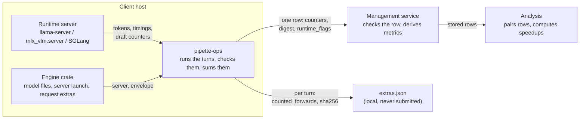
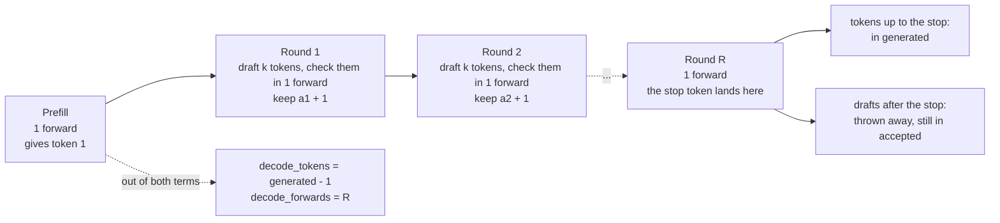
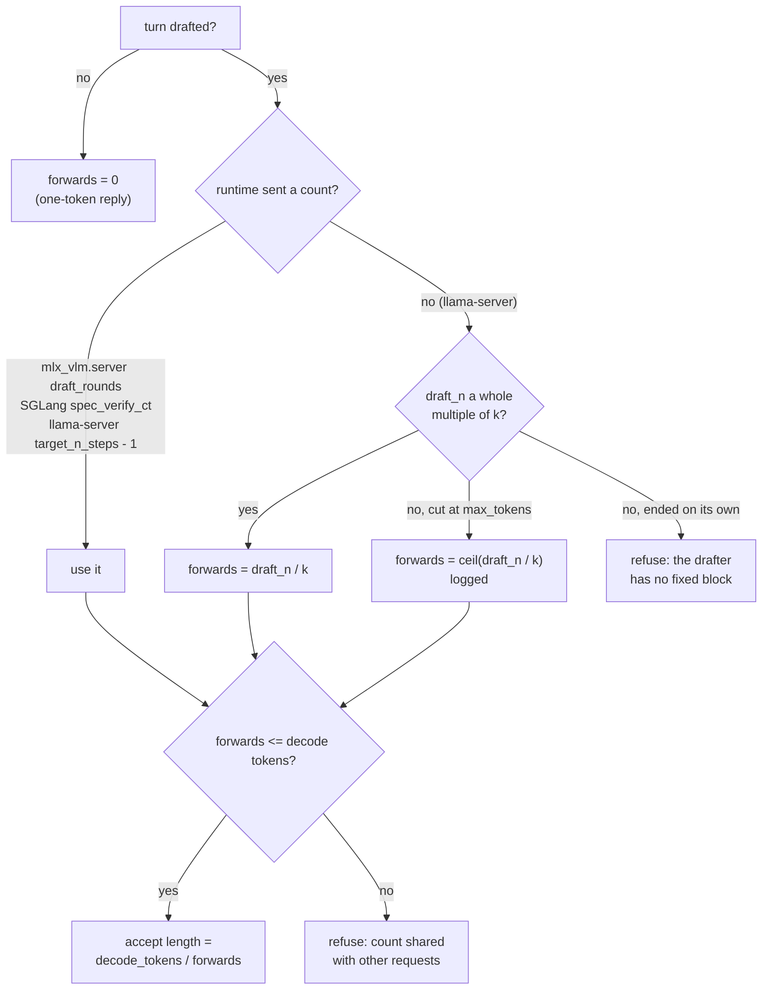
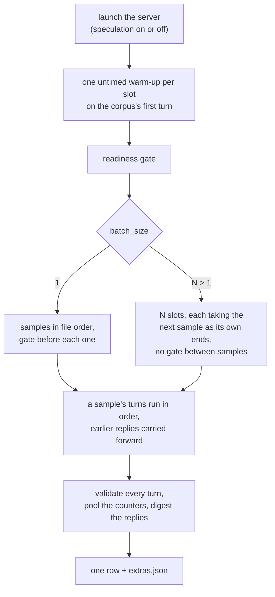

# Vision-Language Speculative Decoding Methodology

What a client counts and how it runs a `vl_spec_decode` traversal. Three
pipette-mgmt documents hold the rest:

- The wire contract, the derived metrics and their validation:
  [docs/benchmarks.md §2.8](https://github.com/Liquid4All/pipette-mgmt/blob/main/docs/benchmarks.md#28-vl-speculative-decoding).
- Pairing two rows, the speedups and the sanity checks:
  [docs/methodology/vl-spec-decode.md](https://github.com/Liquid4All/pipette-mgmt/blob/main/docs/methodology/vl-spec-decode.md).
- Why the benchmark has this shape (one row per run, counters on the wire):
  [docs/design/vl-spec-decode.md](https://github.com/Liquid4All/pipette-mgmt/blob/main/docs/design/vl-spec-decode.md).

## Measured Quantity

`vl_spec_decode` is the DSpark speculative decoding benchmark. In speculative
decoding, a small drafter proposes tokens and the target model checks them in
one forward pass. DSpark is a block drafter: each step, it proposes a whole
block of tokens. The benchmark runs one vision-language (VL) model over MMSpec,
a real image-plus-text corpus, and produces one row. The gain from a drafter is
measured by running the model twice against the **same corpus**:

- once with speculation **off**: a regular model, or the spec-decoding model
  itself with `speculative_enabled = false` (the baseline of the reference
  harness, the DSpark VL reproduction procedure that pipette-mgmt
  [docs/design/vl-spec-decode.md](https://github.com/Liquid4All/pipette-mgmt/blob/main/docs/design/vl-spec-decode.md) describes);
- once with a **spec-decoding model**, speculation on.

Both runs use the same benchmark id, so their rows share the corpus and the
draft length by construction. No client ever holds both rows: the comparison
is computed from the stored rows, outside the service.

Whether a run's drafter is on is its `speculative_enabled` runtime flag,
resolved by `resolve_speculation` in `pipette-plan-types`:

| Model | `speculative_enabled` unset | `false` | `true` |
|---|---|---|---|
| `gguf_vision` / `mlx` / `torch` (no drafter) | off | off | refused |
| `gguf_vision_speculative` | on | off: the same weights, no speculation flags; a merged drafter stays in the file, unused | on |
| `mlx_speculative` | on | off: the target alone, the drafter bundle never loaded | on |
| `torch_speculative` | on | off: the target alone, no `--speculative-*` flags | on |

Unset follows the model, so the common plans need no flag. `false` on a
merged gguf keeps the drafter's weights resident. Every engine writes the
resolved value into the row's `runtime_flags`, so the analysis never infers
the condition from the model.

The row reports **counters, not rates**; the service derives every metric
from them. Who counts what:



## Division of labor

1. **The client counts, and refuses rather than repairs.** Only this side has
   the corpus, the turn loop and the output stream, so only this side can
   count. When a turn does not add up, it fails; it is never clamped or
   defaulted into something plottable.
2. **The wire is a basis.** Nothing on it can be obtained by arithmetic over the
   rest, and nothing the service needs is missing. A field two clients could
   each derive is a field they could derive *differently*, with nothing in the
   row to say which one did.
3. **The service divides and validates; it never decides.** A formula that
   would need a branch is a bug report against the client.

Every row carries the traversal's sums (`vl_spec_decode_turns`,
`_prompt_ms`, `_predicted_ms`, `_generated_tokens`, `_ttft_ms`, `_decode_ms`,
`_e2e_ms`, and with speculation on `_drafted_tokens`, `_accepted_tokens` and
`_turn_accept_length_sum`) and two observations (`observation_dataset_digest`,
`observation_output_digest`). Their definitions and validation are in
pipette-mgmt [docs/benchmarks.md §2.8.4](https://github.com/Liquid4All/pipette-mgmt/blob/main/docs/benchmarks.md#284-submission-fields).
The client sends the three drafter fields only with speculation on: they are
absent, not zero, on a row with speculation off. The output digest is
described under **Greedy identity**.

No model output leaves the device. The per-turn record that the output digest
summarizes stays in the run's local `extras.json` beside the payload: per turn
the sample id, its index, the reply's sha256 (never the reply), the four
counters, whether the turn ended on its own end-of-sequence, and the five
timings. It is what a per-sample analysis (drift along the traversal, which
turn diverged) reads back, and it is never submitted.

The forward count is **not** on the wire. `turn_accept_length_sum` carries
the reading, and each turn's count is in `extras.json` as `counted_forwards`.

Two fields exist so the reference harness's numbers can be reproduced from the
rows. `prompt_ms` is the runtime's prefill clock: the reference reports TTFT as
`prompt_ms` and end-to-end as `prompt_ms + predicted_ms`, with no client clock
at all. The client-clock `ttft_ms` and `e2e_ms` are what a caller waits
(upload and transport included), and both views are kept. `prompt_ms`
compares within one engine only: llama.cpp and `mlx_vlm` do not time prefill
the same way, and SGLang has no per-request clock (see **On SGLang**). `turn_accept_length_sum` gives the request-mean accept length, the
figure the reference compares against; a mean of per-turn ratios cannot be
recovered from the pooled counters, so it needs its own sum.

## Target forward passes

```text
decode_tokens          = generated_tokens - 1              # every engine
decode_forwards        = the runtime's own count           # per engine, below
turn_accept_length_sum = Σ (decode_tokens / decode_forwards)  # per turn, on the wire
accept_length_pooled   = Σ decode_tokens / Σ decode_forwards  # the run's client_extras
```

One speculative turn. The ratio counts the rounds, not the prefill:



The prefill's forward and its token are out of the ratio. Each round is one
forward. `accepted` still counts the drafts the stop token threw away, so
`generated - accepted` is short on every reply that ends mid-round. A one-word
reply at `k = 7`: 2 tokens, 1 round, 6 accepted.

**The denominator is counted, never derived.** The tempting derivation is
`generated - accepted`, since every verification commits one token that is not
an accepted draft. It fails because the runtimes count accepted drafts
**before the stop token discards the rest of the run**: `mlx_vlm.server`
records a round's accepted count when the target verifies it, then streams
the tokens one by one and drops everything after the end-of-sequence
(`speculative/dflash.py`, `generate/ar.py`); SGLang banks each verified run
before its finish check; stock `llama-server` adds `n_accepted` ahead of the
loop that stops on the same token. On every reply that ends mid-run the
difference is short by the discarded tail, and on a short reply it is zero or
negative.

So the count comes from the runtime, read per engine:

| Engine | Build | Read as |
|---|---|---|
| llama.cpp | the fork the reference pins, which like stock `llama-server` keeps its verification-step count to its log | `draft_n / k`, `k` being `parameter_draft_length` |
| MLX | `mlx-vlm`, a catalog row that ships it (for example `0.7.4`) | `timings.draft_rounds` |
| SGLang | the DSpark fork | `sglext.spec_tokens_details.spec_verify_ct` |

The llama.cpp reading rests on the drafter: a block drafter proposes its whole
block every step, so `draft_n` is `k` per step. Measured against a build of
the same fork patched to send its step count (not the pinned one), under the
release flags, it is exact on every reply that ended on its own.
Near `max_tokens` the server shrinks the draft to the budget left, so a reply
cut there is read as the ceiling and logged: one or two steps short of a few
hundred, on the handful of turns a traversal cuts. It holds for `k` up to the
drafter's block (9 for DSpark); a reply that ended on its own with a partial
block is a drafter that does not propose fixed blocks, and is **refused**. A
`k` above the block does not reach that check: the fork clamps the draft length
to its block and only warns, so the block the drafter announces at load is read
off the launch log and a larger `k` refused there, since every later reading
here would divide by a `k` the server never drafted at. A `llama-server` that
does send a count is read by it instead: `target_n_steps - 1` (every target
sampling step, the prefill's and any that drafted nothing included), else
`draft_n_verif_steps`.

A turn that drafted and has no count by any of these is refused by name, on
the first such turn and without a retry, since a row measured off `generated
- accepted` would sit beside the others on another basis with nothing to mark
it. A count larger than the turn's decode tokens is refused too, since every
forward commits at least one token: that is a count shared with other
requests, which is what `mlx_vlm.server`'s global tally gives at a batch size
above 1. The counters themselves are never adjusted; they go to the wire as
the runtime reported them.

How a turn's forward count is read:



**The prefill is out of both terms.** The first token is sampled from the
prefill's own logits before any draft exists: the drafter continues from the
last committed token, so its first proposal is for the second. Every runtime
counts that first token (`predicted_n` on both runtime servers, SGLang's
`completion_tokens`), so `decode_tokens` is the reported count less one on
every engine. The ratio is then what a verification commits, between 1 and
`k + 1`, and it is the first factor of `decode_speedup`, whose clock
(`predicted_ms`) starts at that first token too. `llama-server` prints the
same quantity as `mean len`. A reply of a single token ran no decode loop: it
adds nothing to either sum and reads zero per request.

Two neighboring definitions differ and are not interchangeable with it.
SGLang's native `spec_accept_length` is `completion_tokens / spec_verify_ct`,
which keeps the prefill's token over a denominator without its forward and so
reads one token per turn higher. The reference harness's `predicted_n / target_n_steps` keeps
both, which is this ratio averaged with one guaranteed step of exactly 1.0.
Over the reference harness's own MLX raw data on the full `test` split, with
`draft_n / 7` as the round count, its published 3.74 pooled / 4.25
request-mean are 3.64 / 3.76 on this definition, 3.58 / 3.54 with the prefill
in both terms and 3.67 / 3.87 in SGLang's form.

**Which column to read.** `accept_length_per_request` is
`turn_accept_length_sum / turns`, computed here per turn, and is exact. The
pooled `accept_length` the service derives from `generated` and `accepted`
keeps the prefill in both terms and, on the three runtimes, reads high by the
discarded drafts, so on a speculative row it is the wrong one to quote. The
exact pooled figure is `accept_length_pooled` in the run's `client_extras`,
and each turn's `counted_forwards` is in `extras.json`. `draft_acceptance_rate`
reads a little high on the three runtimes for the same reason: they count the
thrown-away drafts as accepted. The phone does not (see **On iOS**).

The pooled figure weighs long answers more; the per-request figure counts
every turn once. Expected `accept_length_per_request` for the DSpark drafters,
from the reference's raw data and so hardware-independent (llama.cpp and MLX
recomputed on this definition, SGLang in its own form):

- **llama.cpp**: about 3.9. The reference's `testmini` raw data re-read as
  `draft_n / 9` (it ran `--spec-draft-n-max 10` over the block-9 drafter)
  gives 3.90 per request and 3.92 pooled, where it published 4.31 / 4.03 off
  `generated - accepted`. At `k = 8` expect a little under that.
- **MLX**: about 3.76 at `k = 8` (3.64 pooled), from the full `test` raw data:
  upstream `mlx-vlm`'s `dflash` loop over the separate `LFM2.5-VL-3B-DSpark`
  drafter, with none of the fork's switches.
- **SGLang**: the H100 reference's request-mean is 4.22 on the full `test`
  split at the drafter's native block of 9, in SGLang's form; a row here reads
  about 0.1 below it. Its pooled cycle tau (tokens per verification step,
  pooled over the turns) is 3.95, which the service's
  `accept_length` overstates by a few percent.

A value far from these means the drafter is not wired up, not that the device
is slow. Check it before reading a pair's `decode_speedup` below 1.0, which is
a real result on a memory-bound host only once the accept length is in range.
The rest of the sanity checks are in pipette-mgmt
[docs/methodology/vl-spec-decode.md §3](https://github.com/Liquid4All/pipette-mgmt/blob/main/docs/methodology/vl-spec-decode.md#3-sanity-checks).

## The corpus

The workload is a real corpus this project does not own. The client downloads
it from the management server (`GET /datasets/{benchmark_id}`, pipette-mgmt
[docs/httpapi.md §2.15](https://github.com/Liquid4All/pipette-mgmt/blob/main/docs/httpapi.md#215-get-datasetsbenchmark_id); how the
server gates and repacks it is in
[docs/design/vl-spec-decode-dataset-delivery.md](https://github.com/Liquid4All/pipette-mgmt/blob/main/docs/design/vl-spec-decode-dataset-delivery.md)).
The client:

1. verifies the tar's sha256 against the catalog's `dataset.digest`;
2. unpacks `manifest.json`, `samples.jsonl` and `media/`;
3. traverses `samples.jsonl` **in the file's order**, with no sorting,
   shuffling or parallelism beyond `parameter_batch_size`, because a
   throughput number over a different ordering is a different measurement;
4. deletes the corpus when the job ends.

A digest mismatch is **recorded, not rejected**: the computed digest is
submitted as `observation_dataset_digest` either way and the server stamps the
verdict. A download the server refuses fails the job, so an unavailable corpus
reads as an outage rather than as a zero.

The catalog publishes one benchmark per MMSpec subset and draft length:
`vl_spec_decode_mmspec_test_<subset>_k<k>`, the six subsets at `k` 7, 8 and 9.
Every catalog entry is greedy. The id grammar gives a sampled entry a
`_t<temperature>` suffix. Such an entry pins no cut, so each engine samples
under its own default `top_k`/`top_p`/`min_p`
(llama.cpp's are `40`/`0.95`/`0.05`); the acceptance rate moves with that
distribution, so a sampled row compares only with rows from the same engine.

The `k` variants of one subset differ in `parameter_draft_length` alone. They
exist because the best `k` is a property of the chip (8 is the optimum on an
M4 Max for both llama.cpp and MLX; whether it wins on another is what the
variants are there to measure). Two consequences for a sweep:

- A pair is formed on the whole `benchmark_id`, so every `k` needs its own
  speculation-off row even though that arm never drafts and cannot depend on
  `k`. Three draft lengths is three baselines per subset, measuring the same
  thing three times, unless the analysis pairs across `k` itself.
- `k` is engine-native: at `k = 8` llama.cpp drafts 8 tokens a round and
  `mlx_vlm.server` 7, so a `k` curve compares within one engine and one host,
  never across engines.

`k` is bounded by the drafter's trained block (9 for DSpark). Above it the
runtime clamps and drafts its block instead. On llama.cpp that is refused at
launch (see **Target forward passes**). MLX and SGLang count their own
verification steps, so a clamp would leave their accept length intact, but the
row would still carry the `k` it asked for rather than the one it drafted at:
keep catalog `k` at or below the block on every engine.

## The traversal

Each run gets its own server process on the server-driven engines, and its
own model load on iOS. `speculative_enabled`, resolved against the model, decides
only what is launched: on llama.cpp, with speculation on, the derived draft
length (and a separate drafter, when the model has one) is added to the cell's
own `envs` and `raw`; with it off, nothing is. On MLX, speculation on launches
`mlx_vlm.server` with `--draft-model` and `--draft-block-size`, and off launches
it on the target alone.



In order:

1. **One untimed warm-up per slot** on the corpus's own first turn, so kernel
   selection and the vision tower's first-shape cost are paid on a real sample
   rather than on a lighter stand-in that compiles different shapes. A batched
   run sends one on every slot at once, so no slot's first measured sample is
   its first shape.
2. **The readiness gate.**
3. **Every sample in the file's order**, the gate before each one after the
   first and never between the turns of one. A multi-turn sample is one
   conversation whose later prompts carry the earlier replies; a wait inside it
   would split what the corpus defines as a unit. For an MMSpec `test` subset
   that is 100 gates, so `bench_timeout_seconds` has to allow for them.

**Batched.** `parameter_batch_size = N > 1` runs the same traversal with `N`
samples in flight, one per server slot: a slot takes the next sample in file
order the moment its current one ends, and runs that sample's turns
sequentially. Nothing about a turn changes (the same clocks, the same
counters, summed over the same turns), but what the sums mean does:
`predicted_ms` and the three client timings are what one request saw while
sharing the host with `N − 1` others, so `decode_throughput` is a per-stream
rate and the latency means are latency under load. The host's aggregate output
is derived from those sums and `N` (pipette-mgmt
[Aggregate throughput at a batch size](https://github.com/Liquid4All/pipette-mgmt/blob/main/docs/methodology/vl-spec-decode.md#aggregate-throughput-at-a-batch-size)),
not counted here. A batched run gates **once**, before the traversal, and
never between samples: with every slot busy the host is never idle between
samples, so a per-sample gate would stall the other `N − 1` slots and measure
the stall it caused. Expect the greedy identity check to diverge more often
than at `N = 1`, since a fuller batch is a less bitwise-stable forward pass.
The slot flags (`--parallel` / `-np` on llama-server) are reserved in the
cell's `raw` for the same reason the draft length is.

Each condition is refused the other's measurement. A run with speculation on
that drafted nothing, and a run with it off that drafted anything, both fail the
job by name: the first is what an unwired drafter looks like, the second is a
speculative measurement filed as its own baseline, and either would otherwise
reach the warehouse as a plausible row.

**Two clocks per turn.** The runtime's `timings` object gives `prompt_ms` and
`predicted_ms`: the host's own prefill and generation time, which wall clock
would smear with transport. `predicted_ms` is what tok/s is computed from, and
the pair is the reference harness's only clock. Around each request the
client stamps its own clock at send, first token, last token and end of stream,
and reports TTFT, decode and end-to-end from it. Those are what the latency
metrics report, because a user's wait includes the image upload and the HTTP
round trip the runtime never sees. End-to-end is measured, not `ttft + decode`.

Requests are **streamed** so the first token is seen arriving, sampled at the
entry's `parameter_temperature` (greedy, `0.0`, on an entry that omits it,
which is the reference procedure and the only temperature at which two rows can
be compared for output identity), and carry no prompt cache, so each turn
prefills the conversation it actually carries rather than whatever that
particular process still held. On llama.cpp they go to `/v1/chat/completions`
with `cache_prompt: false`, the only endpoint that runs an image through the
vision tower, plus `top_k = 1` at greedy. That pin is llama.cpp's argmax and
would make a pinned temperature a no-op, so a sampled entry sends the
temperature alone. On MLX they go to the same route on `mlx_vlm.server`, the
runtime's own OpenAI-compatible server, with `stream_options.include_usage` so
the complete timings arrive; that server takes no cache field in the request,
so it is launched with `APC_ENABLED=0`. On both engines a turn whose timings
report any prompt tokens served from cache (`cache_n > 0`) is refused, and so
is one whose timings omit the count: both servers always send it, so a turn
without it is refused rather than read as a clean run. On every engine a body that
ends before its terminal frame fails the turn rather than counting the text
that did arrive: the reply is hashed into the row's digest, so a cut stream
would otherwise read as a short answer. Both engines inline their images as
base64 data URLs, and both do that encoding before the client's clock starts:
what falls inside the measured TTFT is the ~33% larger upload, symmetrically on
either side.

### Greedy identity

Greedy speculative decoding is supposed to be output-identical, so identity is a
correctness gate rather than a performance number. It cannot be computed on a
client that holds one row, so each row carries `observation_output_digest`.
Two rows whose digests are equal said the same things at the same lengths on
every turn. The per-turn record in `extras.json` carries the same per-turn
hashes, so a pair whose digests differ can be located to the turn that
diverged without either reply leaving the device.

It will not always match, because a batched forward pass is not bitwise
identical to a single-token one, so a rare late divergence is expected. The
chat endpoint reports no token ids, so the digest is over the emitted text and
token count; identical ids imply both, and the pathological converse (different
ids, same text and count) is a rare tokenizer case, not the drafter bug that
this gate exists to catch.

## Run hygiene

The client **refuses to start this benchmark on battery**, and refuses while
charging: a fast-charging battery throttles the GPU even on AC. Both runs gate,
because either row ends up in a ratio (the run with speculation off is the
denominator of every speedup joined against it), and a ratio whose halves were
measured under different power states is not a measurement at all. The server
records the power state and does not reject, so only the client can stop a
degraded hour-long run from filing a plausible-looking row. A
host whose power state this client cannot read is warned about, not refused,
since refusing there would make the benchmark unrunnable rather than careful.

The machine must otherwise be idle: on unified memory a background workload
contends for the bandwidth being measured.

## Context

Run with an 8192-token context **per slot** against the 2048-token generation
cap. The reference procedure measured the worst turn of MMSpec `test` at 4,110
tokens of prompt plus output, images and accumulated multi-turn history
included; twice that fits. A request refused for its context, or a reply cut
short by it, fails the job rather than entering the counters. Both runs use the
same context, so a pair holds the same conversation in the same window.

On llama-server, `--ctx-size` is a total the server divides across its slots,
so a batched run hands it `8192 × N` unless the cell pins `ctx_size`, which is
then the total and the cell owns the division, the same contract as an eval
cell's `parallel`. The launch log names what each slot ends up with.
`mlx_vlm.server` has no per-slot window to size; it takes `--max-num-seqs N`,
which caps its continuous batch at what the traversal keeps in flight.

## Departures from the reference harness

What matches the published MMSpec harness: the corpus and its prompt (MMSpec's
system prompt, the image on the first user turn after its text), one request
per turn with the conversation's own earlier replies carried forward, greedy
decoding where the entry pins no temperature (`temperature = 0`; llama.cpp also
gets `top_k = 1`, which argmax makes a no-op, and `mlx_vlm` takes
`temperature = 0` as argmax with no penalties), a 2048-token cap in an
8192-token context, no prompt cache on any client (every turn prefills the
whole conversation), three attempts per request with a 5 s × n backoff, and a
run that fails rather than reports when a turn cannot be completed. The
counters are the runtime's own `timings`, so accept length and tok/s compare
directly, and `prompt_ms` makes the reference's TTFT and end-to-end
reproducible.

The differences are deliberate:

- **The warm-up is a real turn.** The reference warms with a text-only "Hi" and
  then counts its first real sample cold. This client warms on the corpus's own
  first turn, uncounted, and then counts every sample warm.
- **The request is streamed.** The reference sends one blocking request, so its
  end-to-end time has no SSE framing in it. The runtime's own timings are
  unaffected, so accept length and tok/s compare directly; client-clock
  `e2e_ms` is not the reference's end-to-end.
- **No prefill canary and no cooldown.** The reference sleeps 240 s between its
  two conditions, then sends a fixed 700-word probe and waits until its
  prefill time is within 5% of the first condition's. Here the two conditions
  are separate jobs, and the readiness gate (before the traversal and before
  every sample) is the only control on host state: no probe is sent.
- **The baseline is the analysis's choice.** The reference's baseline is the
  same merged DSpark model with no speculation flags. Here that is
  `speculative_enabled = false` on the spec-decoding model; a regular model's
  row is the other option, and the shipped example plans use it.
- **Subsets are separate rows.** The reference runs all 600 samples through one
  server per condition. Here each subset is its own job, so heat does not
  accumulate across 723 turns the way it does there, and a late-sample drift
  check reads the per-turn record in `extras.json` rather than the wire.

## Load mode

The reference harness passes **no** load flag, so its server mmaps, which is
llama.cpp's default. The client pins weights in anonymous RAM
(`--load-mode none`) when a cell names no load setting, so a cell reproducing
the published protocol has to author `mmap = true`, which renders no load flag
at all. `load_mode = "mmap"` is **not** equivalent: it renders `--load-mode`,
which fails at launch against a build older than `b10105` or a fork archive.
The shipped example plans set `mmap = true` on both runs, so a pair differs in
the model alone. How each setting renders:
[llamacpp.md](../pipette-cli/llamacpp.md#execution-notes) (Load mode).

## Context checkpoints

The reference harness passes no checkpoint flag, and the llama.cpp client adds
none either, so a cell reproducing the published protocol leaves `no_cache`
unset. A plan that wants the rows comparable with `llama-bench` sets
`no_cache = true`; what it renders, the build each flag needs, and how to tell
older rows that ran four slots are in
[llamacpp.md](../pipette-cli/llamacpp.md#execution-notes) (No cache). The
row's `runtime_flags` record the choice.

On llama.cpp b10216 (Metal), Qwen3.5-2B with its Qwen3.5-0.8B drafter at
`k = 8` over 100 greedy turns, turning the checkpoints off lowers `prompt_ms`
by 29.0 ms a turn (15.5%), `ttft_ms` and `e2e_ms` by 27.4 and 27.5 ms a turn
(0.7%), and the recorded memory by 3.6 GiB (26%). Each percentage is of the
reading with them on. `predicted_ms` and `decode_ms` do not move beyond
run-to-run noise, and the output digest is identical. With them off 2 fewer
drafts of 13,549 are accepted, the same in every run, which lowers
`accept_length` by 0.02%.

## Implementation

Two clients run this benchmark: the CLI, through three engines (llama.cpp,
MLX and SGLang), and the iOS app. What a turn counts as is the same on every
engine. Between the Rust engines it is shared code:
`crates/pipette-ops/src/vl_spec_decode.rs` holds the turn record, the sums, the
refusals, the output digest and the reduction to the wire, and the typed entry
`crates/pipette-ops/src/measurement/vl_spec_decode.rs` its own copy of them for
a batch of one.
`crates/pipette-vl-spec-decode-corpus/src/turn.rs` holds the traversal (warm-up,
gate, samples) and the run's summary in `client_extras` (`Traversal::reduce`).
It also holds the invocation, so no engine repeats it. `turn::Params` reads the
benchmark's parameters, refuses the ones that cannot be run, starts the
`bench_timeout_seconds` deadline and sets one turn's HTTP timeout: a pinned
`http_timeout_seconds` passes through unscaled, otherwise 600 s times the
slots, on every engine. `turn::Envelope` builds the protocol half of the body
(`messages`, the benchmark's `temperature`, `max_tokens`, `stream: true`) and
sends it. A batch of one runs through `turn::measure`, which drives the typed
entry over the same turns, checks and summary; a batched traversal runs
through `turn::run`. Both hand the row back as a `RunResponseBuilder`
(`pipette_ops::run_response`). The engine records its server's output on it,
and on a failed traversal adds the end of that output to the error. The model
load is not a turn: `llama-server`'s readiness wait keeps the 120 s times the
slots every llama.cpp cell gives it.
Each engine contributes only its own observations: how its server is
launched and waited for, its HTTP client, the request extras merged into the
shared body, whose clocks the stream reader trusts (`TimingsSource`), and the
row's provenance. No accept length is computed outside those three files.
`resolve_speculation` is the one rule for `speculative_enabled` every engine
applies. iOS carries a Swift port of that same contract.

- Corpus: `crates/pipette-vl-spec-decode-corpus/src/lib.rs` (the format, its
  download and verification, and its lease),
  `crates/pipette-ops/src/run_context.rs` (the `RunContext` a cell fetches it
  through), `crates/pipette-cli/src/workspace.rs` (the CLI's `RunContext`: the
  signed `GET`). The reader and the traversal are their own crate rather than
  a module in `pipette-ops` because `pipette-android` links `pipette-ops` into
  the shipped `.so`. The Android app cannot run this benchmark, so the crate
  keeps `tar` and `reqwest` out of its APK.
- Run hygiene: `refuse_on_battery` in `crates/pipette-cli/src/run.rs`.
- **llama.cpp**: `crates/pipette-llamacpp/src/execute/vl_spec_decode.rs`, over
  `llama-server`. With speculation on, the draft length is derived from
  `parameter_draft_length` and a separate drafter from the model spec, so both
  are reserved in the cell's `raw`; the rest of speculation's flags (the type,
  the minimum draft, a fork's switches) are ordinary `envs` and `raw`. With it
  off, `raw` may carry no speculation flag at all. Two flag families exist
  (`--spec-*` on the fork, `--draft-*` upstream), so the client picks the one
  the binary documents rather than hard-coding either. The slot count is
  derived from `parameter_batch_size` on both conditions (`--parallel`, with
  the context sized per slot), so `--parallel` / `-np` are reserved too.
- **SGLang**: `crates/pipette-torch-oai/src/execute/vl_spec_decode.rs`, over
  `sglang.launch_server` in docker or a uv venv; see **On SGLang**.
- **MLX**: `crates/pipette-mlx/src/execute/vl_spec_decode.rs`, over
  `mlx_vlm.server`. It mirrors `llama-server`'s `timings` field names,
  `draft_n` / `draft_n_accepted` included, so both engines share one reader
  for the server-sent event (SSE) stream. This is the one MLX cell with a runtime flag, and
  `speculative_enabled` is its only knob: the launch takes fixed arguments.
  Model types `mlx` and `mlx_speculative`, the latter two repositories because
  an MLX drafter is a bundle of its own. The runtime is a catalog row that
  ships `mlx-vlm` (for example `0.7.4`); `mlx-lm` cannot load a VL bundle. On
  `0.7.4` a turn's parts reach the model in corpus order; the
  `0.7.1+lfm2-vl-speculative` row puts LFM2-VL's images ahead of the text.
- **iOS**: in process rather than over a server; see below.
- In every client the drafter is model identity, not a benchmark parameter, so
  it lives in `model_descriptor`; the draft length is a parameter, because
  changing it changes the measurement on a fixed model.
- Android does not implement this benchmark: its in-process engine has a
  vision tower but no drafter.

## On SGLang

The `docker_sglang` and `uv_sglang` runtimes run this benchmark on a `torch`
model or a `torch_speculative` pair (the target and its DSpark drafter, two
checkpoints). With speculation on the server is launched with
`--speculative-algorithm DSPARK`, the drafter's path and a
`--speculative-dspark-block-size` equal to `parameter_draft_length`; those
flags are reserved in the cell's `raw`, and the rest of the launch (the
memory fraction, the draft attention backend) is the cell's own. With it off,
the target is launched alone and `raw` may carry no `--speculative-*` flag.
vLLM has no cell: its OpenAI endpoint reports no per-request draft counters,
only engine-wide Prometheus totals.

The counters come in SGLang's own shape, and the same reader takes them: the
token counts from the `usage` block on the stream's trailing chunk, the draft
counts from `sglext.spec_tokens_details` on the chunk that ends the reply
(`return_spec_tokens_details`), `cached_tokens` under `prompt_tokens_details`,
which is refused when non-zero as on the other engines. Radix caching is off
at launch (`--disable-radix-cache`) and the launch also carries
`--enable-cache-report`: SGLang computes `cached_tokens` only when asked, and
otherwise omits `prompt_tokens_details` entirely, which reads as a clean turn.
Without that flag the refusal could not fire, and the row would carry a
warm-prefix prefill as a cold one.

Two things differ, and the row records both:

- **No runtime clock.** SGLang's OpenAI endpoint reports no per-request
  prefill or generation time. A row on it therefore carries the client's own
  spans in the runtime columns too: `prompt_ms` is `ttft_ms`, `predicted_ms`
  is `decode_ms`. `decode_throughput` on such a row is tokens over the
  client-observed streaming span, which is what the reference harness on this
  engine measures as well. Those two columns compare between SGLang rows and
  not against a llama.cpp or MLX row's runtime clock.
- **The verify-step count is the forward count.** SGLang counts verification
  steps per request (`spec_verify_ct`). Its `completion_tokens` is the
  output through the stop token, the prefill's own first token included:
  measured on the H100, a `max_tokens: 1` request returns
  `completion_tokens: 1` and no verification step. `spec_num_correct_drafts`
  banks each verified run before the stop check (a one-word reply came back
  as `completion_tokens: 2`, six correct drafts), as the other runtimes'
  counters do (see **Target forward passes**). `turn_accept_length_sum` is
  Σ `(generated - 1) / verify_steps` (see **Target forward passes** for how
  it compares with `spec_accept_length`). The pooled `accept_length` that the
  service derives overstates the cycle tau by the discarded drafts, about three
  percent over a subset. The forward sum and all three accept
  lengths (pooled over the counted forwards, per request, and from the
  counters alone) are in every run's `client_extras`, and each turn's count in
  `extras.json`, so the cycle figure (`tokens / verify steps`) can be read
  back exactly.

### Batching

`parameter_batch_size` needs no launch flag on SGLang: it batches continuously
and sizes its own slots (48 under speculation), so the shared traversal keeps
`parameter_batch_size` samples in flight and the server takes them as they
come. The per-turn sums cannot say how much the turns overlapped, so every
run's `client_extras` carries the traversal's wall clock (gate cleared to last
turn landed) and the aggregate tok/s over it. That rate is the gain from the
batch.

## On iOS

The iPhone app runs this benchmark in process on `llamacpp_ios_pipette`, on the
vision tower `vl_throughput` brought to that client
([vl-throughput.md](vl-throughput.md)), with a drafter added beside it when
speculation is on. What the phone shares with the CLI is everything that defines
the measurement: the corpus and its order, the warm-up, the gate,
the flag's rule, the refusals and the output digest byte for byte. The
counters match too, except for what `accepted` counts (below).
It runs on the llama.cpp pin the app vendors, and the drafter loop is llama.cpp's
own (`common/speculative`), reached through a thin C veneer.

Five differences are worth stating; the first four are forced rather than chosen:

- **No launch surface.** In process there is no environment and no argv, so the
  iOS cells take six load knobs (`number_gpu_layers`, `ctx_size`, `n_ubatch`,
  `threads`, `swa_full`, `load_mode`) and `speculative_enabled`, and nothing
  more.
  A run is a freshly loaded model with the drafter attached or not, and each
  condition refuses the other's load after it happens.
- **The drafter arrangement is derived, not authored.** A model spec naming a
  `draft` file gets llama.cpp's standalone-drafter path; one without it is
  attempted as a multi-token-prediction context over the target weights. A
  merged drafter the vendored llama.cpp cannot reach (a DSpark or DFlash head;
  DFlash is another block drafter)
  is **refused at load, by name**: a run that silently dropped speculation
  would submit its own baseline under the speculative name.
- **The forward count is counted, not derived.** The in-process loop counts
  every target forward, so the phone needs none of the recovery the CLI does
  on a `llama-server` that reports no count. It divides the same terms: the
  decode loop's own tokens over its own forwards, the prefill out of both, and
  it refuses a drafting turn whose forward count is missing or larger than the
  tokens it committed. The count still does not go on the wire;
  `turn_accept_length_sum` is what carries the reading.
- **`accepted` counts kept drafts only.** The phone counts a draft as
  accepted once it is kept in the reply. A draft the stop token throws away is
  not counted; the three runtimes count it. So the phone's `accepted_tokens`
  and `draft_acceptance_rate` read a little below a CLI row's for the same
  drafter, and it still refuses a turn where `accepted` reaches `generated`.
  Which side changes is open.
- **One sample in flight.** The in-process engine holds one KV cache and one
  conversation, so there is nothing to open `parameter_batch_size` slots on. A
  `_bs<n>` entry with `n > 1` is refused by name before the load: run serially
  it would be the reference measurement filed under the batched id. An entry
  that omits the parameter runs as 1, as the crate defaults it.

The client clock has no transport in it: `ttft_ms` on the phone is the prompt
evaluation (vision tower included) plus the first sample. `e2e_ms` is still
measured around the whole turn.

There is no prompt cache in process either. Before every turn the phone clears
the target's KV cache and the drafter's, re-renders the whole conversation
through the chat template (every earlier image included), and prefills it from
position zero, so `prompt_ms` and `ttft_ms` on a multi-turn sample measure the
same work as a CLI row with `cache_prompt: false`.

- iOS implementation: `ios/Pipette/Pipette/Benchmarks/Turn.swift` (the
  traversal), `Ops/VlSpecDecode.swift` (the counters and the digest),
  `Runtimes/Llama/LlamaVisionChat.swift` (the in-process engine wrapper),
  `ios/native/pipette_vlspec.{h,cpp}` (the C veneer over `common/speculative`),
  `ios/native/pipette_chat.{h,cpp}` (the Jinja chat-template fallback),
  `Benchmarks/VlSpecDecodeCorpus.swift` (the format,
  its download and its lease), `Workspace.swift` (the signed `GET`).
