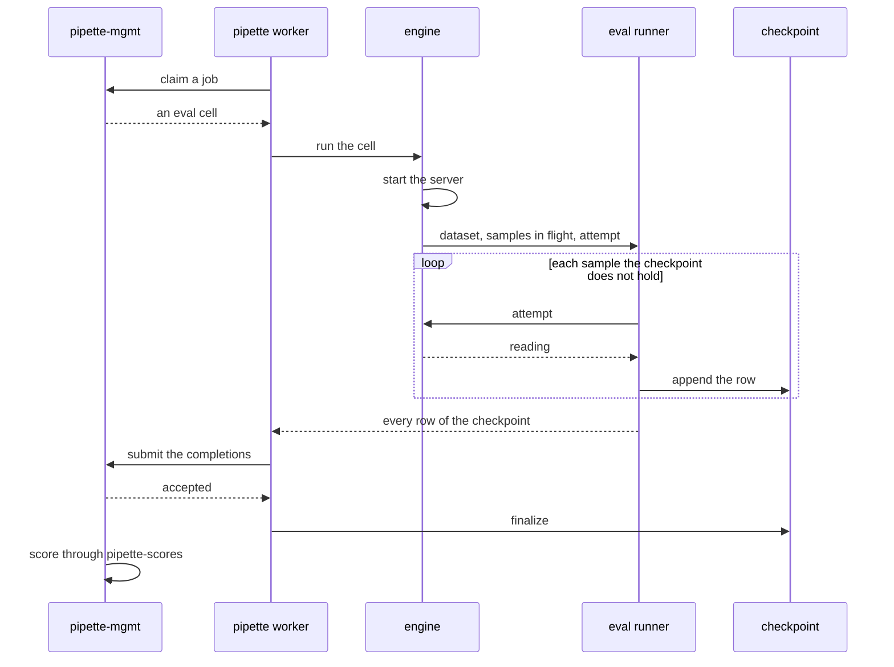

# How an Eval Runs

Applies to **eval** benchmarks on the `pipette` CLI's llama.cpp, MLX and
torch-oai backends. What an eval measures and how it is scored is in
[Eval methodology](../methodology/evals.md), and the checkpoint file is in
[Eval checkpoint & resume](eval-checkpoint.md). This page owns how a run is
carried out: the shared runner, what a crash or a failed sample costs on each
engine, the log lines, and what sets the speed.

## From a job to a scored result

1. **Who starts it.** A `pipette worker` claims one job at a time from the
   management server and runs it. `pipette benchmarks run` runs one cell by
   hand, and `pipette-ctl` runs its cells by calling the CLI on each
   transport. All three hand the cell to its engine through `run_cell`.
2. **The engine** starts its server: `llama-server`, `mlx_lm.server`, or a
   vLLM or SGLang server. It hands the dataset and the checkpoint opened for
   the cell's identity to the shared runner, together with an *attempt*: the
   code that sends one sample and reports how it went.
3. **The runner** sends every sample the checkpoint does not already hold and
   appends each row the moment it lands. It returns every row of the
   checkpoint as the result.
4. **The client finalizes the checkpoint** once the result is safe. When and
   how it does that is in the
   [checkpoint lifecycle](eval-checkpoint.md#state-model).
5. **Scoring** happens on the server side, after the submission. See
   [the protocol](../methodology/evals.md#measurement-protocol).

## The shared runner

[`pipette_ops::measurement::eval`](../../crates/pipette-ops/src/measurement/eval.rs)
runs every CLI eval. An engine gives it an attempt: send the samples it is
handed, and record one reading per sample. Everything else lives in the runner:
the order, the concurrency, what a crash means for the samples around it, the
checkpoint writes and the log lines.

### Samples in flight

| Mode | What it does | Used by |
| --- | --- | --- |
| `Parallel(n)` | `n` one-sample attempts at once; a finished attempt takes the next sample at once | llama.cpp and torch-oai with `n = parallel`; MLX with `n = 1` |
| `Batch(n)` | one attempt at a time carrying `n` samples; a batch lasts as long as its longest sample | no CLI engine; it serves an engine that sends several prompts in one request |

The pool refills: a free slot takes the next sample at once instead of waiting
for the others, so one long answer does not hold the rest back. With more than
one sample in flight, completions land out of dataset order. The sample id
joins each one to its dataset row, so the order does not matter.

### What an attempt records

| Reading | Row | Meaning |
| --- | --- | --- |
| Completed | written | the answer, with its stop reason and token count where the engine reports them |
| Failed | written, marked failed | the sample failed on its own, such as a timeout or a refused request; the cell goes on, and later runs of the cell skip it |
| Lost | none | the sample did not finish, for a reason it shared with the samples beside it, typically a server crash |

The skip rule for a failed row applies to text `eval`. The same runner also
runs `vlm_eval` and `asr_eval`, which give a failed sample up to three
attempts across runs and refuse a cell without an answer to every sample; see
[vlm_eval](../methodology/vlm-eval.md#robustness) and
[asr_eval](../methodology/asr-eval.md#failed-samples).

### When samples are lost

A crash stops every sample in flight, and only one of them caused it. So
the runner:

1. stops handing out new samples;
2. waits for the attempts still running to return;
3. sends each lost sample again, alone, one at a time;
4. records a sample as failed only if it is lost again while alone;
5. continues with the rest of the dataset at full concurrency.

A sample that is already alone when it is lost is recorded as failed at once:
a cell with `parallel = 1`, or the last sample of a dataset. One prompt that
crashes the server therefore costs one failed row, not `parallel` of them.

The runner never restarts anything. The engine starts its server again when
its next attempt needs one, so the failed row of a sample that crashed the server
alone is on disk before the restart.

### When the cell stops

An error from an attempt ends the cell: a server that will not start, an
engine's own stop rule (below), or a row that cannot be written. A panic in an
attempt ends the cell too, instead of leaving it hanging. The rows appended
before it stay in the checkpoint, and the next run of the cell resumes after
them.

## What each engine adds

| Engine | Samples in flight | After a crash | What stops the cell |
| --- | --- | --- | --- |
| llama.cpp | `parallel`, the slot count of one `llama-server` | the next sample starts a new server with the same flags | a restart that fails; the backend could not allocate |
| torch-oai (vLLM, SGLang) | `parallel` requests to one server | no restart | the first failed request |
| MLX | one | the next sample starts a new `mlx_lm.server` | three samples in a row that lose their server |

- **llama.cpp.** After a request fails, the sample waits up to 3 s for
  `llama-server` to exit. It does not hold the server while it waits, so the
  other samples keep going.
  - If the server exited, the sample is lost.
  - If the server is still up, the failure was the sample's own, such as a
    timeout, and the sample is recorded as failed.
  - If the connection closed with no response and the server is still up
    after the wait, the client first sends the sample again, up to twice.

  A `tensor not allocated` abort stops the cell. A restart gets the same flags
  and meets the same limit, and each round would send every sample in flight
  again. The error names the flags that failed and says to lower `parallel` or
  `ctx_size`, then resume. `llama-server` divides its context across the
  slots; see
  [Concurrent samples](../methodology/evals.md#concurrent-samples-parallel).
- **torch-oai.** vLLM and SGLang batch requests themselves, so `parallel` is
  only how many requests the client keeps open. A failed request against a
  live server fails that request and nothing else, so the cell stops at the
  first one and keeps its rows for resume.
- **MLX.** One sample at a time, so every failure is recorded at once and
  nothing is sent again. What happens to the server depends on the failure:
  - An error status from a live server, such as a chat template that refuses
    the sample, is a failed row, and the next sample reuses the server.
  - A server silent for the idle bound, before its response or between stream
    events, is up but does not generate. The client stops it, and the next
    sample starts a new one. `mlx_lm.server` generates on its own thread. That
    thread can die while the HTTP side keeps answering. The server answers a
    request only after that thread takes it, so the bound covers the wait for
    the response as well as gaps in the stream. The idle bound is the
    benchmark's `http_timeout_seconds`, but at least 1,800 s.
  - Any other failure waits up to 3 s for `mlx_lm.server` to show as exited.
    A server that exited is replaced by the next sample. One still up keeps
    serving, and the sample is a failed row.

  Three samples in a row that lose their server end the cell: a server lost
  that often points at the model or the host rather than a sample, and each
  loss costs a model load, or the whole idle bound for a silent server. Their
  rows stay, so a resume continues after them. MLX has no allocation check
  like llama.cpp's, so a Metal allocation failure is one more lost server. See
  [Failed-sample markers](eval-checkpoint.md#failed-sample-markers-llamacpp-and-mlx-eval).

The iOS app runs evals in process, with its own port of the checkpoint (see
[execution alignment](../pipette-ios/execution-alignment.md)). Android has no
eval resume (see
[client parity](../client-parity.md#gap-3-no-eval-resume-on-android)).

## Reading a run's log

| Event | Level | What it says |
| --- | --- | --- |
| `resuming eval from its checkpoint` | info | an earlier run already recorded `completed` of `total` samples |
| `samples in flight at once; completion order will not match dataset order` | info | the cell runs `workers` samples at once |
| `sample completed` | info | one sample finished, with its id, text and stop reason |
| `eval progress` | info | every 20 samples, and the first and the last: `completed` of `total` |
| `eval running` | info | every 30 s on a cell that runs more than one sample at once: rows recorded, samples in flight, time elapsed. It shows whether a slow cell still makes progress |
| `sample lost; to be sent again alone` | warn | a sample's server went away under it |
| `sample lost its server` | warn | llama.cpp's own line for the same event, with the start of the prompt and the `llama-server stderr tail` |
| `sending lost samples again, one at a time` | info | the lost samples are being retried alone |
| `sample lost alone; recorded as failed` | warn | the sample took the server down on its own |
| `llama-server closed the connection with no response and is still up; sending the sample again` | warn | llama.cpp is resending a sample whose connection dropped |
| `sample failed` | warn | a failure of the sample's own, recorded as failed |
| `restarting llama-server after crash`, `restarting mlx_lm.server after it went away` | info | the engine is replacing its server |
| `eval finished` | info, or warn with `failed_ids` | the cell's totals |
| `eval completions hit max_tokens rather than stopping on their own; ...` | warn | some answers were cut at the token cap; see [Truncation](../methodology/evals.md#truncation) |
| `eval checkpoint not finalized` | warn | the result is safe but its checkpoint could not be cleaned up; the next run of the cell resumes it whole |

## What decides the speed

An eval is not timed, but it holds a device until its last sample finishes, and
the current datasets run 990 to 2,500 samples per cell. Two things set the
pace:

- **Samples in flight.** With one at a time, the GPU works on one answer. With
  `parallel`, the engine generates several at once, and the pool keeps every
  slot busy until the end. Then the last few long answers leave slots idle,
  which matters less on a longer eval: one llama.cpp server made 1,300 tokens/s
  on 128 questions and 1,535 on 512.
- **The engine.** vLLM and SGLang put many requests into each step on the GPU.
  `llama-server` does each step's work for all of its slots on one CPU thread,
  and on small models that thread is the limit: with one 16-slot server the GPU
  was busy only 55 to 60% of the time.

On the same card and the same 128 questions, Qwen2.5-1.5B made 8,300 to 8,400
tokens/s on vLLM v0.28.0 at `parallel = 32`, against about 1,300 on one
16-slot `llama-server`.

### llama.cpp: slots per server

More slots do not help past 16 on a small model. Each step carries more work
for the one thread and takes longer: Qwen2.5-1.5B at 16, 32, 64 and 128 slots
made 1,340, 1,241, 820 and 645 tokens/s. A larger model gives the GPU more of
the work: a sweep of Qwen3.5-9B on an H100 found 672 tokens/s at 16 slots
and 731 at 64. Keep `parallel = 16` unless a sweep of the model says
otherwise.

### llama.cpp: servers per GPU

The way past one thread is more servers, each with its own. Several servers on
one GPU, sharing one eval's 512 questions, 16 slots each, in tokens/s, with and
without MPS (NVIDIA Multi-Process Service):

| Servers on the GPU | Qwen2.5-1.5B | with MPS | LFM2.5-2.6B | with MPS |
| --- | --- | --- | --- | --- |
| 1 | 1,535 | 1,494 | 1,488 | not run |
| 2 | 2,206 (+44%) | 2,397 (+56%) | 2,191 (+47%) | 2,382 (+60%) |
| 3 | 2,092 (+36%) | 3,004 (+96%) | not run | 2,812 (+89%) |
| 4 | not run | 3,329 (+117%) | not run | 2,981 (+100%) |

Percentages are against one server without MPS.

- **Without MPS**, the GPU switches between the servers' processes, and past
  two servers the switching costs more than another server adds. The
  Qwen3.5-9B sweep saw the same: two 16-slot servers made 58% more than one,
  and four 8-slot servers made less than one.
- **With [MPS](https://docs.nvidia.com/deploy/mps/)**, the servers' work runs
  on the GPU at the same time, so a third and a fourth server still add. One
  limit: a fatal GPU fault in one MPS process is reported to every process on
  that GPU.
- **Memory** bounds the count: each server holds its own copy of the weights
  and its own context.

One eval cell runs one `llama-server`, and a `pipette worker` runs one job at a
time, so a GPU driven by one worker runs one server. `pipette-ctl` gets two
servers per GPU by running two cells at once (`parallelism = 2`).

### llama.cpp: settings

These reach `llama-server` as environment variables. Set them per host in the
[client configuration](usage.md#8a-client-configuration), which keeps them out
of the cell key, or per cell in the eval's `envs`. A `bNNNNN` name is a
llama.cpp release build tag. With one 16-slot server on 128 questions:

| Variable | Qwen2.5-1.5B | LFM2.5-2.6B | Notes |
| --- | --- | --- | --- |
| `LLAMA_ARG_BACKEND_SAMPLING=1` | +11% | +12% | Samples on the GPU. Experimental: +3% at temperature 0.6 on Qwen2.5-1.5B, and b10216 aborted with it at 64 slots (`GGML_ASSERT(obj_new)`) |
| `LLAMA_ARG_CTX_CHECKPOINTS=0` | +1.5% | +2.5% | Another H100 sweep measured +8.5 to 10.7% on gemma-4-12b-it at 16 slots, and no change on Nanbeige4.2-3B |
| `GGML_CUDA_GRAPH_OPT=1` | +5% | none | Takes effect only with one visible GPU |

On a host with more than one GPU, give each worker, or each cell, one GPU with
`CUDA_VISIBLE_DEVICES`. A `llama-server` that sees two GPUs splits the model's
layers across both, which only adds a hop between the cards for a model that
fits on one: on a two-GPU H100 host, the two cards measured 55% and 56% busy
on 2.6B models.

### llama.cpp: build version

In September 2026, build b11223 measured the same as b10223: 1,359 against 1,361 tokens/s on Qwen2.5-1.5B, and 1,379 against 1,441
on LFM2.5-2.6B. Both came from upstream's CUDA 12 Docker images. Those carry no
H100 (sm_90) code, so the driver compiles their kernels on first use, which
halves a cold run; both were measured with a kept CUDA cache after a warm-up
run.

### How these were measured

On one H100 80GB host (Xeon 8480+, 26 vCPUs) on 2026-09-28, with the b10216
CUDA build unless stated. The models were
Qwen2.5-1.5B-Instruct Q4_K_M and LFM2.5-2.6B Q4_K_M, greedy, up to 1,024
tokens per answer, with flash attention on, every layer on the GPU and 9,216
tokens of context per slot. The requests were the ones an eval sends, the
template and then a streamed `/completion`, over a 128-question set of mixed
lengths. The 512-question runs repeated it four times, with each copy's prompts
tagged so none matched a cached one. The rates are generated tokens per second
over the whole run, and a repeat of the same setup landed within 2 to 5%.

With several slots, greedy llama.cpp output is not reproducible from run to
run: two identical 16-slot runs agreed on 38 of 128 answers word for word. See
[Concurrent samples](../methodology/evals.md#concurrent-samples-parallel) for
what that means for scores.

## Code references

- The runner: [`pipette_ops::measurement::eval`](../../crates/pipette-ops/src/measurement/eval.rs).
- What an eval request carries: [`pipette_ops::eval_cell`](../../crates/pipette-ops/src/eval_cell.rs).
- The checkpoint: [`pipette_ops::eval_completions`](../../crates/pipette-ops/src/eval_completions.rs).
- The engines: [llama.cpp](../../crates/pipette-llamacpp/src/execute/eval.rs),
  [torch-oai](../../crates/pipette-torch-oai/src/execute/eval.rs) and
  [MLX](../../crates/pipette-mlx/src/execute/eval.rs).
- The client: `run_cell` and `finalize_eval_checkpoint` in
  [run.rs](../../crates/pipette-cli/src/run.rs), called from
  [worker.rs](../../crates/pipette-cli/src/commands/worker.rs) and
  [benchmarks.rs](../../crates/pipette-cli/src/commands/benchmarks.rs).
