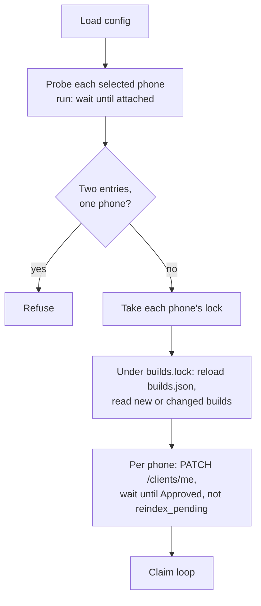
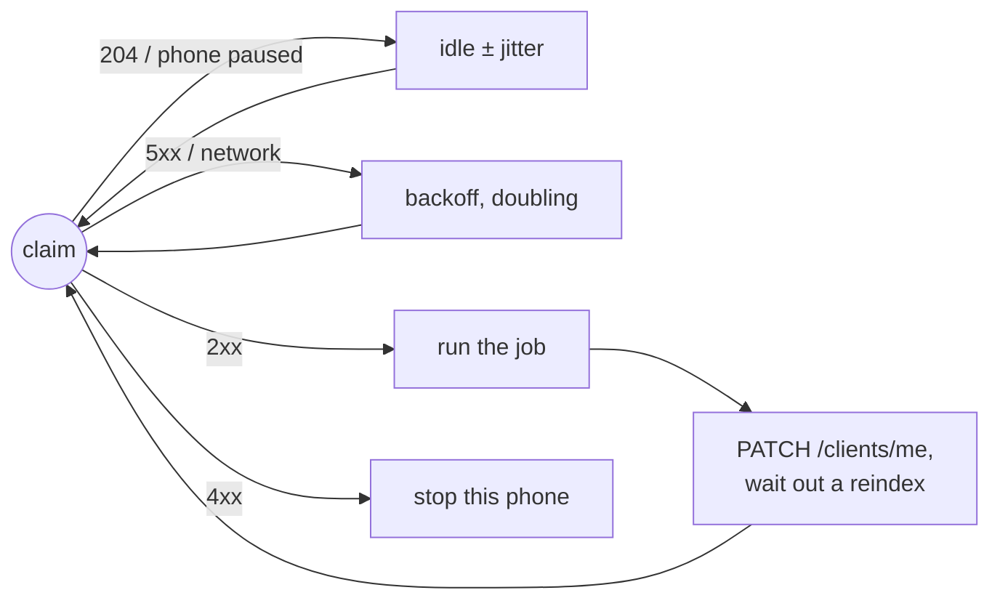
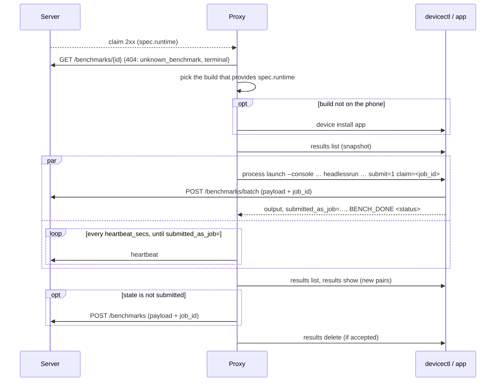
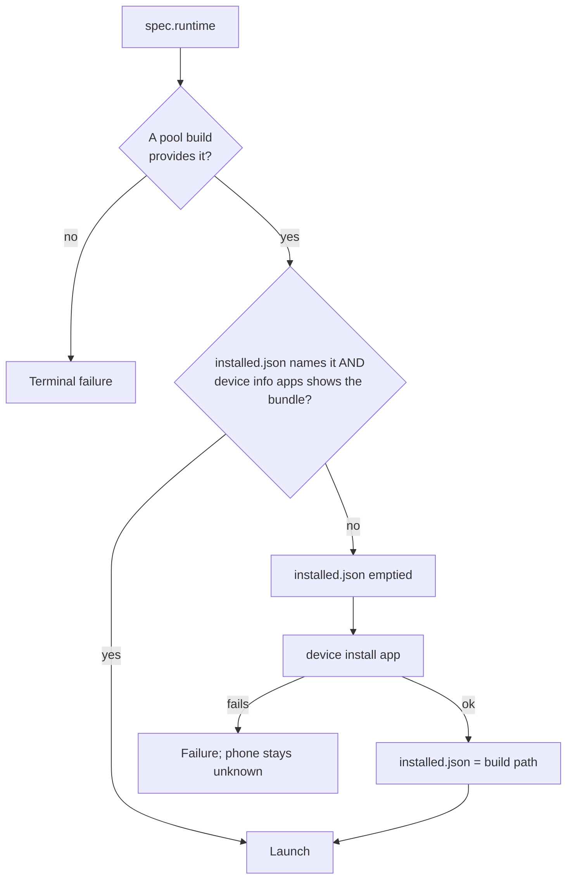
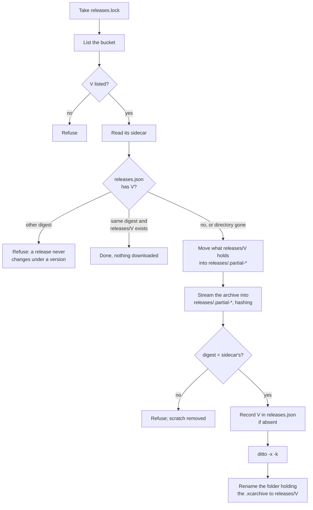
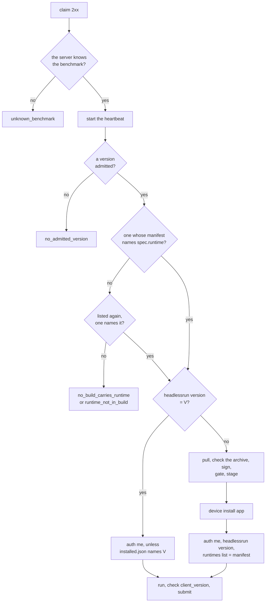

# pipette-ios-proxy: design contract

What the code promises: wire bytes, argv, file rules, failure handling.
[`README.md`](README.md) covers deployment, keys, and commands.

A config installs app builds one of two ways. Pool mode (`[builds]`) installs
pre-signed builds from a directory, picked by the job's runtime. Version mode
(`[signing]`) installs the release build a job pins, signed on this Mac.
Sections 1 to 8 describe pool mode and what both modes share; section 9
describes version mode and where it departs from them.

## 1. Lifecycle





- **Per-phone restarts.** A phone's thread that fails for anything but a `4xx`,
  an operator fault (sections 4 and 9) or the stop signal starts again from
  `PATCH /clients/me`, with backoff.
- **Stopping.** The stop signal (`SIGTERM`, `SIGINT`, `SIGHUP`) is a clean exit.
- **A phone that cannot run a job** pauses claiming, and no job is failed for
  it: one that is absent, answers from a cache, or has Developer Mode off
  (section 6). The pause is logged when it starts, every 10 minutes while it
  lasts, and when it ends (section 7).
- **The pool read** (step E) installs each new build on the first selected
  phone. One that phone cannot install (a profile that does not list it, an
  iOS floor above its own) makes `run`, `register` and `scan` exit non-zero,
  and stays unread until a phone that can install it reads it: that phone's
  next start, or `scan --udid <it>` with its process stopped. Removing the
  build from the pool also clears it.
- **The profile between jobs.** After each job, holding no lease, the profile is
  sent again; the server treats an unchanged one as a no-op. A reindex after an
  unchanged report means something else signing as the phone replaced it (the app
  on a build older than `HeadlessRunner.isOneShot`, or opened by hand), which also
  relinquished the lease. That is logged as a warning, and the reindex is waited
  out before the next claim. Chip and RAM learned from a run reach the server the
  same way.
- **The phone's iOS version** is read at startup, and again by the reachability
  probe before each claim (section 6), with no call of its own. A changed one is
  reported before that claim and its reindex waited out; the same one reported
  again changes nothing.

## 2. Configuration

The keys, their defaults and what each does are in
[`pipette-ios-proxy.toml.example`](pipette-ios-proxy.toml.example) and
`src/config.rs`; the fixed timings (backoff caps, submit retries, lock waits)
are in `src/timing.rs`. Relative paths resolve against the config file. This
section holds the rules a config is refused by.

- **Unknown keys.** Every table denies unknown keys; an unknown or missing key is
  an error naming it. An empty `$PIPETTE_IOS_PROXY_CONFIG` counts as unset.
- **Refused:**
  - a `[server] url` with a query, a fragment, or a scheme other than http(s).
    Trailing `/`s are stripped and a path prefix is kept, since a deployment
    behind one signs over it;
  - no `[[devices]]` entries;
  - with two or more entries, any entry without `udid`;
  - two entries naming, or probing to, the same phone;
  - two entries with the same `client_id`;
  - not exactly one credential source among `identity_token`,
    `identity_token_file`, `private_key`, `private_key_file`; a key without
    `client_id`; a `client_id` that disagrees with the token's;
  - any key-holding file (key file, or the config when a key is inline) with a
    mode beyond `0600`;
  - not exactly one of `[builds]` and `[signing]`, and `[signing]` without
    `[client_releases]` (section 9).
- **Keys are never persisted or logged.** A config that does not parse is
  reported by line and message, never by quoting the line, which may hold a key.
- **`[client_releases]`** is optional; without it the `builds` verbs refuse in
  one sentence naming the missing table, `check` reports it as
  off, and nothing else changes. Its shape is checked at load like any table, so
  these stop every verb:
  - `bucket` or `region` outside lowercase letters, digits, `-` and `.`, or
    starting with `-` or `.`;
  - an `endpoint` that is not a bare `http(s)://host[:port]` origin (no
    credentials, path, query or fragment). The refusal echoes it without its
    credentials, query or fragment;
  - a blank `access_key_id`;
  - not exactly one of `secret_access_key`, `secret_access_key_file`, or either
    one blank;
  - a `default` that is not a version (`[a-z0-9][a-z0-9._-]*`). Only version
    mode reads it.

  In pool mode the secret is read only by `check` and `builds`, once each run,
  so a bad secret file never stops `run`; version mode reads it in `run`,
  `register` and `probe` too. A verb that reads it refuses a missing or blank
  secret file, and whichever file holds the secret (that file, or the config
  when it is inline) at a mode beyond `0600`. The secret prints as
  `<redacted>`. Without `endpoint` the bucket is
  `https://<bucket>.s3.<region>.amazonaws.com/`, or
  `https://s3.<region>.amazonaws.com/<bucket>/` for a bucket name with a `.`,
  which AWS's certificate does not cover; with it, `<endpoint>/<bucket>/`
  (path-style).
- **No `client_version:` flag in pool mode.** A pool build is picked by the
  job's runtime, so a pool offering several builds could answer a pin with the
  wrong one. Version mode advertises `client_version:` flags and build flags
  (section 9).
- **Capability flags in pool mode.** Each build's runtime descriptors produce
  flags exactly as the app derives them (`src/pool/capabilities.rs`). One
  exception is llama.cpp: the descriptor carries only one version (the tag if
  pinned, else the commit), so that is the only versioned flag reported. The
  app itself reports both, for its main llama.cpp pin alone.
- **Build flags.** Each iOS app runtime also gives one build flag,
  `runtime:descriptor:<digest>`, from `pipette_plan_types::runtime_build_flag`.
  The server's catalog offers a runtime build only to a phone that reports its
  build flag. In pool mode, a phone reports the build flag of each runtime that
  a pool build carries. This includes each extra llama.cpp pin.

## 3. State files

- **`<udid>/`:** one directory per phone. `<udid>` is the entry's `udid` as
  written, made safe as a path segment. For an entry without `udid`, it is the
  CoreDevice identifier that `devicectl list devices` shows.
- **`<udid>/lock`:** `flock(2)`, taken after the probe for each phone
  a `run`, `register`, `scan` or `uninstall` drives. A second holder exits at once
  naming the first holder's pid. `status`, `probe`, `check`, `builds list` and
  `builds pull` don't take it; `builds prune` takes every phone's (section 8).
- **`builds.lock`:** held while refreshing `builds.json`. A process that finds it
  held polls for it (honoring the stop signal), then re-reads the index.
- **`builds.json`:** per build, a stamp (length and mtime of `Info.plist` for an
  `.app`, of the file for an `.ipa`), and its runtimes. A changed
  stamp is re-read; a build removed from the directory is dropped. A corrupt file
  is an error, not an empty index.
- **`installed.json`:** written with no `path` before an install and with the
  build's `path` after it. Version mode adds the `version` the phone reported after the
  install, and writes `{version}` alone when startup or a claim finds the phone
  already on it; read `version` to name a phone's build.
- **`<udid>/device.json`:** the `device_name`, `device_chip_model` and
  `device_ram_bytes` of the phone's last submitted payload (section 4,
  "Submitting").
- **`releases/<version>/`:** one pulled app build, unpacked: the `.xcarchive` and
  whatever the release zipped beside it. It appears whole (renamed into place) or
  not at all. A pull that downloads first moves aside whatever no record vouches
  for there.
- **`releases.json`:** per version, the sha256 it was first pulled with, its key
  and when. Written once the download matches its sidecar; never rewritten for
  that version.
- **`releases.lock`:** held while one process pulls, from before it lists the
  bucket. A second `builds pull` exits at once naming the holder's pid; `run`
  in version mode waits for it instead (section 9).
- **`releases/.partial-*`:** a pull's scratch directory, removed when the pull
  ends. One left by a killed pull is removed by the next pull that downloads,
  under the lock.
- **`signed/<version>/`:** one pulled build exported for the fleet: the
  `.app`, whole or absent, and `source.sha256`, the digest of the archive it
  came from. `signed/.partial-*` is an export in flight, or one a killed
  process left; the next export sweeps it.
- **`signed.lock`:** held while one process checks the signed cache, exports,
  and copies a build out of it. Never held with `releases.lock`. A claim waits
  for it up to `export_timeout_secs` plus 3 minutes: another phone's whole
  export.
- **`<udid>/staged/`:** this phone's own copy of the signed build it
  installs.
- **Pruning.** Nothing is removed on its own. `builds prune` (section 8)
  removes every `releases/<version>/` and `signed/<version>/` that neither the
  catalog nor a phone's `installed.json` names, and every `.partial-*`; a later
  claim pulls and signs again what it needs. It never touches
  `releases.json`, which pins each version's first digest, the locks, or the
  phone directories. It refuses while another process holds any lock:
  `releases/<version>/` is read outside any lock between the pull and the
  export, and a claim that finds it gone files that as the version's fault and
  withdraws it. With every process using the state directory stopped, an
  operator may delete the same directories by hand.
- **All files:** written atomically (temp file then rename). Each is stamped with
  a `schema`: a newer schema is refused, a missing one reads as 0.

## 4. One job

Pool mode; version mode's claim is in section 9.

The phones are trusted to be registered with Apple and in the team's profile.
Before an install a `.app` must pass `codesign --verify --deep --strict` and
carry an `embedded.mobileprovision` (an `.ipa` passes with a warning). Nothing
checks that the profile lists the phone, or the build's `MinimumOSVersion`: a
phone that cannot take the build fails `device install app`. During a job
that is `install_failed`, which is terminal; in the pool read it stops the
process (section 1). After the install, the app must still hold the phone's
client. If it does not, the job fails `install_failed` and the phone stops
until an operator fixes it (section 7).





**Launch:** `xcrun devicectl device process launch --device {udid} --terminate-existing --console {bundle} headlessrun <args…>`

- **`headlessrun`:** without it the app opens its UI and `--console` never
  returns.
- **`--terminate-existing`:** `--console` only attaches its streams to an app
  that isn't already running. It also makes each run a fresh process, which a
  memory cell's figure depends on: it is the process's footprint.
- **No `--timeout`:** it would bound the whole command, and `--console` waits for
  the app to exit. `run_timeout_secs` bounds the run instead, and
  `call_timeout_secs` a verb's launch.
- **Single App Mode races the launch.** The lab phones run Single App Mode
  (Guided Access), which stays on. After every exit it reopens the app in UI
  mode, with no arguments, 0.7 to 35 s later. When that reopen lands between
  `--terminate-existing`'s terminate step and its launch step, devicectl
  attaches to the reopened copy: no `headlessrun`, so it shows its jobs screen,
  prints nothing and never exits. The streams are not connected and the
  launch's own process never starts. On phone 1, 3 in 600 back-to-back launches
  did this; on the fleet, 9 runs sat silent until `run_timeout_secs` or a unit
  stop, and about 100 verbs until `call_timeout_secs`, between 2026-10-19 and
  10-22. The proxy cannot close the race, so it detects it.
- **The app's first line:** every headless launch prints `[HEADLESS] hello
  pid=<pid>` on stderr before it parses its arguments. The proxy counts any line
  starting `[HEADLESS] `, on either stream, as the app's; devicectl's `Launched
  application…`, `Waiting for the application to terminate…` and `App
  terminated…` are not. A launch, a run's or a verb's, on which no such line
  arrives within `first_line_timeout_secs` (60 s by default) is ended as below
  and launched once more, a run under the same lease. The relaunch's
  `--terminate-existing` ends the UI copy, and a run's relaunch gets the whole
  `run_timeout_secs`. A run whose relaunch is silent too is `launch_silent`,
  retriable: the app never had the cell. Once the app has printed a line, only
  the launch's own deadline applies, since a download or a long cell can go
  quiet later. Each verb the proxy launches is safe to launch twice, so each is
  relaunched (section 6), and none waits out `call_timeout_secs` silent. 60 s
  also holds for builds from before the marker, which a phone still runs for a
  runtime no newer build carries: their first line follows the app's
  benchmark request, whose timeout is 30 s, and on 6119 lab runs from
  2026-10-12 to 10-22 it came at most 48 s after the spawn, nearly all of that
  devicectl's own launch.
- **`submit=1 claim=<job_id>`, always:** the app uploads the result itself, with
  the claim's `job_id` echoed, under its Keychain identity, the client that
  claimed the job. The app's default for `submit=` is on for a run that its
  catalog resolves and off for a run that names an exact model, so the proxy
  always passes it.
- **Arguments:** `spec.runtime` is forwarded verbatim; the app refuses a mismatch,
  which is terminal in pool mode. No argument is ever added speculatively,
  because the app refuses an unknown `key=`.
- **Flags:** `spec.runtime_flags` and `spec.benchmark_flags` go to the app as
  `runtime-flags=` and `benchmark-flags=` JSON, without their axis keys. An entry
  that is not an object, or whose axes name another cell, is refused here, as
  `pipette-cli` refuses it. The proxy has no catalog, so it reads the benchmark
  axis off the id's prefix (`BenchmarkType::from_id`), and an id it cannot
  classify leaves that axis to the app. The app validates each flag value, and
  it refuses by name a flag that no iOS cell carries. An entry with only its axes sends no `benchmark-flags=`,
  and the app keeps its own readiness default. The readiness wait runs inside
  `run_timeout_secs`.
- **Benchmark:** before anything else, the proxy asks the server for the claim's
  benchmark (`GET /benchmarks/{id}`, signed as the phone's client). A `404` is
  `unknown_benchmark`, terminal, as `pipette-cli`'s worker makes it; the app could only
  report it as a failed run, which is retriable. Any other failure of that request is
  logged and the launch goes ahead. `benchmarks=` then carries the id alone: the app
  resolves it from its own catalog, else from the id's spelling, else with its own
  signed `GET /benchmarks/{id}` because the launch carries a claim, all before the model
  download, so a phone needs no `sync` to run a benchmark published after its last one.
  A body the server serves but this build cannot read is still the app's to judge: it
  ends the run at status 1, retriable, since another build may read it.

**Output:**
- Drain stdout and stderr at the same time; stderr carries multi-minute readiness
  waits, and a full pipe deadlocks the app.
- A stderr line the app's `AppLog` wrote (`[HEADLESS] <level> <category> …`) is
  logged at its level; the rest of stderr at debug.
- Every line is scrubbed of the argv's `auth_token` values as it is read, before
  it is logged or kept: the app echoes its whole argv on a usage error.
- The sentinel is `BENCH_DONE <int>` as a substring of a line. The last one wins,
  and a bare `BENCH_DONE` means 0. It is trusted over the exit code (identical
  refused launches exited 2, 2, 2, 2, 2, 0).
- With no sentinel, the exit code stands in. Status 2 (malformed arguments) is
  terminal; any other failure is retriable, except a kill by iOS or an engine
  failure.
- **Killed by iOS:** a run with no sentinel whose last stdout line is devicectl's
  `App terminated due to signal 9.` (devicectl 642.16) is `killed_by_ios`,
  terminal. Nothing sends `SIGKILL` to a run the proxy has not been told to stop:
  the proxy's own stops are `SIGTERM`, and a supervisor sends `SIGKILL` only
  after its `pkill -TERM` of the proxy. So iOS killed the app, in practice at its
  per-app memory limit. The cause is terminal so the cell fails for every phone
  instead of waiting out its deadline. This holds even on a fleet that mixes
  phone models: a phone with more memory tries the cell only after
  `pipette-ctl campaigns rerun`. The proxy's own
  deadline outranks it, and a run whose console was lost prints no such line and
  stays retriable. The line does not say why iOS sent the signal, so a watchdog
  kill (a launch that hung) is filed the same way.
- A cell the app's engine failed on is `engine_failed`, terminal. A current
  build ends that claimed run `BENCH_DONE 1 failed: <error>`; an older one,
  closing on the job's status, prints `BENCH_DONE 0 completed` and leaves no
  payload, so the check runs after either. The deadline, a kill by iOS and
  status 2 outrank it. The app logs
  `[HEADLESS] error jobRun <benchmark> / <model> failed: <error>` on stderr, the
  rest of a multi-line error (llama.cpp's log tail) on the lines below, and the
  reason quotes them, joined with ` | `. Only the engine's own wording counts
  (`Engine error:`, `Engine backend failed:`, and the out-of-memory message),
  and only after `[HEADLESS] info jobRun dispatch:`. A download, a readiness
  wait, the power-state refusal, the Apple foundation model not ready on the
  phone, and a load that failed on the file (missing, not a GGUF, cut short),
  which a fresh download repairs, stay `run_failed`, retriable.
- The deadline (`run_timeout_secs`) is `engine_timed_out`, terminal, once the
  app's engine had the cell for half the window or more; under half, or before
  `[HEADLESS] info jobRun dispatch:`, it is `run_timed_out`, retriable, since the
  window also covers the in-app download, and the next try finds the model on
  the phone. The engine's time runs from the dispatch line, read as stderr
  arrives, and leaves out a `vl_spec_decode` corpus fetch (`fetching a corpus:`
  to `corpus for`) and each readiness wait (`→ waiting` to `→ proceeding` or
  `→ timed out`). Both reasons name the limit and the engine's time.
- On `results show`, the payload is the app's first document on stdout and the
  sentinel moves to stderr. `devicectl --console` prints its own lines ahead of
  the app's, so the payload starts at the first line that opens an object.

**Ending a run early** (deadline, first-line deadline, lost lease, or stop
signal):
- `SIGTERM` the `xcrun` child; it forwards the signal to the app, which can
  finish its upload.
- Then, as a backstop, `device process terminate` on the app's pid.
- Never `SIGKILL`: it orphans the app on the phone.

**Submitting:**
- The app submits. Its line for an accepted cell, `result cell=… submitted_as_job=…`,
  stops the heartbeat at once: the upload closed the lease, and the next beat
  would read as a lost one.
- After the run, `results list` names each new result's `state=`. One that is
  `submitted` (or `scored`) only leaves the phone. Any other the app could not
  upload, and the proxy submits it: the payload unchanged except for the added
  `job_id`, and the run's console as `runtime_stdout` / `runtime_stderr` where
  the phone sent none. The runtime runs inside the app, so the app's output is
  the runtime's. Each stream is cut to its last MiB. A failure after the launch
  carries the same two fields; a result the app uploaded carries neither.
- Every new payload's `device_name`, `device_chip_model` and `device_ram_bytes`
  are saved to `device.json`, the only source for RAM (`0` is not a reading).
  The iOS version reported is devicectl's.
- A lost lease means no submission from the proxy. A result the app uploaded
  before a beat found the lease gone still leaves the phone.
- A result the proxy leaves on the phone stays unsent: the app's launch drain
  skips a claimed job, so a Guided Access relaunch cannot echo a stale lease.
- Failures are reported by the proxy only: the app uploads results, not
  failures.

| failure | cause | retriable |
|---|---|---|
| phone absent or unreachable | `device_unreachable` | yes |
| devicectl error or timeout | `devicectl_failure` | yes |
| run failed (status other than 2) | `run_failed` | yes |
| deadline with the engine under half the window | `run_timed_out` | yes |
| deadline with the engine half the window or more | `engine_timed_out` | no |
| no line from the app on the launch or its relaunch | `launch_silent` | yes |
| the app's engine failed on the cell | `engine_failed` | no |
| iOS killed the app (signal 9), most likely at its memory limit | `killed_by_ios` | no |
| status 2: malformed arguments | `malformed_invocation` | no |
| runtime mismatch with the installed build (status 2) | `malformed_invocation` | no |
| no build provides the runtime | `install_failed` | no |
| install failed | `install_failed` | no |
| the app holds another client after the install; the phone stops | `install_failed` | no |
| spec the proxy cannot interpret | `uninterpretable_spec` | no |
| the server does not know the benchmark | `unknown_benchmark` | no |

## 5. Wire protocol

Every call is signed as the phone's client by `pipette_mgmt_client`, the same
code `pipette-cli` signs with; the proxy has no copy of the signing code. The
signed payload and headers are pipette-mgmt
[`docs/authentication.md` §2.1](https://github.com/Liquid4All/pipette-mgmt/blob/main/docs/authentication.md#21-the-signed-payload),
and what each route answers is
[`docs/httpapi.md`](https://github.com/Liquid4All/pipette-mgmt/blob/main/docs/httpapi.md)
and [`docs/queue.md`](https://github.com/Liquid4All/pipette-mgmt/blob/main/docs/queue.md).
This section holds the calls the proxy makes and how it reacts to each answer.

| Call | Request | Success |
|---|---|---|
| me | `GET /clients/me` | profile |
| update_me | `PATCH /clients/me` | profile |
| claim | `POST /plans/claim` | 204 nothing, 2xx job |
| benchmark | `GET /benchmarks/{id}` | the benchmark (`404` is `unknown_benchmark`, section 4) |
| heartbeat | `PUT /plans/{job_id}/heartbeat` | 2xx |
| reclaim | `POST /plans/{job_id}/reclaim` | 2xx |
| submit | `POST /benchmarks` | `{job_id}` |

- **Profile updates:** only the fields the proxy knows are sent, and an
  omitted field keeps the server's stored value
  ([`PATCH /clients/me`](https://github.com/Liquid4All/pipette-mgmt/blob/main/docs/httpapi.md#24-patch-clientsme)
  has no per-field clear). `device_os_name` (`iOS`) and `device_os_version`
  (devicectl's `osVersionNumber`, trimmed) go together, or neither when
  devicectl read no version. `device_cpu_arch` is devicectl's `cpuType`
  name (`arm64e`), trimmed, and is absent when devicectl read none.
  `device_os_family` (`iOS`) is a constant and goes in every update.
  `capabilities`, when sent, is the complete set,
  since it replaces the stored one; an empty set is not sent.
- **The iOS a job needs** is its plan's to state, as `requires =
  ["os_version:<v>"]`, matched by the server against `device_os_version`. The
  proxy never compares a build's `MinimumOSVersion` with the phone's iOS.
- **Heartbeat,** as `pipette-cli` does it:
  - interval is `heartbeat_secs`; one above half of the lease's `time_window`
    (`PTnHnMnS`, 10 min if unparseable) is honored with a warning;
  - `409` aborts the run; `404` reclaims once, and a reclaim refused
    (`404`, `409` or another non-transient status) aborts it; any other `4xx`
    is retried.
- **Submit retries:** 1 s doubling to 30 s, 32 attempts. A `404` reclaims once and
  resends the same body; a `409` drops the result.
- **Never registers.** `POST /clients/register` would create a second client row
  for the phone.
- **Claim specs are never logged raw.** Every `auth_token` in them is replaced
  first.

## 6. devicectl

- **JSON output:** calls pass `--json-output <tmpfile>` and read it back even on
  failure, since a failed call writes an `error` object and no `result`.
- **Timeouts:** every call except the launch gets `--timeout {call_timeout_secs}`.
  A verb is a launch, so `call_timeout_secs` bounds it from the proxy's side, and
  the first-line deadline (section 4) applies to it as to a run. The proxy's
  verbs, and what a silent launch of each does:

  | verb | when | on a silent launch |
  |---|---|---|
  | `results list` | before and after a run | relaunched: a read |
  | `results show result=…` | after a run | relaunched: a read |
  | `results delete result=…` | after a submit | relaunched: idempotent; a repeat on a result already gone ends `no result`, which the proxy only warns about |
  | `version` | before a job, after an install | relaunched: a read |
  | `auth me local=1` | after an install | relaunched: a Keychain read, no request |
  | `runtimes list` | after an install, and on a pool read | relaunched: a read |

  A verb that is silent twice fails at the second first-line deadline as a
  `devicectl_failure`, with the message `no BENCH_DONE …, after the app printed
  nothing by the first-line deadline, twice`.
- **Picking the phone** when there's no `udid`: `list devices` must show exactly
  one attached phone. With none, it exits 0 and prints `No devices found.` on
  **stdout**, which must never be taken for a device.
- **Reachability** uses `device info apps`, not `device info details`: details
  answers from cache for an absent phone, while apps fails with
  `CoreDeviceError 1011`. A `tunnelState` of `unavailable` in details also counts
  as unreachable, and so does a `developerModeStatus` other than `enabled`: the
  app cannot launch, so a claim would only fail. Details with no
  `developerModeStatus` count as enabled. A reachable phone's details carry its
  `osVersionNumber`, which the next profile report uses (section 1); details
  that fail or carry none keep the last one.
- **Identity** comes from details: `result.identifier` (the CoreDevice UUID, which
  detects two entries that name one phone), `osVersionNumber`, `productType`, `marketingName`,
  `udid`, and `cpuType.name` (`cpuType` is an object).
- **Finding the bundle:** `device info apps --bundle-id <id>`, then an exact
  match on each entry's `bundleIdentifier`. A result with no `apps` array is
  an error, not an empty list, which would reinstall before every job.
- **GPU performance state** (on when `[devicectl] pymobiledevice3` names the
  CLI, for every phone the proxy drives; off when unset). Left alone, iOS runs
  some small-model decode reps at a GPU state about 1.3x slower than the rest.
  Xcode's "GPU Performance State" device condition pins it. On phone 1, an
  iPhone 17 Pro, 12-rep Qwen3.5-0.8B runs had 13 of 28 cells two-speed
  unpinned and 0 of 28 at `max`. Decode matched the unpinned fast reps; prefill
  ran about 2% faster. `mid` ran 1.9x slower, so `max` is the only state held
  and there is no setting for it.
  - **Once configured, it is required.** There is no fallback to an unpinned
    run: the key is the switch, so a missing or broken CLI stops the proxy
    rather than quietly turning the pin off.
  - **How it holds:** devicectl cannot set a condition, so the proxy runs
    `{pymobiledevice3} developer dvt condition set GPUPerformanceStateMax
    --native --udid <hardware udid>` for the launch. It waits up to
    `call_timeout_secs` for the CLI's `Press Ctrl+C` prompt, then SIGTERMs the
    CLI after the launch, before the post-run verbs. The phone drops the
    condition when that connection closes, so the child must outlive the launch.
  - **`--native`:** rides Apple's own tunnel, with no root and no pairing record.
    It briefly evicts `remoted`'s connection to the phone. `remoted` re-attaches
    at once, and an immediate launch still works.
  - **When the pin cannot be set,** the job fails `devicectl_failure`, which is
    retriable, and the app is never launched. An unpinned run would publish rows
    that look the same as pinned ones.
  - **When the pin is lost during the run** (the CLI exited before the proxy
    ended it: a crash, or the tunnel dropping), the job fails the same way
    instead of submitting. Rows the app already uploaded during the launch stay
    on the server: the proxy cannot recall them.
  - **The path:** absolute, `~/`-relative, or relative to the config file like
    the other paths; a bare name is looked up on `PATH`.
  - **At `run` startup,** with the phone's lock held, the proxy:
    - SIGTERMs any helper still holding the condition for the phone's hardware
      UDID. A proxy that dies without unwinding leaves one behind, which happens
      when an ssh drop makes SIGPIPE kill it.
    - with the pin configured, refuses to start unless every phone reported a
      hardware UDID and `{pymobiledevice3} version` succeeds (run once, not per
      phone). Without both, every job it claimed would fail. `check` runs the
      same `version` test and prints the pin as `off` when unset.
  - **Rows don't record the state.** The app uploads them itself, so the proxy
    logs `holding the GPU performance state for the run` in the job's span
    instead.

## 7. CLI and logs

- **Failures:** every failure prints one stderr line. The exit status is:
  - **0** when the stop signal ended the process, whatever the phones did.
  - **8** when every phone that failed stopped for an operator fault (sections 4
    and 9). No other failure uses 8. The operator faults are:
    - a replaced identity;
    - a keychain password that the unlock refuses;
    - the wrong team or an expired profile on a fresh export;
    - every offered version withdrawn.
  - **1** for every other failure. This includes a `4xx` and the signing check
    that `run` starts with (section 9, "Startup").

  A restart after an operator fault stops the same way, possibly after it
  fails another job. So a supervisor must leave a process that exits 8 down
  until a person fixes the cause. A `4xx` and the signing check fail while no
  lease is held, so a restart costs no job. It recovers after the server, the
  clock or the Mac is fixed.

  The status shows when the fault was found, not what it was. A wrong keychain
  password exits 1 when the startup check finds it, and 8 when the unlock
  before a later export finds it. When one phone stops for an operator fault
  and another for anything else, `run` exits 1. The supervisor then restarts
  it, and the stopped phone can fail another job on each restart until a
  person fixes it.
- **Waiting for a phone:** `run` waits for a phone that hasn't enumerated, and
  says so as a pause (below); the other commands fail without one, and `check`
  and `builds` never touch a phone.
- **stdout** carries only a command's result; the `builds` verbs print their
  data there and everything else on stderr.
- **Logs** go through `tracing` to stderr, one line per event, as text or JSON.
  Each phone's work, including its heartbeat, watchdog and app stderr threads,
  runs inside a `phone{device, client_id}` span, so every line it logs names the phone (in
  JSON, under `spans`). Each claimed job runs inside a `job{id}` span within it,
  `id` being the server's job id, so every line from `claimed a job` to
  `job finished` names the job too; the claim loop's lines after it do not. A
  claim names no plan, since one job can serve several. The proxy logs at
  `[log] level` (or `--log-level`), dependencies at `warn`; a set `RUST_LOG`
  replaces that filter.

**The job summary.** Every claimed job, however it ends, closes with one
`info` line, `job finished`, after any failure report:

```
INFO phone{device=… client_id=…}:job{id=job-01a1…}: job finished outcome=accepted cause=- infra=- benchmark=prefill_throughput_256 version=<V> chosen_by=default installed=yes choose_secs=0.0 pull_secs=3.1 sign_secs=9.8 install_secs=14.6 run_secs=62.3 submit_secs=3.0 total_secs=98.7
```

Every field is always there, in this order; none holds a space, and `-` stands
for none, so an alarm can match a field as a term. In the text format that is
`"job finished" "cause=devicectl_failure"`. In JSON (`[log] format = "json"`)
each field is a top-level string key beside `message`, so the same filter is
`{ $.message = "job finished" && $.cause = "devicectl_failure" }`. A step that
failed still reports the seconds it took to fail.

A job that stops its phone for an operator logs `the job stops this phone until
an operator fixes it` with the error, inside the job's span, before this line.

| field | value |
|---|---|
| `outcome` | `accepted`: every result the run left was accepted; `not_accepted`: the run succeeded, but the server refused a result or it could not be submitted, and the phone keeps its copy; `failed`: a failure was reported, or its report was attempted; `lease_lost`, `stopped`: nothing was reported |
| `cause` | the failure's cause (sections 4 and 9) when `failed` |
| `infra` | when `failed`: `yes` for `device_unreachable`, `devicectl_failure`, `launch_silent`, `build_not_ready`, `build_unusable`, `identity_replaced` and pool mode's `install_failed`, which an operator fixes on the phone, the Mac, the pool or the release pipeline; `no` for any other cause, which is the job's, its plan's or the app's |
| `benchmark` | the claim's `benchmark_id` |
| `version` | the build version mode chose; `-` in pool mode and before a choice |
| `chosen_by` | `default` or `newest` (section 9), `pool` in pool mode |
| `installed` | `yes` when `device install app` put a build on the phone for this job |
| `choose_secs` | choosing the version, a listing taken again included |
| `pull_secs` | pulling it, the wait for `releases.lock` included |
| `sign_secs` | the archive checks, then reusing or exporting the signed build, the gates and the copy for this phone, the wait for `signed.lock` included |
| `install_secs` | `device install app` and the checks around it; `-` when nothing was installed |
| `run_secs` | the launch that runs the cell, to the app's exit, readiness gate waits and a relaunch after a silent launch included; each submitted result's `readiness_gate_waits` times them per rep |
| `submit_secs` | reading the results off the phone and submitting them, or reporting the failure |
| `total_secs` | from the claim to this line |

**Alarm lines.** These messages are fixed, so an alarm can count them:

| message, then its fields | level | logged |
|---|---|---|
| `the phone cannot run a job; pausing claims (no job is failed for this) reason=…` | `warn` | when a pause starts |
| `phone still paused paused_mins=<n> reason=…` | `warn` | every 10 minutes while any pause lasts, from the first probe 10 minutes in |
| `the phone can run a job again; resuming claims paused_mins=<n>` | `info` | when a pause ends |
| `waiting for the phone; the claim loop starts when it is attached error=… retry_secs=10` | `warn` | when `run` starts with the phone not attached; `phone still paused` follows as above, and `the phone is attached again device=… paused_mins=<n>` ends it |
| `the app printed nothing after launch; relaunching launch=<what> silent_secs=<n>` | `warn` | when a launch reaches `first_line_timeout_secs` with no line from the app; it is ended and launched once more. `launch` is `the run` or the verb (`results list`, …) |
| `the app printed nothing after the relaunch either; giving up launch=<what> silent_secs=<n>` | `warn` | when the relaunch is silent too; for a run, `job finished … cause=launch_silent` follows |
| `job finished … infra=yes …` | `info` | when a job failed for a cause an operator fixes |

`reason` says why, and may hold spaces; `paused_mins` counts whole minutes
from the pause's start. Only a probe that finds the phone still unable to
run a job logs `phone still paused`, so a pause that ends just after a
10-minute mark may skip that mark's line. `"job finished" "infra=yes"`
counts each such job once; the seven `cause=` terms would take seven filters,
and also match `reporting a job failure`.

## 8. App builds from the releases bucket

Each release publishes the unsigned app archive `pipette-ios-<V>.xcarchive.zip`,
its `pipette-ios-<V>.xcarchive.zip.sha256` (`sha256sum` output) and the
manifest `pipette-ios-<V>.json` as GitHub release assets. The release workflow
does not upload them to the bucket. The operator copies them into the bucket as
`s3://<bucket>/<tag>/pipette-ios-<V>.xcarchive.zip` and so on. `V` is the app's
own `client_version`. A release publishes one such build: the private-API
build ([private-thermal-release-build.md](../../docs/pipette-ios/private-thermal-release-build.md)),
whose version is `<tag>-internal`. It carries every llama.cpp pin
([llama.cpp variants](../../docs/pipette-ios/build.md#llamacpp-variants)).

**The manifest** is `{"client_version": "<V>", "runtimes": [<descriptor>, ...]}`:
the runtimes `headlessrun runtimes list` prints for that build, in the plan
`Runtime` JSON a claim's `spec.runtime` carries. The app builds them at
runtime and the archive cannot run on the release runner, so
`ios/release-manifest.py` writes them from what the archive compiled:

- the runtime list, from `RuntimesCommands.runtimeRows`;
- one llama.cpp runtime for each framework that the archived app carries, from
  the `Info.plist` of that framework;
- the other pins, from the `*BuildInfo.json` files that the build-info
  generators write beside their Swift;
- `private_thermal` and `private_memory`, from the probes of the archived
  binary.

A proxy test runs the script and parses every descriptor it writes.
The `builds` verbs read that bucket with the `[client_releases]` key pair and
nothing else: no phone, no management server. `run` installs from the bucket
in version mode only (section 9).

**Listing:**
- every key in the bucket, `ListObjectsV2` with no prefix and no delimiter,
  followed through `NextContinuationToken`. A truncated page that names no
  token, or one already named, fails the listing;
- a key whose file name is `pipette-ios-<V>.xcarchive.zip` is a candidate.
  Skipped, each with a warning: `V` not matching `[a-z0-9][a-z0-9._-]*`; `V`
  under two or more keys (every copy, whatever their sidecars); a key at the
  bucket root, or with a `.` or `..` segment (URL parsing resolves those, so the
  request would leave the signed path); a directory name outside
  `[A-Za-z0-9._-]`; no `<key>.sha256`; a sidecar over 4096 bytes, or whose first
  whitespace-separated token is not 64 lowercase hex characters; no manifest; a
  manifest over 64 KiB, not that JSON object, or naming another
  `client_version`;
- a build is `{version, tag, key, sha256, bytes, uploaded_at, runtimes}`, where
  `tag` is the directory the archive sits in (`feature-x` for
  `branches/feature-x/...`), `uploaded_at` is the archive's `LastModified`, and
  `runtimes` the manifest's descriptors as written;
- newest `uploaded_at` first, ties by version descending;
- only a failed listing fails `builds list`; a sidecar or manifest that cannot
  be read skips its build. The catalog of section 9 skips only one the bucket
  refuses with a 4xx, which every read meets again; any other failed read
  fails it. `builds pull` reads only its own build's sidecar and manifest and
  fails, naming the reason, when it cannot.

**`builds list`** prints one line per build on stdout:
`<version>  <tag>  <size>  <uploaded_at>  <sha256, first 12>  <state>`, columns
padded, `size` in MiB to one decimal, `uploaded_at` as RFC 3339 UTC. No value
holds whitespace, so a line also splits on it. `state` is
`pulled` (recorded with this digest and unpacked), `not-pulled`, or `changed`
(recorded with another digest, so `builds pull` refuses it).

**`builds pull <V>`**, which prints the directory on stdout:



- **What is verified:** the downloaded bytes against the sidecar's digest, and
  that digest against the first one recorded for the version. Not verified: the
  archive's signature or contents beyond holding an `.xcarchive`.
- **Unpacking** uses `ditto`, as the release job packs with it, so the bundle's
  symlinks and extended attributes survive. The release wraps the archive in a
  `pipette-ios-<V>/` folder; that folder, or the zip's root when there is none,
  becomes `releases/<V>/`.
- **A failure leaves no `releases/<V>/` and no scratch directory:** a refused,
  broken or mismatched download, a write that fails on this Mac (reported as
  `writing <file>`, not as a broken response), or an archive that does not
  unpack. Once the bytes match their sidecar, `releases.json` keeps the digest
  even if unpacking then fails.

**`builds prune`** prints each directory it removes on stdout, one per line:

- **What goes:** every `releases/<V>/` and `signed/<V>/` whose `V` is neither
  in section 9's catalog, listed as `run` lists it, nor the `version` of a
  phone's `installed.json`, and every `.partial-*` in either directory. Other
  entries stay, and a listing that fails removes nothing.
- **Locks:** `releases.lock`, `signed.lock` and every phone's `lock`, taken
  without waiting and held until it ends. One another process holds refuses
  the prune, naming each holder's pid and lock, so it runs only with every
  process using the state directory stopped (a running `run` holds its
  phones' locks).
- **`--dry-run`** prints the same lines, taking no lock and removing nothing.

**Requests:**
- every request is a GET carrying an AWS Signature Version 4 query
  (`X-Amz-*`, `host` signed, `UNSIGNED-PAYLOAD`, valid 15 minutes), signed in
  `src/releases/s3.rs` with `hmac` and `sha2`. Pinned by AWS's published
  presigned-GET example and by two path-style requests as botocore signs them;
- object keys and query values are encoded as AWS's `UriEncode` (everything
  but `A-Za-z0-9-._~` as `%XX`; `/` kept in a key);
- sent through `pipette_http::send` on the client that refuses redirects, so the
  signed query never follows one;
- `ListObjectsV2` is read with `quick-xml`;
- the connect waits 30 s; the headers and each read of a body wait 60 s, never
  the whole download.

**Failures never print a credential.** A signed URL is a credential until it
expires, so no log line or error carries one: a transport error is printed
without its URL, a refusal as `HTTP <status>: <Code>: <Message>` from S3's
error body (the rest of which echoes the request), and a page that is not a
listing without the parser's message, which quotes the body. What does carry
text from reqwest or the server is scrubbed of the URL, the signature and the
secret.

## 9. Version mode: the build a job pins

A config with `[signing]` installs the release builds of section 8: each claim
runs on a version its `client_versions` admits, signed on this Mac when it is
installed. A config without `[signing]` is pool mode, whatever
`[client_releases]` holds.

**One mode per config.** To run some phones each way, render two config files
and point each unit's `--config` at its own. Both may share `--state-dir`: pool
mode's files (`builds.json`, `builds.lock`) and version mode's (`signed/`,
`staged/`) do not overlap, and the per-phone lock stops two
processes driving one phone.

### Config

`[signing]` is refused when:

- `team_id` is not 10 characters of `A-Z0-9`. It is the team the export signs
  for and every gate requires;
- the `keychain` path holds `"`, `\`, CR or LF, or (read by `run` and `check`)
  is not a file. `run` also requires it on the user's keychain search list,
  where `codesign` finds the identity (Startup, below);
- the `keychain_password_file`, after exactly one trailing LF or CRLF is
  stripped, is empty or holds `"`, `\`, CR or LF, or its mode is beyond `0600`;
- the `api_key_file` (the App Store Connect `.p8`, passed to `xcodebuild` and
  never read) has a mode beyond `0600`;
- `api_key_id` or `api_issuer_id` is blank, or `export_timeout_secs` is 0.

Only `run` (once, before any phone starts) and `check` read the password file
and mode-check the API key file. `security` and `xcodebuild` run from
`/usr/bin` by absolute path, so the password never reaches whatever `security`
comes first on `PATH`.

### What a phone advertises

- **The catalog:** section 8's listing cut to the newest 20 uploads, plus
  `default` when it is older, minus each version recorded with another digest.
  The cut is made before any sidecar or manifest is read, and only those
  builds' are read. One the bucket refuses with a 4xx (a wrong access control
  list (ACL), or a wrong AWS Key Management Service (KMS) key) skips its build
  with a warning, since every read meets it again. Any other failed read (the
  network, a 5xx, a body that breaks off) fails the listing, so an outage never
  changes the set. A release uploads one build whatever llama.cpp pins it
  carries, so the 20 reach back 20 releases, fewer when branch builds are among
  them.
- **The profile budget:** the phone then offers only the catalog builds whose
  flags fit in 48 KiB of the profile. It adds the default first, then the other
  builds, newest first, and skips a build whose flags do not fit. This keeps
  `PATCH /clients/me` under the server's 64 KB limit, whose `413` would stop
  every phone. It logs a warning when it offers fewer builds than the catalog
  holds. A phone that can fit no build stops, as an operator fault.
- **Flags:** one `client_version:<V>` per offered version, and one build flag (section 2) per runtime that the manifest of
  such a version names, sorted and unique. A build flag names one exact
  runtime, and the proxy chooses a version that carries the job's runtime
  (below), so the flag needs no version. The phone reports no other `runtime:`
  flag. A phone's flags are one set, so `runtime:llama_cpp:<build>` could not
  say which version carries that build. A runtime that this proxy cannot read
  gets no build flag. The iOS capability rules require no `runtime:` flag. The
  server matches a phone on `os:`, `os_version:`, `device:`, `tag:`,
  `client_version:` and the build flags.
- **Refresh:** at the top of the claim loop, holding no lease, once the
  listing is 15 minutes old, and, reading the whole bucket, during a claim
  whose runtime no admitted build carries (below). A failed or empty listing
  keeps the previous one and warns. A changed set is reported before the next claim.
- **Nothing left to offer:** a phone that has withdrawn every catalog version
  stops, as an operator's fault (see the failure classes), at startup or after
  the job that withdrew the last one, even when its report fails. Claiming on
  would fail every job it got, and an empty set is not reported, so the server
  would keep the last flags.
- **Plans:** a plan that excludes one `client_version:` flag (`excludes`,
  `not_all_of`) excludes every phone in this mode, since each advertises them
  all. A plan whose `requires` names a `runtime:` flag other than a build
  flag, or pins a version outside the catalog, matches none.

### Choosing the version

A claim's `client_versions` admits every advertised version when it is absent,
and the advertised versions it lists when it is present; `[]` admits none.
`client_versions` is not the plan's list. The server fills it with the
versions that the job admits, from those that this phone advertised when it
claimed. For an unpinned job, that is every advertised version.

Among the admitted versions whose manifest names `spec.runtime`, the proxy
chooses `default`, else the newest upload. If `default` is missing from the
bucket, the proxy logs a warning and uses the newest. Without a `default`,
unpinned jobs follow the newest upload that carries their runtime, branch
builds included.

Both misses are reported before the phone is touched. None admitted is a
retriable `no_admitted_version`. When the admitted ones all lack the runtime,
the proxy lists the bucket again, holding the lease, and the claim chooses
again, so a manifest corrected since the last listing is found first. This
listing reads every build, not only the newest 20: two more reads per older
build, on this miss alone.

A build uploaded since the last listing, one this phone withdrew, or one past
its newest 20 is never in `client_versions`. The job may still admit it on a
phone that advertises it, such as one whose proxy has it as `default`. So the
claim fails `no_build_carries_runtime`, not retriable, only when all of these
are true:

- the second listing read the whole bucket;
- it read every object named like an archive as a build, and every descriptor
  is readable;
- it holds every version that `client_versions` names;
- no build in the bucket carries the runtime: none that the claim left out,
  that this phone withdrew, that is older than the newest 20, or that is
  published under another digest than recorded.

A build still uploading, one whose manifest does not parse or names another
version, or one whose files cannot be read may carry the runtime. When all the
conditions hold, no proxied phone can run the job, since every phone lists the
same bucket. The reason gives the job's runtime and the runtimes of its type
that the admitted builds carry (all of them when none is of its type), in plan
TOML to copy.

In every other case the claim fails `runtime_not_in_build`, retriable, and the
reason names the admitted builds. Examples are a failed listing, a claim
without `client_versions`, an admitted version not listed, a build or
descriptor that cannot be read (warned once per process), and a listed build
that carries the runtime. So a job pinned to builds without its runtime, while
a build that it does not admit carries the runtime, stays retriable: the claim
cannot tell whether the job admits that build.

Descriptors match as typed runtimes, so an alias or a defaulted field in the
manifest does not matter. One this proxy cannot read is kept for the check
after an install, and matches no job.

### Startup

`run` first proves this Mac can sign, with no Apple call: `security -i`
unlocks the keychain with the password, `security list-keychains -d user`
must name it, `security find-identity -v -p codesigning <keychain>` must count
at least one valid identity (without Apple's Worldwide Developer Relations
(WWDR) G3 intermediate certificate it counts none), and
`xcodebuild -version` must exit 0 (it does not when `xcode-select` names the
command line tools or the license is not accepted). The last three get 60 s
each. A failure exits 1. `check` runs the same and prints a
`signing:` line. Then, per phone, before its profile is reported:

1. The bucket is listed. A failure restarts the phone with backoff, unless an
   earlier start of this process listed it: then the last listing is offered,
   as a failed refresh does.
2. `headlessrun version`: a phone on any catalog version is left alone, so a
   restart never undoes the last job's install. Unless `installed.json` names
   that version (an install cut short, an empty state directory), the phone
   first proves its client with `auth me local=1`; another client stops it.
   Then it runs `runtimes list` ("Runtimes a version carries", below). If the
   app's listing fails or differs from the manifest, the proxy withdraws that
   version and the phone claims. A devicectl error restarts the phone. A phone on
   no catalog version gets the default (else the newest), installed with no
   lease held. When the install or a check after it fails with a devicectl
   error and the phone is present (a profile that does not list it, an iOS
   floor above its own), the phone does not restart: it claims, every version
   still offered, and each claim installs its own build (`devicectl_failure`,
   backed off). A restart would install again every minute and never report
   the profile.

A phone that cannot run a job (section 6) pauses before step 1, as a claim
would (section 1): step 2 runs the app, and would fail and restart the phone
every minute.

`register` and `probe` list the bucket for the flags and install nothing;
`scan` is refused.

### One claim



| step | failure | cause | retriable |
|---|---|---|---|
| read the spec | unreadable | `uninterpretable_spec` | no |
| `GET /benchmarks/{id}` | `404` | `unknown_benchmark` | no |
| start the heartbeat | | | |
| choose `V` | none admitted | `no_admitted_version` | yes |
| choose `V` | no admitted manifest names `spec.runtime`, nor any build in the bucket, listed again whole | `no_build_carries_runtime` | no |
| choose `V` | no admitted manifest names `spec.runtime`, otherwise | `runtime_not_in_build` | yes |
| `headlessrun version` | phone gone | `device_unreachable` | yes |
| `auth me local=1`, when `V` runs and `installed.json` does not name it | another client | `identity_replaced`, and the phone stops | yes |
| `runtimes list`, when `V` runs and `installed.json` does not name it | devicectl error | `devicectl_failure` | yes |
| `runtimes list`, when `V` runs and `installed.json` does not name it | the app's listing fails, or is not what the manifest names | `build_unusable` | yes |
| pull `V` (section 8), bounded wait for `releases.lock` | see the classes below | `build_not_ready` or `build_unusable` | yes |
| check the archived app | see the gates | `build_unusable` | yes |
| sign: reuse or export, gate, copy for this phone, bounded wait for `signed.lock` | see the classes below | `build_not_ready` or `build_unusable` | yes |
| `device install app` | devicectl error | `device_unreachable` or `devicectl_failure` | yes |
| `auth me local=1` | another client | `identity_replaced`, and the phone stops | yes |
| `headlessrun version` | not `V` | `build_unusable` | yes |
| `runtimes list` | devicectl error | `devicectl_failure` | yes |
| `runtimes list` | the app's listing fails, or is not what the manifest names | `build_unusable` | yes |
| run, collect | as section 4, refusals below | | |
| `client_version` of each payload the app did not upload | not `V` | `run_failed`; the proxy submits nothing, the phone's copies kept | yes |

- **The heartbeat starts before anything is chosen,** so a 110 MB pull, an
  export and an install all run under the lease. It runs until the run ends.
  A lost lease or a stop ends the claim with no report; a lock wait or an
  export gives up on either at once, a download at its next read, within 60 s,
  and no install starts after one. An install already started runs to its end.
- **Refusals by the build are retriable.** The proxy, not the job, chose the
  build: any status 2, the app's refusal of the runtime included, is
  `refused_by_build`. A
  replaced identity is retriable too: the job is fine, the phone is not. A kill
  by iOS (`killed_by_ios`, section 4) is terminal here too, though a build may
  cause it: a cell that a later build would fit needs
  `pipette-ctl campaigns rerun`. So are an engine failure (`engine_failed`) and
  a deadline in the engine (`engine_timed_out`): a build that fixes either
  needs `pipette-ctl campaigns rerun`.
- **`client_version` on a failure** is `V` once the phone has reported running
  it, else this proxy's own; `failure_reason` names `V` for every failure after
  the choice.
- **Backoff:** consecutive claims that end `build_not_ready` or
  `devicectl_failure` wait the claim backoff before the next claim, doubling
  to 15 minutes; any other ending resets it. An S3 or Apple outage, or a phone
  whose storage is full, fails a few jobs per phone, not one a minute.

### Failure classes

| class | what | during a claim | at startup |
|---|---|---|---|
| operator | a keychain password the unlock refuses, a replaced identity, and on a fresh export: wrong team, an expired profile; at startup also the keychain off the search list, no identity, an `xcodebuild` that does not run | `build_not_ready` (or `identity_replaced`), then the phone stops | exit non-zero |
| version | a version that would fail again on this phone: not published any more, other bytes than recorded, a download that does not match its sidecar, an archive that unpacks to no single archive and app, the archive checks, the memory entitlement, the bundle id, another version or other runtimes than the manifest's reported after the install, a `runtimes list` that the app refuses | `build_unusable`; the phone stops advertising `V` until it restarts, and says so before its next claim | `V` withdrawn, the phone claims without it |
| transient | anything else: S3 or the network, a lock wait, an unlock that times out or whose stdin closes before it is fed, an archive that does not unpack (a full disk reads the same), an export that fails or times out (a search list, identity or `xcodebuild` lost after startup reads as one), a local tool past 60 s, a copy | `build_not_ready`, with the backoff above | restart with backoff, but a devicectl error at the install claims (startup step 2) |

A phone that stops is one an operator must fix: `run` exits 8 when every
failed phone stopped this way, and 1 otherwise (section 7). The signing check
at startup fails before any phone starts, and exits 1. Withdrawals are per
process, so each phone fails one job per unusable version, and a phone that
withdraws them all stops.

### Signing

Under `signed.lock`, in a scratch `signed/.partial-*` (left-over ones swept
first):

1. **`ExportOptions.plist`:** `method` `debugging`, `teamID` the team,
   `signingStyle` `automatic`, `signingCertificate` `Apple Development`,
   `thinning` `<none>`.
2. **Unlock:** `/usr/bin/security -i`, stdout discarded, and exactly
   `unlock-keychain -p "<password>" "<keychain>"` and a newline on its stdin,
   then EOF; at most 30 s. Its status is the command's. Errors are scrubbed of
   the password. The keychain is locked to every non-console session, so it is
   unlocked before every export, in this process's own session.
3. **Export:** `xcodebuild -exportArchive -archivePath <the .xcarchive>
   -exportPath <scratch>/export -exportOptionsPlist <scratch>/ExportOptions.plist
   -allowProvisioningUpdates -authenticationKeyPath <key> -authenticationKeyID
   <id> -authenticationKeyIssuerID <issuer>`, in its own process group, both
   streams drained. A stop, a lost lease or `export_timeout_secs` sends the
   group `SIGTERM`, then `SIGKILL` 5 s later, so no orphan overlaps the next
   export. A failure names `xcodebuild -exportArchive` and the last three
   lines of its output (400 characters at most). That output opens with the
   argv, so the key path, key id and issuer id are scrubbed from it first.
4. **Extract** the one `.ipa` with `ditto -x -k`, and its one `Payload/*.app`.
5. **Gate** it for this phone. A refusal leaves the cache as it was.
6. **Publish** as `signed/<V>/`, with `source.sha256` beside the app, by
   rename.

A cached `signed/<V>/` is reused while its `source.sha256` is the archive's
digest and it passes the gates for this phone; otherwise it is exported again,
once. `ditto` and the copy below get 60 s each. An export's profile lists the
phones registered when it ran, so a phone registered later fails the install
of a cached `V` until `signed/<V>/` is deleted (every process stopped) and the
next claim exports it again. Then the gated app is cloned into
`<device>/staged/` (`cp -c`, no extra disk) and the lock released: no install
holds it. One lock serializes exports across versions and processes.

### The gates

On the signed app before every install, all with `codesign` and `security
cms -D` on the Mac:

| gate | refusal | class on a fresh export |
|---|---|---|
| an `.app` | not an app | transient |
| `codesign --verify --deep --strict` | unsigned | transient |
| `embedded.mobileprovision`, decoded by `security cms -D` | no profile, undecodable | transient |
| the profile's `TeamIdentifier` is the team | wrong team | operator |
| the profile's `ExpirationDate`: more than 7 days away on a cached copy, so it is signed again in time; not passed on a fresh one, with a warning inside 7 days | expired | operator |
| the signature's `TeamIdentifier` is the team | wrong team | operator |
| entitlements: `application-identifier` is `<team>.<bundle_id>`, `com.apple.developer.team-identifier` is the team | wrong team | operator |
| entitlements: `com.apple.developer.kernel.increased-memory-limit` is true | no memory entitlement | version |
| `Info.plist` `CFBundleIdentifier` is the device's `bundle_id` | wrong bundle id | version |

A build signed by another team installs cleanly and replaces the phone's
client identity, so every team check fails closed. On a cached copy any refusal
means "export again". No gate asks whether the profile lists the phone or
whether the phone meets `MinimumOSVersion` (sections 4 and 5).

**The archive checks** run before any export, on the archived app: the bundle
id, the memory entitlement its ad-hoc signature carries
(`codesign -d -v --entitlements - --xml` reads one), and `PipetteBuildVersion`,
with or without `-internal`, equal to `V`. Every refusal is the version's.

### Runtimes a version carries

The manifest says what a version carries, so a claim is matched to a build
before anything is pulled. After each install the proxy reads
`headlessrun runtimes list` and compares it with the manifest, each descriptor
in one canonical spelling (typed when this proxy can read it, sorted keys
either way). Any difference means the release wrote the manifest wrong: the
claim ends `build_unusable` under `V`, which this phone withdraws. The listing
loads every llama.cpp pin that the build carries, so it also proves that each
pin loads on this phone. A run loads only the pin that its `runtime=` names. A
phone already running `V` is listed again only when `installed.json` does not
name `V`. The app refuses a runtime that it lacks with status 2, which is
`refused_by_build`.

### Downgrades

Installs move a phone between versions in both directions, and the app's data
container survives each one. Nothing guarantees that an older build reads what
a newer one wrote there (a build from `main` can change the format of the model
manifests), so each install logs its `from` and `to` versions.
