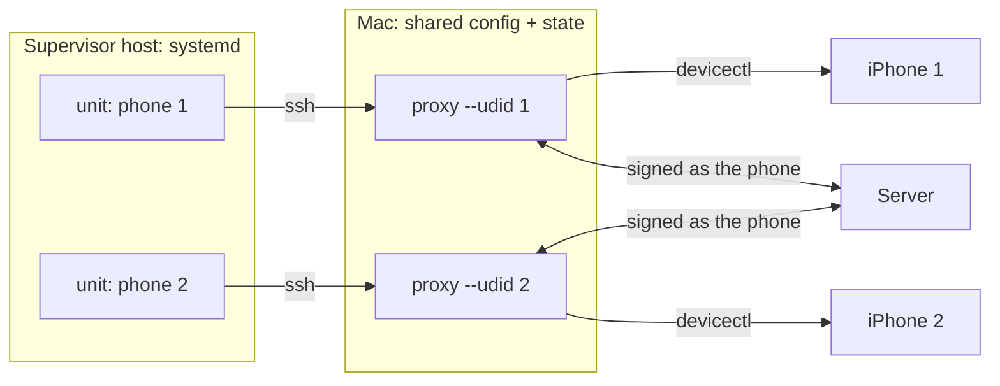
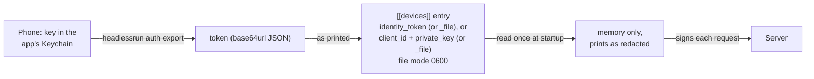

# pipette-ios-proxy

Runs benchmark jobs on tethered iPhones from a Mac, one server client per phone.
It signs as each phone's own registered client, claims that phone's jobs,
installs the app build the job needs, and runs it headless over `xcrun devicectl`.
The app submits the result under the claim; the proxy submits one it could not.

It replaces the app's own `headlessrun worker` for the phones it drives, and adds
two things:

- **Switching app builds per job.** A config takes builds from one of two
  sources:
  - **Pool mode** (`[builds]`): the proxy reads what every build in a pool
    directory provides and advertises all of it, so the server can send any of
    those runtimes.
  - **Version mode** (`[signing]`): the proxy advertises the recent builds of
    the releases bucket. It installs the version that each job pins, signed on
    the Mac (see "Installing the version a job pins").
- **A fresh app process per job.** A memory cell (`max_memory_usage`,
  `vl_max_memory`, `asr_max_memory`) reports its process's footprint. The
  worker runs every job in one process, so it counts what earlier jobs left
  behind.

[`DESIGN.md`](DESIGN.md) is the contract: startup, one job, the install
decision, the device fields that the proxy reports, and every failure cause.
This README covers deployment, keys and commands.

## Where it runs

In a typical deployment, a supervisor host runs one systemd unit per phone.
Each unit starts one proxy process on the Mac over ssh. All of the
processes share one config file (or one per mode, see "Installing the version a
job pins") and one state directory on the Mac.



- **Drive a phone with the proxy or with `headlessrun worker`, never both.**
  Both sign as the same client and would claim the same jobs.
- The proxy refuses a second process for one phone. `check` lists which phones
  another process drives.
- Killing `ssh` does not signal the process on the Mac. So each unit's stop and
  pre-start steps must run `pkill -TERM -f 'pipette-ios-proxy run .*--udid <id>'`.
  Start the proxy as `run --config <p> --udid <id>` so that the pattern matches.
  On `SIGTERM`, a run in progress ends without leaving the app orphaned.
- Without `--udid`, one process drives every configured phone, one thread each.
  [`package/ai.liquid.pipette.ios-proxy.plist`](package/ai.liquid.pipette.ios-proxy.plist)
  runs it that way as a LaunchAgent, for a Mac with no supervisor host.
- Keep the Mac awake (`sudo pmset -a sleep 0`). If it sleeps, every lease drops.
- **Pool mode needs builds whose one-shot launches leave the profile alone**
  (`HeadlessRunner.isOneShot`). An older build reports its own profile on each
  `headlessrun` launch, which releases the lease that the proxy holds
  ([DESIGN section 1](DESIGN.md#1-lifecycle)).
- **Every phone must be able to install every pool build.** A build that the
  first phone cannot install stops `run`, `register` and `scan`
  ([DESIGN section 1](DESIGN.md#1-lifecycle) says how to clear it).
- **Register each phone with Apple and add it to the team's profile.** The
  proxy does not check that a build's profile lists the phone, or that the
  phone meets the build's iOS floor. A phone that cannot take a build fails
  its install ([DESIGN section 4](DESIGN.md#4-one-job)).

## Keys

The proxy has no identity of its own on the management server and never
registers one. Each `[[devices]]` entry holds that phone's `client_id` and
Ed25519 key, and only that phone's process or thread signs with them. The
proxy's own credentials are:

- an AWS key pair that reads the releases bucket (see "Pulling builds");
- in version mode, a keychain password and an App Store Connect key that sign
  builds (see "Installing the version a job pins").



- **Getting the key.** `headlessrun auth export` prints one token. Put it in the
  entry as `identity_token`, or in a file named by `identity_token_file`. The
  token carries the `client_id`, so you need not write one (one that you write
  must match). The export launches the app again, so run it between jobs.
- **Storing it.** Use the token, or `client_id` with `private_key` /
  `private_key_file` (the 64-hex seed). Paths are relative to the config file.
  Whichever file holds a key or token must be `0600`. If you deploy with a
  configuration tool, write the file with mode `0600` and keep its contents out
  of the tool's logs.
- **Where it never goes:** the state directory, logs, or the app's arguments.
- **Checking it.** `check` confirms that every key loads. `status` confirms that
  the server accepts it (`401`: wrong key or host clock, `403`: client not
  approved).
- **Changing it.** Edit the file and restart the process.

[DESIGN section 2](DESIGN.md#2-configuration) has the rules that the proxy
checks a config against.

## Commands

```
run          claim jobs until stopped (the default)
register     push each phone's profile and capabilities, then exit
status       server-side status and whether each phone is reachable
scan         read the build pool, installing each unread build
uninstall    remove the app from each phone
probe        print the profile a phone would report
check        validate config, keys, pool or signing; list driven phones
builds list | pull <version> | prune [--dry-run]
             the releases bucket's app builds (see "Pulling builds")
```

`pipette-ios-proxy --help` (and `<verb> --help`) lists the flags and how the
proxy finds its config file. [The example config](pipette-ios-proxy.toml.example)
lists every key.

Failures print one line and exit 1. `run` exits 8 when its phones stopped for
a fault that only a person can fix, such as a replaced identity or an expired
profile. Do not let a supervisor restart the proxy on that status. Each job
ends with one `job finished` line. A phone that cannot run a job (absent,
Developer Mode off) logs `phone still paused` every 10 minutes.
[DESIGN section 7](DESIGN.md#7-cli-and-logs) has the exit rules, the log fields
and the alarm lines to match.

## State

The state directory is `$XDG_STATE_HOME/pipette-ios-proxy/`, else
`$HOME/.local/state/pipette-ios-proxy/`. `--state-dir` overrides the whole
path. `src/state.rs` lists every file, and
[DESIGN section 3](DESIGN.md#3-state-files) has their rules.

**Disk.** The proxy removes nothing on its own: every version pulled (about
110 MB) and signed stays. To free space:

1. Stop every process that uses the state directory.
2. Run `builds prune --dry-run` to see what it removes.
3. Run `builds prune`.

It keeps the versions a phone advertises and the one each phone last
installed, and refuses while another process holds a lock
([DESIGN section 8](DESIGN.md#8-app-builds-from-the-releases-bucket), "builds
prune").

## Pulling builds

Each release publishes the unsigned app archive
`pipette-ios-<version>.xcarchive.zip`, its `.sha256`, and the manifest
`pipette-ios-<version>.json` as GitHub release assets. The release workflow
does not upload them to the bucket. The operator copies them into the releases
bucket under `<tag>/`. The proxy reads that bucket with its own key pair, not
through the management server. The `builds` verbs only list, pull and prune; `run` installs from the
bucket in version mode (next section).
[DESIGN section 8](DESIGN.md#8-app-builds-from-the-releases-bucket) has the
bucket layout, the manifest, and the listing, pull and request rules.

```
$ pipette-ios-proxy builds list 2>/dev/null
feature-x.1                  feature-x              4.0MiB  2026-10-02T19:00:00Z  5fc8687a467a  not-pulled
2026.10.02-0123abc-internal  2026.10.02-0123abc   105.0MiB  2026-10-02T16:00:00Z  f7a521db689f  pulled
2026.10.01-0000000-internal  2026.10.01-0000000   104.0MiB  2026-10-01T16:00:00Z  3a496c985fb1  not-pulled
$ pipette-ios-proxy builds pull feature-x.1 2>/dev/null
/Users/<user>/.local/state/pipette-ios-proxy/releases/feature-x.1
```

**The key pair** belongs to an AWS Identity and Access Management (IAM) user
that can only read the bucket:

```json
{
  "Version": "2012-10-17",
  "Statement": [
    { "Effect": "Allow", "Action": "s3:ListBucket",
      "Resource": "arn:aws:s3:::example-client-releases" },
    { "Effect": "Allow", "Action": "s3:GetObject",
      "Resource": "arn:aws:s3:::example-client-releases/*" }
  ]
}
```

1. Create an access key for that user.
2. Put the access key id in `[client_releases]` as `access_key_id`.
3. Put the secret access key alone in a file, mode `0600`. Name the file in
   `secret_access_key_file` (relative to the config). If you deploy with a
   configuration tool, keep the secret out of its logs.
4. Run `check` to confirm that the table and the secret load.
5. Run `builds list` to confirm that the bucket accepts the pair.

If the bucket refuses the pair, `builds list` prints S3's reason:

- `SignatureDoesNotMatch`: the wrong secret.
- `InvalidAccessKeyId`: the wrong id.
- `AccessDenied`: the user may not read the bucket, or the host clock is so far
  off that the 15-minute signature has expired.

To rotate the key, create the new key, replace both values, then delete the old
key. [DESIGN section 2](DESIGN.md#2-configuration) says which verbs read the
secret, and what stops them.

`endpoint` points the same table at an S3-compatible store (path-style) instead
of AWS.

## Installing the version a job pins

With `[signing]` in place of `[builds]` ("version mode"), `run` installs the
builds that the releases bucket publishes. Each job runs on a version that its
plan admits. The proxy pulls that version, signs it for the fleet on this Mac,
and installs it only when the phone runs another.
[DESIGN section 9](DESIGN.md#9-version-mode-the-build-a-job-pins) has the rules:
which versions a phone advertises, how a claim chooses one, startup, the
failure classes, signing, and downgrades.

```toml
[client_releases]
# ...the bucket, as above, and optionally:
default = "2026.10.02-0123abc-internal"

[signing]
team_id                = "ABCDE12345"
keychain_password_file = "keychain.password"
api_key_file           = "AuthKey_ABCDE12345.p8"
api_key_id             = "ABCDE12345"
api_issuer_id          = "00000000-0000-0000-0000-000000000000"
```

A plan pins a version with a variant's `client_versions = [...]`. An unpinned
job runs on `default` when that build carries the job's runtime, else on the
newest build that does
([DESIGN section 9, "Choosing the version"](DESIGN.md#choosing-the-version)).

**Secrets.**

- `keychain_password_file` holds the signing keychain's password alone (one
  trailing newline allowed).
- `api_key_file` holds the App Store Connect `.p8`.
- Both must be mode `0600`. Paths are relative to the config.

The password reaches `security -i` on stdin, never an argv, a log or the state
directory. `check` runs the signing preflight with no Apple call: it unlocks
the keychain, checks that the keychain is on the search list, counts its
signing identities, and runs `xcodebuild -version`. `run` runs the same
preflight before any phone starts, and exits 1 if it fails
([DESIGN section 9, "Config" and "Startup"](DESIGN.md#config)).

**What the signing Mac needs.** If one of these is missing, the export fails
with an error that does not name it. The preflight names only the first two.

- The keychain is on the user's search list (`security list-keychains -d
  user`), where `codesign` looks for the identity. The login keychain is on it
  by default.
- Apple's Worldwide Developer Relations (WWDR) G3 intermediate certificate is
  in the System keychain. Without it, the identity counts as invalid.
- `codesign` is in the private key's partition list (`security
  set-key-partition-list -S apple-tool:,apple:,codesign: -s -t private
  <keychain>`). Without it, the export fails with `errSecInternalComponent`,
  because `codesign` asks for a confirmation that no ssh session can give.
- An App Store Connect API key for the team. With it, each export fetches a
  profile that lists every phone registered at that time. To install a version
  on a phone registered after that version's export, stop every process,
  delete `signed/<V>/`, and start again; the next claim exports it again
  ([DESIGN section 9, "Signing"](DESIGN.md#signing)).

A version's first install on this Mac takes a pull (about 110 MB), an export
(about 10 s) and an install, all under the claimed job's heartbeat.

**One mode per config.** To move phones to version mode one at a time, render
a second config file with `[signing]`. Point each moved unit's `--config` at
it. Both configs may share the state directory.

## Build

```bash
cargo build --release -p pipette-ios-proxy
cargo nextest run -p pipette-ios-proxy
```

macOS only; elsewhere the binary refuses to run. Each release publishes
`pipette-ios-proxy-aarch64-apple-darwin.tar.gz` (binary, example config,
LaunchAgent plist) with a `.sha256`; `--version` prints the release version.
